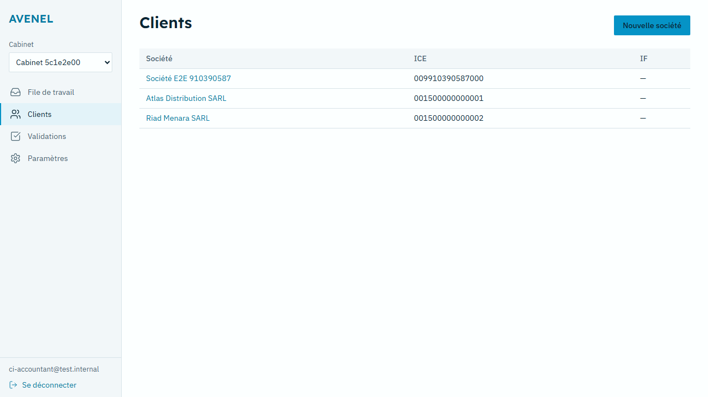
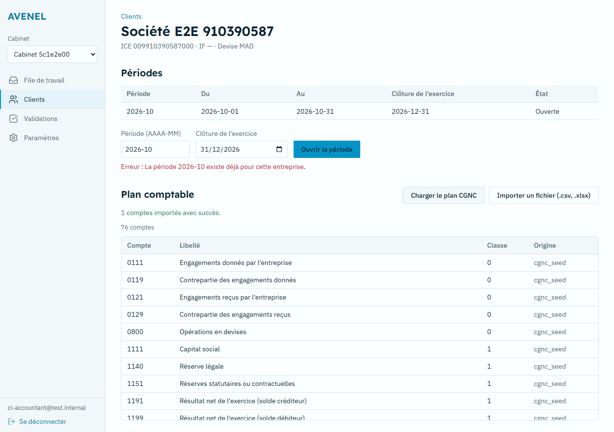
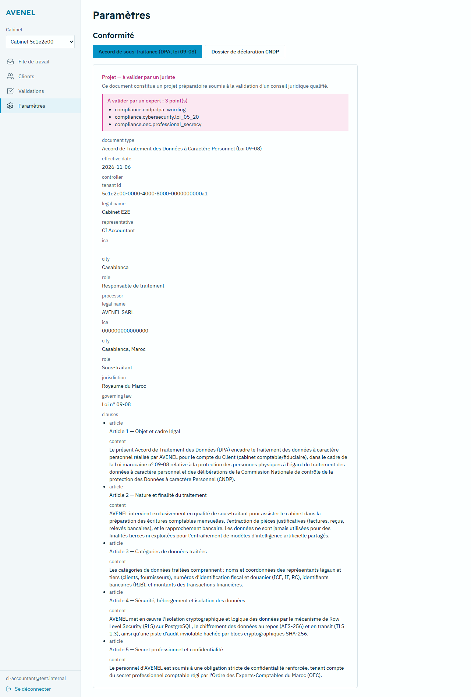
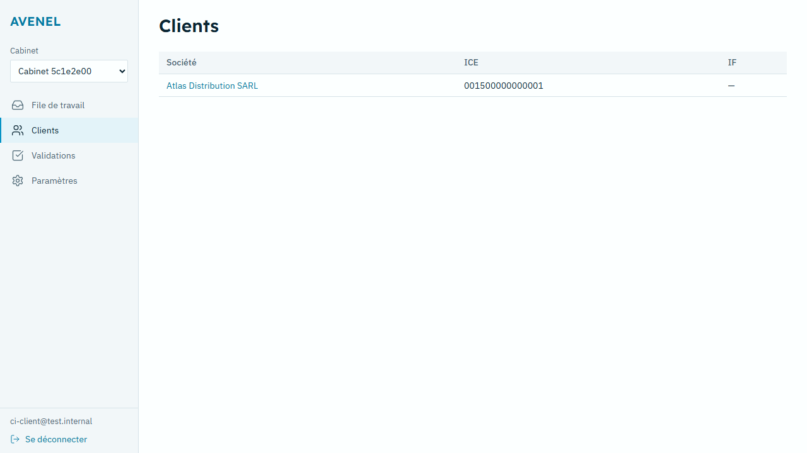

# Phase 1 completion report — tenancy, clients, periods

**Date:** 5 November 2026 · **Plan:** `docs/plans/phase-1-completion.md` · **Repository:** `../avenel-split` (commits after `f1bee69`, not pushed)

`make ci` exited **0** locally (full log below), including 4 browser tests against the docker-compose stack. Phase 1 is complete against its exit criteria, with the exceptions listed under Unverified. Stopped here for review; Phase 2 not started.

## Exit criteria

| Criterion (Part G Phase 1) | Evidence | Result |
|---|---|---|
| Cross-tenant tests for every endpoint (read, write, list, ID guessing) return 404 | `tests/api/test_phase1_matrix.py` (all 15 Phase 1 endpoints × same-tenant / cross-tenant / out-of-scope client user / unauthenticated), `tests/api/test_cross_tenant_isolation.py`, `tests/api/test_chart_import_file.py` (new endpoint). **Now run with the API connected as `avenel_app`** (`tests/api/conftest.py`), so RLS is enforced on every API request in the suite. | Pass |
| Client user cannot see another company | API tests above + browser e2e `e2e/phase1-clients.spec.ts` (Queue and Clients show only the scoped company; direct `GET /v1/client-entities/{other}` with the client user's own token → 404; the UI shows "Société introuvable.") | Pass |
| Audit chain verifies | `make audit-verify` in the log below | Pass |
| OIDC login, membership resolution, roles, client scopes | 5c-1 login e2e + new client-user e2e; role-dependent actions hidden in the UI and refused by the API | Pass |
| Client company CRUD | Create, read, list, archive in the browser; update via API (tested). **No edit form in the UI yet** (see Unverified) | Partial |
| Chart import (CSV/XLSX), CGNC seed | New `POST …/chart-accounts/import-file` using the existing hardened parsers; e2e imports a CSV through the browser; pytest covers XLSX, wrong format (415) and an XXE-laden XLSX (422) | Pass |
| Periods with overlap protection | e2e opens 2026-10, then the same period again → API 409, the UI shows the API's message, no second row | Pass |
| Jurisdiction pack loader with schema validation | Existing pytest (unchanged) | Pass |
| DPA and CNDP dossier generator | Rendered in Settings → Conformité from the API, with the `needs_expert` points. **Content needs a lawyer; placeholder values found** (see Unverified) | Pass (technical) |

## What changed

1. **API tests run as the production role.** `tests/api/conftest.py` overrides the API's DB dependency with an `avenel_app` connection. This exposed two production bugs:
   - `issues`: re-validation ran `DELETE FROM issues`, which the app role may not do, so **every real document intake failed**. Per your decision: supersede, never delete. Migration `010` adds status `superseded` and `superseded_at`; the three "active issue" queries (approval blocking check ×2, issue actions) exclude it. Recorded in `docs/open-questions.md` (D.2 does not list this status).
   - `export_round_trips`: never granted to the app role (created in 008 after the blanket grant), so recording a round trip failed. Migration `010` grants `SELECT, INSERT` (append-only).
   - New guard `tests/rls/test_app_role_privileges_match_code.py`: every `INSERT/UPDATE/DELETE` in `avenel/` and `apps/` must target a table where `avenel_app` holds that privilege. It fails on the old `DELETE FROM issues` (checked).
2. **Chart import from a file:** `POST /v1/client-entities/{id}/chart-accounts/import-file` (multipart), contract updated, typed client regenerated.
3. **Screens:** Clients (list, "Nouvelle société"), client page (periods with open-period form, chart of accounts with "Charger le plan CGNC" and file import, archive with confirmation), Settings → Conformité (DPA, CNDP). Session context from `GET /v1/me`; actions hidden for roles the API refuses (the API stays the authority). The typed client adds a fresh `Idempotency-Key` to every mutating call.
4. **Seed/realm:** second test user `ci-client@test.internal` (`client_user`, OTP) scoped to "Atlas Distribution SARL".
5. **E2E fixes:** TOTP replay state moved from `test-results/` (emptied by Playwright on every run) to `.e2e-state/`; this fixed the 5c-1 CI failure for real. 90 s test timeout.

## Raw output of `make ci`

Full log: `docs/reports/phase-1/make-ci.log` (1039 lines, exit code on the last line).

<details><summary>make ci — full output</summary>

```
.venv/Scripts/python.exe -m ruff check avenel apps scripts
All checks passed!
.venv/Scripts/python.exe scripts/check_no_tax_literals.py
[LINT PASSED] No forbidden numeric tax literals, hardcoded identifier regexes, or account seeds found in application code.
.venv/Scripts/python.exe scripts/check_migration_hashes.py
SUCCESS: All 16 frozen migrations (001�008) verified intact.
.venv/Scripts/python.exe scripts/check_test_count.py
[TEST COUNT CHECK] Collected: 230 | Required Baseline: 224
[INFO] Updated test count baseline to 230.
[TEST COUNT CHECK PASSED] Test count maintained or increased.
.venv/Scripts/python.exe scripts/generate_expert_sign_off.py --check
PASS: C:\Users\21263\Downloads\avenel-split\docs\pilot\expert-sign-off-sheet.md is up to date with 28 needs_expert rules.
.venv/Scripts/python.exe -m mypy avenel apps/api scripts
Success: no issues found in 88 source files
npx @stoplight/spectral-cli lint contracts/openapi.yaml --ruleset .spectral.yaml
No results with a severity of 'error' found!
.venv/Scripts/python.exe scripts/rls_check.py
Applying migration 001_core from 001_core.up.sql...
Applied 001_core successfully.
Applying migration 002_rls from 002_rls.up.sql...
Applied 002_rls successfully.
Applying migration 003_append_only from 003_append_only.up.sql...
Applied 003_append_only successfully.
Applying migration 004_fx_rates from 004_fx_rates.up.sql...
Applied 004_fx_rates successfully.
Applying migration 005_rounding_directions from 005_rounding_directions.up.sql...
Applied 005_rounding_directions successfully.
Applying migration 006_reconciliation_refinements from 006_reconciliation_refinements.up.sql...
Applied 006_reconciliation_refinements successfully.
Applying migration 007_active_bq_proposal_unique from 007_active_bq_proposal_unique.up.sql...
Applied 007_active_bq_proposal_unique successfully.
Applying migration 008_round_trips_and_approval_policy from 008_round_trips_and_approval_policy.up.sql...
Applied 008_round_trips_and_approval_policy successfully.
Applying migration 009_review_metrics_and_rate_limits from 009_review_metrics_and_rate_limits.up.sql...
Applied 009_review_metrics_and_rate_limits successfully.
Applying migration 010_issue_supersede_and_round_trip_grants from 010_issue_supersede_and_round_trip_grants.up.sql...
Applied 010_issue_supersede_and_round_trip_grants successfully.
Found 31 tables with tenant_id:
  - accounting_periods: rls_enabled=True, rls_forced=True, policies=1
  - agent_runs: rls_enabled=True, rls_forced=True, policies=1
  - approvals: rls_enabled=True, rls_forced=True, policies=1
  - audit_events: rls_enabled=True, rls_forced=True, policies=1
  - bank_accounts: rls_enabled=True, rls_forced=True, policies=1
  - bank_statements: rls_enabled=True, rls_forced=True, policies=1
  - bank_transactions: rls_enabled=True, rls_forced=True, policies=1
  - chart_accounts: rls_enabled=True, rls_forced=True, policies=1
  - client_entities: rls_enabled=True, rls_forced=True, policies=1
  - client_tax_mappings: rls_enabled=True, rls_forced=True, policies=1
  - counterparties: rls_enabled=True, rls_forced=True, policies=1
  - document_versions: rls_enabled=True, rls_forced=True, policies=1
  - documents: rls_enabled=True, rls_forced=True, policies=1
  - evidence_records: rls_enabled=True, rls_forced=True, policies=1
  - export_profiles: rls_enabled=True, rls_forced=True, policies=1
  - export_round_trips: rls_enabled=True, rls_forced=True, policies=1
  - exports: rls_enabled=True, rls_forced=True, policies=1
  - extractions: rls_enabled=True, rls_forced=True, policies=1
  - fx_rates: rls_enabled=True, rls_forced=True, policies=1
  - idempotency_keys: rls_enabled=True, rls_forced=True, policies=1
  - issues: rls_enabled=True, rls_forced=True, policies=1
  - journal_lines: rls_enabled=True, rls_forced=True, policies=1
  - journal_proposals: rls_enabled=True, rls_forced=True, policies=1
  - membership_client_scopes: rls_enabled=True, rls_forced=True, policies=1
  - memberships: rls_enabled=True, rls_forced=True, policies=1
  - provider_calls: rls_enabled=True, rls_forced=True, policies=1
  - reconciliation_match_items: rls_enabled=True, rls_forced=True, policies=1
  - reconciliation_matches: rls_enabled=True, rls_forced=True, policies=1
  - review_effort_metrics: rls_enabled=True, rls_forced=True, policies=1
  - usage_records: rls_enabled=True, rls_forced=True, policies=1
  - work_requests: rls_enabled=True, rls_forced=True, policies=1

[RLS-CHECK PASSED] All 31 tables with tenant_id have forced RLS and tenant policy.
.venv/Scripts/python.exe scripts/verify_audit_chain.py --seed
Applying migration 001_core from 001_core.up.sql...
Applied 001_core successfully.
Applying migration 002_rls from 002_rls.up.sql...
Applied 002_rls successfully.
Applying migration 003_append_only from 003_append_only.up.sql...
Applied 003_append_only successfully.
Applying migration 004_fx_rates from 004_fx_rates.up.sql...
Applied 004_fx_rates successfully.
Applying migration 005_rounding_directions from 005_rounding_directions.up.sql...
Applied 005_rounding_directions successfully.
Applying migration 006_reconciliation_refinements from 006_reconciliation_refinements.up.sql...
Applied 006_reconciliation_refinements successfully.
Applying migration 007_active_bq_proposal_unique from 007_active_bq_proposal_unique.up.sql...
Applied 007_active_bq_proposal_unique successfully.
Applying migration 008_round_trips_and_approval_policy from 008_round_trips_and_approval_policy.up.sql...
Applied 008_round_trips_and_approval_policy successfully.
Applying migration 009_review_metrics_and_rate_limits from 009_review_metrics_and_rate_limits.up.sql...
Applied 009_review_metrics_and_rate_limits successfully.
Applying migration 010_issue_supersede_and_round_trip_grants from 010_issue_supersede_and_round_trip_grants.up.sql...
Applied 010_issue_supersede_and_round_trip_grants successfully.
[AUDIT-VERIFY] Seeded 5 audit events for test tenant 0002ba96-3b8d-4e54-aa39-11c1b52a355d
  - Tenant 0002ba96-3b8d-4e54-aa39-11c1b52a355d: verified 5 audit events in linear sequence.

[AUDIT-VERIFY PASSED] All 5 audit events across 1 tenant(s) verified linear and intact.
.venv/Scripts/python.exe -m pytest -v tests
C:\Users\21263\Downloads\avenel-split\.venv\Lib\site-packages\pytest_asyncio\plugin.py:300: PytestDeprecationWarning: The configuration option "asyncio_default_fixture_loop_scope" is unset.
The event loop scope for asynchronous fixtures will default to the "fixture" caching scope. Future versions of pytest-asyncio will default the loop scope for asynchronous fixtures to "function" scope. Set the default fixture loop scope explicitly in order to avoid unexpected behavior in the future. Valid fixture loop scopes are: "function", "class", "module", "package", "session"

  warnings.warn(PytestDeprecationWarning(_DEFAULT_FIXTURE_LOOP_SCOPE_UNSET))
============================= test session starts =============================
platform win32 -- Python 3.12.2, pytest-9.2.0, pluggy-1.7.0 -- C:\Users\21263\Downloads\avenel-split\.venv\Scripts\python.exe
cachedir: .pytest_cache
hypothesis profile 'default'
rootdir: C:\Users\21263\Downloads\avenel-split
configfile: pytest.ini
plugins: anyio-4.16.0, hypothesis-6.170.14, platformdirs-4.14.3, asyncio-1.4.1.post1
asyncio: mode=Mode.STRICT, debug=False, asyncio_default_fixture_loop_scope=None, asyncio_default_test_loop_scope=function
collecting ... collected 229 items

tests/api/test_audit_chain_verifies.py::test_audit_chain_verifies_after_phase1_operations PASSED [  0%]
tests/api/test_auth_jwt.py::test_jwt_valid_signature_authenticates PASSED [  0%]
tests/api/test_auth_jwt.py::test_jwt_expired_token_gets_401 PASSED       [  1%]
tests/api/test_auth_jwt.py::test_jwt_wrong_audience_gets_401 PASSED      [  1%]
tests/api/test_auth_jwt.py::test_jwt_wrong_issuer_gets_401 PASSED        [  2%]
tests/api/test_auth_jwt.py::test_jwt_forged_signature_gets_401 PASSED    [  2%]
tests/api/test_auth_jwt.py::test_jwt_immature_nbf_gets_401 PASSED        [  3%]
tests/api/test_auth_jwt.py::test_mfa_enforced_for_professional_registration PASSED [  3%]
tests/api/test_auth_jwt.py::test_operator_access_lifecycle_and_expiry PASSED [  3%]
tests/api/test_chart_import_file.py::test_import_file_four_quadrants PASSED [  4%]
tests/api/test_chart_import_file.py::test_import_file_xlsx PASSED        [  4%]
tests/api/test_chart_import_file.py::test_import_file_rejects_other_formats PASSED [  5%]
tests/api/test_chart_import_file.py::test_import_file_rejects_corrupt_xlsx PASSED [  5%]
tests/api/test_client_user_scoping.py::test_client_user_cannot_see_unscoped_company PASSED [  6%]
tests/api/test_compliance.py::test_compliance_dpa_and_cndp_generation PASSED [  6%]
tests/api/test_cross_tenant_isolation.py::test_cross_tenant_isolation_every_endpoint_returns_404 PASSED [  6%]
tests/api/test_documents_intake.py::test_document_intake_full_pipeline_success PASSED [  7%]
tests/api/test_documents_intake.py::test_exact_duplicate_document_resubmitted_returns_200 PASSED [  7%]
tests/api/test_documents_intake.py::test_same_file_different_client_entities_creates_two_separate_documents PASSED [  8%]
tests/api/test_documents_intake.py::test_malware_quarantined_with_immutable_evidence PASSED [  8%]
tests/api/test_documents_intake.py::test_clamav_stale_or_scanner_down_intake_paused PASSED [  9%]
tests/api/test_documents_intake.py::test_field_correction_generates_immutable_evidence PASSED [  9%]
tests/api/test_documents_intake.py::test_scope_first_and_role_permissions PASSED [ 10%]
tests/api/test_health_ready.py::test_health_ready_reports_database_ok PASSED [ 10%]
tests/api/test_health_ready.py::test_health_ready_returns_503_when_database_unreachable PASSED [ 10%]
tests/api/test_idempotency.py::test_missing_idempotency_key_returns_400 PASSED [ 11%]
tests/api/test_idempotency.py::test_idempotent_replay_returns_cached_response PASSED [ 11%]
tests/api/test_idempotency.py::test_same_key_different_body_returns_422 PASSED [ 12%]
tests/api/test_idempotency.py::test_concurrent_in_flight_returns_409 PASSED [ 12%]
tests/api/test_idempotency.py::test_non_mutating_get_does_not_require_idempotency_key PASSED [ 13%]
tests/api/test_periods_and_chart.py::test_periods_overlap_protection_returns_409 PASSED [ 13%]
tests/api/test_periods_and_chart.py::test_chart_accounts_seed_and_import PASSED [ 13%]
tests/api/test_phase1_matrix.py::test_phase1_matrix_four_quadrants[get_session-GET-/v1/me-None-200] PASSED [ 14%]
tests/api/test_phase1_matrix.py::test_phase1_matrix_four_quadrants[list_client_entities-GET-/v1/client-entities-None-200] PASSED [ 14%]
tests/api/test_phase1_matrix.py::test_phase1_matrix_four_quadrants[create_client_entity-POST-/v1/client-entities-payload2-201] PASSED [ 15%]
tests/api/test_phase1_matrix.py::test_phase1_matrix_four_quadrants[get_client_entity-GET-/v1/client-entities/{c1_id}-None-200] PASSED [ 15%]
tests/api/test_phase1_matrix.py::test_phase1_matrix_four_quadrants[put_client_entity-PUT-/v1/client-entities/{c1_id}-payload4-200] PASSED [ 16%]
tests/api/test_phase1_matrix.py::test_phase1_matrix_four_quadrants[patch_client_entity-PATCH-/v1/client-entities/{c1_id}-payload5-200] PASSED [ 16%]
tests/api/test_phase1_matrix.py::test_phase1_matrix_four_quadrants[archive_client_entity-POST-/v1/client-entities/{c1_archive_id}/archive-payload6-200] PASSED [ 17%]
tests/api/test_phase1_matrix.py::test_phase1_matrix_four_quadrants[list_accounting_periods-GET-/v1/client-entities/{c1_id}/periods-None-200] PASSED [ 17%]
tests/api/test_phase1_matrix.py::test_phase1_matrix_four_quadrants[open_accounting_period-POST-/v1/client-entities/{c1_id}/periods-payload8-201] PASSED [ 17%]
tests/api/test_phase1_matrix.py::test_phase1_matrix_four_quadrants[list_chart_accounts-GET-/v1/client-entities/{c1_id}/chart-accounts-None-200] PASSED [ 18%]
tests/api/test_phase1_matrix.py::test_phase1_matrix_four_quadrants[seed_cgnc_chart-POST-/v1/client-entities/{c1_id}/chart-accounts/seed-cgnc-payload10-200] PASSED [ 18%]
tests/api/test_phase1_matrix.py::test_phase1_matrix_four_quadrants[import_chart_accounts-POST-/v1/client-entities/{c1_id}/chart-accounts/import-payload11-200] PASSED [ 19%]
tests/api/test_phase1_matrix.py::test_phase1_matrix_four_quadrants[get_dpa-GET-/v1/compliance/dpa-None-200] PASSED [ 19%]
tests/api/test_phase1_matrix.py::test_phase1_matrix_four_quadrants[get_cndp-GET-/v1/compliance/cndp-dossier-None-200] PASSED [ 20%]
tests/api/test_phase5_api.py::test_api_record_round_trip_permissions_and_mfa PASSED [ 20%]
tests/api/test_phase5_api.py::test_api_decide_approval_mfa_5_minute_and_stale_hash PASSED [ 20%]
tests/api/test_phase5_api.py::test_api_issue_acknowledge_endpoint PASSED [ 21%]
tests/api/test_proposals_api.py::test_proposal_generate_retrieve_and_list PASSED [ 21%]
tests/api/test_proposals_api.py::test_proposal_revision_flow_and_no_per_entry_approval PASSED [ 22%]
tests/api/test_proposals_api.py::test_proposal_role_based_access PASSED  [ 22%]
tests/api/test_review_effort_metrics.py::test_internal_metrics_rbac_owner_and_operator_allowed PASSED [ 23%]
tests/api/test_review_effort_metrics.py::test_no_identifier_values_in_metrics_responses PASSED [ 23%]
tests/api/test_role_action_matrix.py::test_role_action_matrix_create_client PASSED [ 24%]
tests/api/test_role_action_matrix.py::test_role_action_matrix_update_client PASSED [ 24%]
tests/api/test_role_action_matrix.py::test_role_action_matrix_archive_client PASSED [ 24%]
tests/api/test_role_action_matrix.py::test_role_action_matrix_periods PASSED [ 25%]
tests/api/test_role_action_matrix.py::test_role_action_matrix_chart PASSED [ 25%]
tests/api/test_security_headers_and_rate_limits.py::test_security_headers_present_on_all_responses PASSED [ 26%]
tests/api/test_security_headers_and_rate_limits.py::test_rate_limiting_enforced_on_auth_endpoint PASSED [ 26%]
tests/api/test_shared_rate_limiter.py::test_shared_rate_limiter_two_workers PASSED [ 27%]
tests/api/test_tenant_context.py::test_db_spec_function_definitions PASSED [ 27%]
tests/api/test_tenant_context.py::test_no_tenant_context_sees_zero_rows PASSED [ 27%]
tests/api/test_tenant_context.py::test_app_never_runs_query_without_tenant_context PASSED [ 28%]
tests/api/test_tenant_context.py::test_api_unauthenticated_request_refused_before_query PASSED [ 28%]
tests/api/test_xlsx_safety.py::test_xlsx_valid_parse PASSED              [ 29%]
tests/api/test_xlsx_safety.py::test_xlsx_file_size_limit PASSED          [ 29%]
tests/api/test_xlsx_safety.py::test_csv_file_size_limit PASSED           [ 30%]
tests/api/test_xlsx_safety.py::test_xlsx_row_limit PASSED                [ 30%]
tests/api/test_xlsx_safety.py::test_csv_row_limit PASSED                 [ 31%]
tests/api/test_xlsx_safety.py::test_xlsx_zip_bomb_rejection PASSED       [ 31%]
tests/api/test_xlsx_safety.py::test_xlsx_xxe_payload_rejection PASSED    [ 31%]
tests/approvals/test_approvals.py::test_approval_request_refused_on_zero_proposals PASSED [ 32%]
tests/approvals/test_approvals.py::test_approval_request_refused_on_blocking_issues PASSED [ 32%]
tests/approvals/test_approvals.py::test_approval_request_refused_on_unbalanced_proposals PASSED [ 33%]
tests/approvals/test_approvals.py::test_approval_full_flow_segregation_and_registration PASSED [ 33%]
tests/approvals/test_approvals.py::test_unacknowledged_review_issues_blocks_approval PASSED [ 34%]
tests/approvals/test_approvals.py::test_subject_hash_stable_on_approval_status_transition PASSED [ 34%]
tests/approvals/test_approvals.py::test_altering_accepted_match_after_approval_refuses_export PASSED [ 34%]
tests/approvals/test_approvals.py::test_single_person_policy_configured_on_client_entities PASSED [ 35%]
tests/bank/test_bank_statement_parsing.py::test_csv_bank_statement_parsing_valid_balance PASSED [ 35%]
tests/bank/test_bank_statement_parsing.py::test_csv_bank_statement_parsing_balance_break_detected PASSED [ 36%]
tests/bank/test_bank_statement_parsing.py::test_xlsx_bank_statement_parsing PASSED [ 36%]
tests/bank/test_bank_statement_parsing.py::test_ingest_statement_with_balance_break_raises_blocking_issue PASSED [ 37%]
tests/bank/test_bank_statement_parsing.py::test_bank_statement_fixture_stubs_awaiting_real_samples PASSED [ 37%]
tests/bank/test_rib.py::test_moroccan_rib_key_calculation_and_validation PASSED [ 37%]
tests/bank/test_rib.py::test_moroccan_rib_invalid_length_or_characters PASSED [ 38%]
tests/bank/test_rib.py::test_rib_cleaning_and_formatting PASSED          [ 38%]
tests/bank/test_rib.py::test_rib_masking_and_sha256 PASSED               [ 39%]
tests/bank/test_rib.py::test_rib_encryption_roundtrip PASSED             [ 39%]
tests/bank/test_rib.py::test_known_bank_codes_loaded_from_jurisdiction_pack PASSED [ 40%]
tests/bank/test_rib.py::test_app_refuses_to_start_without_rib_encryption_key PASSED [ 40%]
tests/bank/test_rib.py::test_rib_encrypted_never_in_api_response_or_logs PASSED [ 41%]
tests/evaluation/test_synthetic_pipeline.py::test_synthetic_corpus_count_and_report_header_reconciliation PASSED [ 41%]
tests/evaluation/test_synthetic_pipeline.py::test_mixed_inv_002_raises_totals_inconsistent_validator PASSED [ 41%]
tests/evaluation/test_synthetic_pipeline.py::test_synthetic_pipeline_per_field_exact_match PASSED [ 42%]
tests/exports/test_golden_exports.py::test_golden_sage100_csv_byte_identical PASSED [ 42%]
tests/exports/test_golden_exports.py::test_golden_sage100_pnm_byte_identical PASSED [ 43%]
tests/exports/test_golden_exports.py::test_golden_odoo_csv_byte_identical PASSED [ 43%]
tests/exports/test_golden_exports.py::test_evidence_pack_zip_bundle_and_artifacts PASSED [ 44%]
tests/exports/test_golden_exports.py::test_bundle_evidence_pack_zip_with_source_documents PASSED [ 44%]
tests/exports/test_golden_exports.py::test_export_does_not_modify_export_profile PASSED [ 44%]
tests/exports/test_golden_exports.py::test_manual_record_round_trip PASSED [ 45%]
tests/exports/test_golden_exports.py::test_reexport_idempotent_no_double_billing PASSED [ 45%]
tests/exports/test_golden_exports.py::test_download_token_verification_and_expiry PASSED [ 46%]
tests/exports/test_golden_exports.py::test_download_records_audit_event PASSED [ 46%]
tests/guards/test_negative_guards.py::test_tax_literal_linter_fails_on_planted_rate PASSED [ 47%]
tests/guards/test_negative_guards.py::test_linter_fails_on_planted_identifier_regex PASSED [ 47%]
tests/guards/test_negative_guards.py::test_linter_fails_on_planted_account_seed PASSED [ 48%]
tests/guards/test_negative_guards.py::test_spectral_fails_on_planted_nullable_true PASSED [ 48%]
tests/guards/test_negative_guards.py::test_rls_check_fails_on_planted_unprotected_table PASSED [ 48%]
tests/integration/test_keycloak_jwks.py::test_keycloak_real_token_issuance_caching_and_rotation PASSED [ 49%]
tests/integration/test_migrations.py::test_migrations_forward_and_rollback_cycle PASSED [ 49%]
tests/integration/test_migrations.py::test_migrate_down_refuses_in_production PASSED [ 50%]
tests/invariants/test_c4_invariants.py::test_invariant_2_cross_client_composite_fk_rejection PASSED [ 50%]
tests/invariants/test_c4_invariants.py::test_invariant_8_segregation_of_duties_and_registration PASSED [ 51%]
tests/invariants/test_c4_invariants.py::test_invariant_9_overlapping_periods_and_chart_accounts_rejected PASSED [ 51%]
tests/invariants/test_c4_invariants.py::test_unique_nulls_not_distinct_duplicates_rejected PASSED [ 51%]
tests/invariants/test_c4_invariants.py::test_export_fk_requires_approval PASSED [ 52%]
tests/invariants/test_c4_invariants.py::test_invariant_7_export_refused_on_hash_mismatch PASSED [ 52%]
tests/issues/test_issues.py::test_issue_lifecycle_assign_resolve_and_rules PASSED [ 53%]
tests/issues/test_issues.py::test_issue_portal_request_and_client_answer PASSED [ 53%]
tests/issues/test_issues.py::test_acknowledge_review_issue_workflow PASSED [ 54%]
tests/proposals/test_bq_proposal_lifecycle.py::test_bq_proposal_full_lifecycle_and_db_unique_index PASSED [ 54%]
tests/proposals/test_duplicates.py::test_duplicate_window_reads_from_pack PASSED [ 55%]
tests/proposals/test_duplicates.py::test_probable_duplicate_detected_by_exact_invoice_number PASSED [ 55%]
tests/proposals/test_duplicates.py::test_probable_duplicate_detected_by_amount_and_date_window PASSED [ 55%]
tests/proposals/test_duplicates.py::test_negative_monthly_rent_30_days_apart_not_flagged PASSED [ 56%]
tests/proposals/test_duplicates.py::test_negative_two_different_suppliers_same_amount_never_flagged PASSED [ 56%]
tests/proposals/test_duplicates.py::test_record_duplicate_issues_inserts_duplicate_probable PASSED [ 57%]
tests/proposals/test_golden_bank_proposals.py::test_golden_bank_proposal_supplier_payment PASSED [ 57%]
tests/proposals/test_golden_bank_proposals.py::test_golden_bank_proposal_customer_receipt_with_vat_withheld PASSED [ 58%]
tests/proposals/test_golden_bank_proposals.py::test_golden_bank_proposal_bank_fees_and_commissions PASSED [ 58%]
tests/proposals/test_golden_bank_proposals.py::test_bank_fees_missing_mapping_raises_account_unmapped PASSED [ 58%]
tests/proposals/test_golden_bank_proposals.py::test_golden_bank_proposal_unmatched_line_with_suspense_account PASSED [ 59%]
tests/proposals/test_golden_bank_proposals.py::test_golden_bank_proposal_customer_receipt_is_only_withholding PASSED [ 59%]
tests/proposals/test_golden_bank_proposals.py::test_golden_bank_proposal_customer_receipt_combined_withholding PASSED [ 60%]
tests/proposals/test_golden_proposals.py::test_golden_standard_purchase_invoice PASSED [ 60%]
tests/proposals/test_golden_proposals.py::test_golden_multi_rate_purchase_invoice PASSED [ 61%]
tests/proposals/test_golden_proposals.py::test_golden_sales_invoice PASSED [ 61%]
tests/proposals/test_golden_proposals.py::test_golden_purchase_credit_note_reversing_purchase PASSED [ 62%]
tests/proposals/test_golden_proposals.py::test_golden_sales_credit_note PASSED [ 62%]
tests/proposals/test_golden_proposals.py::test_golden_fixed_asset_acquisition PASSED [ 62%]
tests/proposals/test_golden_proposals.py::test_golden_non_deductible_vat_by_cash_limit PASSED [ 63%]
tests/proposals/test_golden_proposals.py::test_golden_non_deductible_vat_by_nature PASSED [ 63%]
tests/proposals/test_golden_proposals.py::test_golden_auto_entrepreneur_supplier_no_vat_lines PASSED [ 64%]
tests/proposals/test_golden_proposals.py::test_golden_prorata_deduction_using_client_entities_vat_prorata PASSED [ 64%]
tests/proposals/test_golden_proposals.py::test_golden_foreign_currency_eur_with_residual PASSED [ 65%]
tests/proposals/test_golden_proposals.py::test_evidence_refs_with_only_rule_refs_rejected PASSED [ 65%]
tests/proposals/test_golden_proposals.py::test_missing_approved_tax_mapping_raises_account_unmapped PASSED [ 65%]
tests/proposals/test_golden_proposals.py::test_missing_fx_rate_raises_fx_rate_missing PASSED [ 66%]
tests/proposals/test_golden_proposals.py::test_golden_foreign_currency_eur_with_negative_residual_credited_to_gain_account PASSED [ 66%]
tests/proposals/test_golden_proposals.py::test_multi_rate_14_percent_accepted_in_2025 PASSED [ 67%]
tests/proposals/test_golden_proposals.py::test_multi_rate_14_percent_rejected_in_2026 PASSED [ 67%]
tests/proposals/test_golden_proposals.py::test_account_suggester_ma_only_without_local_model_falls_back_to_counterparty_history PASSED [ 68%]
tests/proposals/test_golden_proposals.py::test_account_suggester_low_confidence_raises_account_low_confidence_issue PASSED [ 68%]
tests/proposals/test_hypothesis_proposals.py::test_hypothesis_every_proposal_balances_and_has_evidence PASSED [ 68%]
tests/proposals/test_hypothesis_proposals.py::test_hypothesis_every_bank_proposal_balances_and_has_evidence PASSED [ 69%]
tests/reconciliation/test_reconciliation.py::test_reconciliation_exact_single_match PASSED [ 69%]
tests/reconciliation/test_reconciliation.py::test_reconciliation_withheld_vat_match_and_difference_kind PASSED [ 70%]
tests/reconciliation/test_reconciliation.py::test_reconciliation_withheld_vat_unmapped_account_raises_account_unmapped_issue PASSED [ 70%]
tests/reconciliation/test_reconciliation.py::test_reconciliation_no_bank_line_in_two_accepted_matches PASSED [ 71%]
tests/reconciliation/test_reconciliation.py::test_reconciliation_withholding_other_5_pct_is_detected PASSED [ 71%]
tests/reconciliation/test_reconciliation.py::test_reconciliation_combined_withholding_is_and_vat_detected PASSED [ 72%]
tests/rls/test_app_privileges.py::test_avenel_app_role_attributes PASSED [ 72%]
tests/rls/test_app_privileges.py::test_avenel_app_is_not_table_owner PASSED [ 72%]
tests/rls/test_app_privileges.py::test_permission_denied_on_append_only_tables_with_triggers_dropped PASSED [ 73%]
tests/rls/test_app_role_privileges_match_code.py::test_every_write_in_app_code_is_granted_to_avenel_app PASSED [ 73%]
tests/rls/test_app_role_privileges_match_code.py::test_avenel_app_can_select_every_table_it_writes PASSED [ 74%]
tests/rls/test_rls.py::test_make_rls_check_passes PASSED                 [ 74%]
tests/rls/test_rls.py::test_tenant_isolation_and_row_level_security PASSED [ 75%]
tests/rls/test_session_resolution_as_app_role.py::test_resolve_user_session_works_as_avenel_app PASSED [ 75%]
tests/rls/test_session_resolution_as_app_role.py::test_resolve_user_session_as_avenel_app_unknown_subject_is_none PASSED [ 75%]
tests/security/test_auth_test_mode_gate.py::test_subject_header_rejected_outside_test_mode PASSED [ 76%]
tests/security/test_auth_test_mode_gate.py::test_plain_bearer_rejected_outside_test_mode PASSED [ 76%]
tests/security/test_auth_test_mode_gate.py::test_forged_mfa_headers_rejected_outside_test_mode PASSED [ 77%]
tests/security/test_auth_test_mode_gate.py::test_subject_header_still_works_in_test_mode PASSED [ 77%]
tests/security/test_auth_test_mode_gate.py::test_jwt_with_stale_auth_time_cannot_decide_even_with_forged_header PASSED [ 78%]
tests/security/test_production_realm_secrets.py::test_production_realm_export_exists PASSED [ 78%]
tests/security/test_production_realm_secrets.py::test_production_realm_contains_no_static_totp_secret_or_credentials PASSED [ 79%]
tests/security/test_production_realm_secrets.py::test_production_realm_enforces_secure_otp_policy PASSED [ 79%]
tests/security/test_production_realm_secrets.py::test_test_totp_secret_confined_to_ci_test_realm_and_fixtures PASSED [ 79%]
tests/triggers/test_append_only.py::test_audit_events_is_append_only PASSED [ 80%]
tests/triggers/test_append_only.py::test_evidence_records_is_append_only PASSED [ 80%]
tests/triggers/test_append_only.py::test_frozen_proposal_lines_cannot_be_mutated PASSED [ 81%]
tests/triggers/test_append_only.py::test_cannot_move_line_to_another_proposal PASSED [ 81%]
tests/triggers/test_audit_chain.py::test_audit_event_hash_chaining PASSED [ 82%]
tests/triggers/test_audit_chain.py::test_audit_verify_on_seeded_data_passes PASSED [ 82%]
tests/triggers/test_audit_chain.py::test_audit_verify_detects_tampering_and_exits_non_zero PASSED [ 82%]
tests/triggers/test_audit_concurrent.py::test_concurrent_audit_inserts_chain_stays_linear PASSED [ 83%]
tests/triggers/test_balance_trigger.py::test_balanced_proposal_commits_successfully PASSED [ 83%]
tests/triggers/test_balance_trigger.py::test_unbalanced_proposal_fails_on_commit PASSED [ 84%]
tests/triggers/test_balance_trigger.py::test_proposal_with_single_line_fails_on_commit PASSED [ 84%]
tests/triggers/test_balance_trigger.py::test_line_with_both_debit_and_credit_rejected PASSED [ 85%]
tests/triggers/test_document_versions_malware_scan.py::test_malware_scan_column_removed_from_document_versions PASSED [ 85%]
tests/triggers/test_document_versions_malware_scan.py::test_document_versions_current_view_reflects_evidence_records PASSED [ 86%]
tests/unit/test_deterministic_validation.py::test_validation_all_clean_purchase_invoice PASSED [ 86%]
tests/unit/test_deterministic_validation.py::test_validation_missing_mandatory_purchase_mention PASSED [ 86%]
tests/unit/test_deterministic_validation.py::test_validation_arithmetic_inconsistency_blocks PASSED [ 87%]
tests/unit/test_deterministic_validation.py::test_validation_unknown_vat_rate_blocks PASSED [ 87%]
tests/unit/test_deterministic_validation.py::test_validation_auto_entrepreneur_charging_vat PASSED [ 88%]
tests/unit/test_deterministic_validation.py::test_validation_cash_limit_exceeded PASSED [ 88%]
tests/unit/test_deterministic_validation.py::test_validation_period_mismatch PASSED [ 89%]
tests/unit/test_hashing.py::test_canonical_json_formatting PASSED        [ 89%]
tests/unit/test_hashing.py::test_proposal_set_hash_determinism PASSED    [ 89%]
tests/unit/test_jurisdiction_pack.py::test_jurisdiction_pack_schema_validation PASSED [ 90%]
tests/unit/test_jurisdiction_pack.py::test_part_i_items_present_and_needs_expert PASSED [ 90%]
tests/unit/test_jurisdiction_pack.py::test_every_rule_has_non_empty_source PASSED [ 91%]
tests/unit/test_residency_router.py::test_residency_policy_region_allowlist PASSED [ 91%]
tests/unit/test_residency_router.py::test_residency_router_refuses_disallowed_external_calls PASSED [ 92%]
tests/unit/test_residency_router.py::test_zero_provider_calls_in_tests PASSED [ 92%]
tests/unit/test_residency_router.py::test_pii_sanitization_for_external_calls PASSED [ 93%]
tests/unit/test_s3_storage.py::test_s3_storage_initialization_defaults PASSED [ 93%]
tests/unit/test_s3_storage.py::test_s3_put_object_with_sse PASSED        [ 93%]
tests/unit/test_s3_storage.py::test_s3_put_original_with_object_lock_compliance PASSED [ 94%]
tests/unit/test_s3_storage.py::test_s3_put_object_graceful_fallback_when_object_lock_unsupported PASSED [ 94%]
tests/unit/test_s3_storage.py::test_s3_get_object_success_and_not_found PASSED [ 95%]
tests/unit/test_s3_storage.py::test_s3_presigned_urls PASSED             [ 95%]
tests/unit/test_s3_storage.py::test_s3_object_exists PASSED              [ 96%]
tests/unit/test_s3_storage.py::test_storage_factory_selection PASSED     [ 96%]
tests/unit/test_scanner.py::test_clean_document_scan_in_fixture_mode PASSED [ 96%]
tests/unit/test_scanner.py::test_eicar_signature_detection PASSED        [ 97%]
tests/unit/test_scanner.py::test_scanner_unavailable_fail_safe_quarantine PASSED [ 97%]
tests/unit/test_scanner.py::test_clamav_signature_status_fresh_and_stale PASSED [ 98%]
tests/unit/test_scanner.py::test_check_intake_health_paused_when_stale PASSED [ 98%]
tests/unit/test_scanner.py::test_check_intake_health_paused_when_scanner_down PASSED [ 99%]
tests/unit/test_scanner.py::test_check_intake_health_active_when_fresh PASSED [ 99%]
tests/unit/test_scanner.py::test_clamd_reply_nul_terminator_is_stripped PASSED [100%]

============================== warnings summary ===============================
.venv\Lib\site-packages\fastapi\testclient.py:1
  C:\Users\21263\Downloads\avenel-split\.venv\Lib\site-packages\fastapi\testclient.py:1: StarletteDeprecationWarning: Using `httpx` with `starlette.testclient` is deprecated; install `httpx2` instead.
    from starlette.testclient import TestClient as TestClient  # noqa

-- Docs: https://docs.pytest.org/en/stable/how-to/capture-warnings.html
================= 229 passed, 1 warning in 117.61s (0:01:57) ==================
npx openapi-typescript contracts/openapi.yaml -o src/api/schema.d.ts
✨ openapi-typescript 7.13.0
🚀 contracts/openapi.yaml → src/api/schema.d.ts [225.7ms]
git diff --exit-code -- src/api/schema.d.ts
npx tsc -b --noEmit
npm run build

> avenel-web@1.0.0 build
> tsc -b && vite build

vite v5.4.21 building for production...
transforming...
✓ 1597 modules transformed.
rendering chunks...
computing gzip size...
dist/index.html                   0.47 kB │ gzip:  0.29 kB
dist/assets/index-DvlZ1U8w.css   23.00 kB │ gzip:  5.01 kB
dist/assets/index-v-MR6_K8.js   108.89 kB │ gzip: 29.90 kB
dist/assets/vendor-DR-wpGsq.js  163.86 kB │ gzip: 53.44 kB
✓ built in 5.81s
npx vitest run --reporter=default --reporter=json --outputFile=.vitest-results.json

 RUN  v2.1.9 C:/Users/21263/Downloads/avenel-split

 ✓ scripts/guards/check_css_palette.test.mjs (4 tests) 17ms
 ✓ src/auth/oidc.test.ts (7 tests) 21ms
 ✓ scripts/guards/guards.test.mjs (9 tests) 26ms
stderr | src/screens/QueueScreen.test.tsx > QueueScreen states (stubbed fetch) > shows the error state when the API is unreachable
⚠️ React Router Future Flag Warning: React Router will begin wrapping state updates in `React.startTransition` in v7. You can use the `v7_startTransition` future flag to opt-in early. For more information, see https://reactrouter.com/v6/upgrading/future#v7_starttransition.
⚠️ React Router Future Flag Warning: Relative route resolution within Splat routes is changing in v7. You can use the `v7_relativeSplatPath` future flag to opt-in early. For more information, see https://reactrouter.com/v6/upgrading/future#v7_relativesplatpath.

stderr | src/screens/QueueScreen.test.tsx > QueueScreen states (stubbed fetch) > shows the loading state first
Warning: An update to AuthProvider inside a test was not wrapped in act(...).

When testing, code that causes React state updates should be wrapped into act(...):

act(() => {
  /* fire events that update state */
});
/* assert on the output */

This ensures that you're testing the behavior the user would see in the browser. Learn more at https://reactjs.org/link/wrap-tests-with-act
    at AuthProvider (C:\Users\21263\Downloads\avenel-split\src\auth\AuthProvider.tsx:10:25)
    at Router (C:\Users\21263\Downloads\avenel-split\node_modules\react-router\dist\umd\react-router.development.js:1203:17)
    at MemoryRouter (C:\Users\21263\Downloads\avenel-split\node_modules\react-router\dist\umd\react-router.development.js:1097:7)

 ✓ src/screens/QueueScreen.test.tsx (4 tests) 299ms
stderr | src/components/domain/ReconciliationScreen.test.tsx > ReconciliationScreen component > triggers onAcceptMatch when clicking Rapprocher button
Warning: An update to ReconciliationScreen inside a test was not wrapped in act(...).

When testing, code that causes React state updates should be wrapped into act(...):

act(() => {
  /* fire events that update state */
});
/* assert on the output */

This ensures that you're testing the behavior the user would see in the browser. Learn more at https://reactjs.org/link/wrap-tests-with-act
    at ReconciliationScreen (C:\Users\21263\Downloads\avenel-split\src\components\domain\ReconciliationScreen.tsx:15:3)

stderr | src/components/domain/ReconciliationScreen.test.tsx > ReconciliationScreen component > triggers onRejectMatch when clicking Rejeter button
Warning: An update to ReconciliationScreen inside a test was not wrapped in act(...).

When testing, code that causes React state updates should be wrapped into act(...):

act(() => {
  /* fire events that update state */
});
/* assert on the output */

This ensures that you're testing the behavior the user would see in the browser. Learn more at https://reactjs.org/link/wrap-tests-with-act
    at ReconciliationScreen (C:\Users\21263\Downloads\avenel-split\src\components\domain\ReconciliationScreen.tsx:15:3)

stderr | src/components/domain/ReconciliationScreen.test.tsx > ReconciliationScreen component > accepts match on Enter keypress
Warning: An update to ReconciliationScreen inside a test was not wrapped in act(...).

When testing, code that causes React state updates should be wrapped into act(...):

act(() => {
  /* fire events that update state */
});
/* assert on the output */

This ensures that you're testing the behavior the user would see in the browser. Learn more at https://reactjs.org/link/wrap-tests-with-act
    at ReconciliationScreen (C:\Users\21263\Downloads\avenel-split\src\components\domain\ReconciliationScreen.tsx:15:3)

stderr | src/components/domain/ReconciliationScreen.test.tsx > ReconciliationScreen component > rejects match on Escape keypress
Warning: An update to ReconciliationScreen inside a test was not wrapped in act(...).

When testing, code that causes React state updates should be wrapped into act(...):

act(() => {
  /* fire events that update state */
});
/* assert on the output */

This ensures that you're testing the behavior the user would see in the browser. Learn more at https://reactjs.org/link/wrap-tests-with-act
    at ReconciliationScreen (C:\Users\21263\Downloads\avenel-split\src\components\domain\ReconciliationScreen.tsx:15:3)

 ✓ src/components/domain/ReconciliationScreen.test.tsx (5 tests) 739ms
   ✓ ReconciliationScreen component > renders bank lines and candidate matches correctly 301ms
 ✓ src/components/domain/ProposalReview.test.tsx (6 tests) 1095ms
   ✓ ProposalReview Component > renders balanced entry with accounts, totals and balance badge 330ms
 ✓ src/components/domain/Phase5Screens.test.tsx (11 tests) 1301ms
   ✓ Phase 5 UI Components > ApprovalScreen > renders dossier metadata, balanced totals, and allows approval when eligible 609ms

 Test Files  7 passed (7)
      Tests  46 passed (46)
   Start at  21:21:51
   Duration  8.26s (transform 1.19s, setup 8.00s, collect 3.18s, tests 3.50s, environment 24.51s, prepare 2.27s)

JSON report written to C:/Users/21263/Downloads/avenel-split/.vitest-results.json
node scripts/guards/check_web_test_count.mjs
check_web_test_count: 46/46 passed, baseline 46
node scripts/guards/check_css_palette.mjs
check_css_palette: 1 file(s), 0 violation(s)
node scripts/guards/no_test_code_in_prod.mjs
no_test_code_in_prod: 0 violation(s)
node scripts/guards/no_e2e_interception.mjs
no_e2e_interception: 0 violation(s)
node scripts/guards/no_legacy_terms.mjs
no_legacy_terms: 0 violation(s)
docker compose up -d --build postgres keycloak clamav freshclam ocr migrate seed api worker web
Compose can now delegate builds to bake for better performance.
 To do so, set COMPOSE_BAKE=true.
#0 building with "desktop-linux" instance using docker driver

#1 [migrate internal] load build definition from Dockerfile.api
#1 transferring dockerfile: 1.82kB 0.0s done
#1 DONE 0.1s

#2 [migrate] resolve image config for docker-image://docker.io/docker/dockerfile:1
#2 DONE 1.0s

#3 [migrate] docker-image://docker.io/docker/dockerfile:1@sha256:4edf897a3ffa55b89f906fc8cc78afdb3f1834cc9c7083565e611a8a7d5fe99e
#3 CACHED

#4 [migrate internal] load metadata for docker.io/library/python:3.12-slim
#4 DONE 0.0s

#5 [migrate internal] load .dockerignore
#5 transferring context: 2B done
#5 DONE 0.0s

#6 [migrate builder 1/5] FROM docker.io/library/python:3.12-slim
#6 DONE 0.0s

#7 [migrate internal] load build context
#7 transferring context: 7.33kB 2.3s done
#7 DONE 2.3s

#8 [migrate runner  5/10] COPY --from=builder --chown=appuser:appgroup /root/.local /home/appuser/.local
#8 CACHED

#9 [migrate runner  6/10] COPY --chown=appuser:appgroup avenel /app/avenel
#9 CACHED

#10 [migrate builder 2/5] WORKDIR /build
#10 CACHED

#11 [migrate builder 4/5] COPY requirements.txt .
#11 CACHED

#12 [migrate runner  9/10] COPY --chown=appuser:appgroup db /app/db
#12 CACHED

#13 [migrate builder 3/5] RUN apt-get update && apt-get install -y --no-install-recommends     build-essential     libpq-dev     && rm -rf /var/lib/apt/lists/*
#13 CACHED

#14 [migrate builder 5/5] RUN pip install --no-cache-dir --user -r requirements.txt
#14 CACHED

#15 [migrate runner  4/10] RUN groupadd -g 10001 appgroup &&     useradd -u 10001 -g appgroup -s /bin/false -m appuser
#15 CACHED

#16 [migrate runner  3/10] RUN apt-get update && apt-get install -y --no-install-recommends     libpq5     ca-certificates     && rm -rf /var/lib/apt/lists/*
#16 CACHED

#17 [migrate runner  8/10] COPY --chown=appuser:appgroup jurisdiction /app/jurisdiction
#17 CACHED

#18 [migrate runner  2/10] WORKDIR /app
#18 CACHED

#19 [migrate runner  7/10] COPY --chown=appuser:appgroup apps /app/apps
#19 CACHED

#20 [migrate runner 10/10] COPY --chown=appuser:appgroup contracts /app/contracts
#20 CACHED

#21 [migrate] exporting to image
#21 exporting layers done
#21 writing image sha256:eddd503fd9946e1c92398333d22be4b692928634ace56555281e2ef77bc00141 0.1s done
#21 naming to docker.io/library/avenel-split-migrate
#21 naming to docker.io/library/avenel-split-migrate done
#21 DONE 0.1s

#22 [migrate] resolving provenance for metadata file
#22 DONE 0.0s

#23 [seed internal] load build definition from Dockerfile.api
#23 transferring dockerfile: 1.82kB done
#23 DONE 0.0s

#2 [seed] resolve image config for docker-image://docker.io/docker/dockerfile:1
#2 DONE 1.3s

#3 [seed] docker-image://docker.io/docker/dockerfile:1@sha256:4edf897a3ffa55b89f906fc8cc78afdb3f1834cc9c7083565e611a8a7d5fe99e
#3 CACHED

#4 [seed internal] load metadata for docker.io/library/python:3.12-slim
#4 DONE 0.0s

#24 [seed internal] load .dockerignore
#24 transferring context: 2B done
#24 DONE 0.0s

#6 [seed builder 1/5] FROM docker.io/library/python:3.12-slim
#6 DONE 0.0s

#25 [seed internal] load build context
#25 transferring context: 7.33kB 0.0s done
#25 DONE 0.0s

#26 [seed runner  8/10] COPY --chown=appuser:appgroup jurisdiction /app/jurisdiction
#26 CACHED

#13 [seed builder 3/5] RUN apt-get update && apt-get install -y --no-install-recommends     build-essential     libpq-dev     && rm -rf /var/lib/apt/lists/*
#13 CACHED

#27 [seed runner  9/10] COPY --chown=appuser:appgroup db /app/db
#27 CACHED

#16 [seed runner  3/10] RUN apt-get update && apt-get install -y --no-install-recommends     libpq5     ca-certificates     && rm -rf /var/lib/apt/lists/*
#16 CACHED

#10 [seed builder 2/5] WORKDIR /build
#10 CACHED

#28 [seed builder 4/5] COPY requirements.txt .
#28 CACHED

#29 [seed runner  5/10] COPY --from=builder --chown=appuser:appgroup /root/.local /home/appuser/.local
#29 CACHED

#30 [seed builder 5/5] RUN pip install --no-cache-dir --user -r requirements.txt
#30 CACHED

#31 [seed runner  6/10] COPY --chown=appuser:appgroup avenel /app/avenel
#31 CACHED

#32 [seed runner  7/10] COPY --chown=appuser:appgroup apps /app/apps
#32 CACHED

#18 [seed runner  2/10] WORKDIR /app
#18 CACHED

#15 [seed runner  4/10] RUN groupadd -g 10001 appgroup &&     useradd -u 10001 -g appgroup -s /bin/false -m appuser
#15 CACHED

#33 [seed runner 10/10] COPY --chown=appuser:appgroup contracts /app/contracts
#33 CACHED

#34 [seed] exporting to image
#34 exporting layers done
#34 writing image sha256:689f4d3a92af7e43d7839ce0fe61a6871c1e440a1bc194c86530e8201d72cbfd done
#34 naming to docker.io/library/avenel-split-seed done
#34 DONE 0.0s

#35 [seed] resolving provenance for metadata file
#35 DONE 0.0s

#36 [api internal] load build definition from Dockerfile.api
#36 transferring dockerfile: 1.82kB done
#36 DONE 0.0s

#2 [api] resolve image config for docker-image://docker.io/docker/dockerfile:1
#2 DONE 1.6s

#3 [api] docker-image://docker.io/docker/dockerfile:1@sha256:4edf897a3ffa55b89f906fc8cc78afdb3f1834cc9c7083565e611a8a7d5fe99e
#3 CACHED

#4 [api internal] load metadata for docker.io/library/python:3.12-slim
#4 DONE 0.0s

#37 [api internal] load .dockerignore
#37 transferring context: 2B done
#37 DONE 0.0s

#6 [api builder 1/5] FROM docker.io/library/python:3.12-slim
#6 DONE 0.0s

#38 [api internal] load build context
#38 transferring context: 7.33kB 0.0s done
#38 DONE 0.0s

#39 [api runner  8/10] COPY --chown=appuser:appgroup jurisdiction /app/jurisdiction
#39 CACHED

#40 [api runner  7/10] COPY --chown=appuser:appgroup apps /app/apps
#40 CACHED

#41 [api runner  6/10] COPY --chown=appuser:appgroup avenel /app/avenel
#41 CACHED

#42 [api builder 5/5] RUN pip install --no-cache-dir --user -r requirements.txt
#42 CACHED

#15 [api runner  4/10] RUN groupadd -g 10001 appgroup &&     useradd -u 10001 -g appgroup -s /bin/false -m appuser
#15 CACHED

#43 [api runner  9/10] COPY --chown=appuser:appgroup db /app/db
#43 CACHED

#13 [api builder 3/5] RUN apt-get update && apt-get install -y --no-install-recommends     build-essential     libpq-dev     && rm -rf /var/lib/apt/lists/*
#13 CACHED

#44 [api builder 4/5] COPY requirements.txt .
#44 CACHED

#16 [api runner  3/10] RUN apt-get update && apt-get install -y --no-install-recommends     libpq5     ca-certificates     && rm -rf /var/lib/apt/lists/*
#16 CACHED

#45 [api runner  5/10] COPY --from=builder --chown=appuser:appgroup /root/.local /home/appuser/.local
#45 CACHED

#10 [api builder 2/5] WORKDIR /build
#10 CACHED

#18 [api runner  2/10] WORKDIR /app
#18 CACHED

#46 [api runner 10/10] COPY --chown=appuser:appgroup contracts /app/contracts
#46 CACHED

#47 [api] exporting to image
#47 exporting layers done
#47 writing image sha256:5db14b02e52db58bb3bb7db2888d1155fab4105756b437d057b1289a6484f61f done
#47 naming to docker.io/library/avenel-split-api done
#47 DONE 0.0s

#48 [api] resolving provenance for metadata file
#48 DONE 0.0s

#49 [worker internal] load build definition from Dockerfile.api
#49 transferring dockerfile: 1.82kB 0.0s done
#49 DONE 0.0s

#50 [web internal] load build definition from Dockerfile.web
#50 transferring dockerfile: 690B 0.0s done
#50 DONE 0.0s

#2 [web] resolve image config for docker-image://docker.io/docker/dockerfile:1
#2 DONE 1.9s

#3 [worker] docker-image://docker.io/docker/dockerfile:1@sha256:4edf897a3ffa55b89f906fc8cc78afdb3f1834cc9c7083565e611a8a7d5fe99e
#3 CACHED

#4 [worker internal] load metadata for docker.io/library/python:3.12-slim
#4 DONE 0.0s

#51 [worker internal] load .dockerignore
#51 transferring context: 2B done
#51 DONE 0.0s

#6 [worker builder 1/5] FROM docker.io/library/python:3.12-slim
#6 DONE 0.0s

#52 [worker internal] load build context
#52 transferring context: 7.33kB 0.0s done
#52 DONE 0.0s

#53 [web internal] load metadata for docker.io/nginxinc/nginx-unprivileged:alpine
#53 ...

#10 [worker builder 2/5] WORKDIR /build
#10 CACHED

#54 [worker builder 5/5] RUN pip install --no-cache-dir --user -r requirements.txt
#54 CACHED

#13 [worker builder 3/5] RUN apt-get update && apt-get install -y --no-install-recommends     build-essential     libpq-dev     && rm -rf /var/lib/apt/lists/*
#13 CACHED

#55 [worker builder 4/5] COPY requirements.txt .
#55 CACHED

#56 [worker runner  9/10] COPY --chown=appuser:appgroup db /app/db
#56 CACHED

#57 [worker runner  7/10] COPY --chown=appuser:appgroup apps /app/apps
#57 CACHED

#58 [worker runner  5/10] COPY --from=builder --chown=appuser:appgroup /root/.local /home/appuser/.local
#58 CACHED

#16 [worker runner  3/10] RUN apt-get update && apt-get install -y --no-install-recommends     libpq5     ca-certificates     && rm -rf /var/lib/apt/lists/*
#16 CACHED

#59 [worker runner  6/10] COPY --chown=appuser:appgroup avenel /app/avenel
#59 CACHED

#60 [worker runner  8/10] COPY --chown=appuser:appgroup jurisdiction /app/jurisdiction
#60 CACHED

#18 [worker runner  2/10] WORKDIR /app
#18 CACHED

#15 [worker runner  4/10] RUN groupadd -g 10001 appgroup &&     useradd -u 10001 -g appgroup -s /bin/false -m appuser
#15 CACHED

#61 [worker runner 10/10] COPY --chown=appuser:appgroup contracts /app/contracts
#61 CACHED

#62 [worker] exporting to image
#62 exporting layers done
#62 writing image sha256:638f48ecc7ceb79dc0e0570b2c2fef4c5d1b0e96819971d741b6e1e328b0cc05 done
#62 naming to docker.io/library/avenel-split-worker done
#62 DONE 0.0s

#63 [worker] resolving provenance for metadata file
#63 DONE 0.0s

#64 [web internal] load metadata for docker.io/library/node:20-alpine
#64 DONE 0.7s

#53 [web internal] load metadata for docker.io/nginxinc/nginx-unprivileged:alpine
#53 DONE 0.7s

#65 [web internal] load .dockerignore
#65 transferring context: 2B done
#65 DONE 0.0s

#66 [web runner 1/3] FROM docker.io/nginxinc/nginx-unprivileged:alpine@sha256:b5047b9b76845eac124358373c6852377c52e4b05834a47647e955dd91cb8f1e
#66 DONE 0.0s

#67 [web builder 1/6] FROM docker.io/library/node:20-alpine@sha256:fb4cd12c85ee03686f6af5362a0b0d56d50c58a04632e6c0fb8363f609372293
#67 DONE 0.0s

#68 [web internal] load build context
#68 transferring context: 59.93MB 5.0s
#68 transferring context: 119.87MB 10.1s
#68 transferring context: 179.53MB 15.2s
#68 transferring context: 240.44MB 20.2s
#68 transferring context: 299.16MB 25.4s
#68 transferring context: 351.86MB 30.4s
#68 transferring context: 411.11MB 35.4s
#68 transferring context: 477.63MB 40.5s
#68 transferring context: 546.32MB 45.7s
#68 transferring context: 598.37MB 50.7s
#68 transferring context: 646.60MB 55.8s
#68 transferring context: 708.72MB 61.0s
#68 transferring context: 761.34MB 66.1s
#68 transferring context: 806.54MB 71.1s
#68 transferring context: 859.18MB 76.1s
#68 transferring context: 916.04MB 81.2s done
#68 DONE 81.3s

#69 [web builder 3/6] COPY package*.json ./
#69 CACHED

#70 [web builder 2/6] WORKDIR /build
#70 CACHED

#71 [web builder 4/6] RUN npm ci --no-audit
#71 CACHED

#72 [web builder 5/6] COPY . .
#72 DONE 10.9s

#73 [web builder 6/6] RUN npm run build
#73 1.132 
#73 1.132 > avenel-web@1.0.0 build
#73 1.132 > tsc -b && vite build
#73 1.132 
#73 9.908 vite v5.4.21 building for production...
#73 10.01 transforming...
#73 14.56 ✓ 1597 modules transformed.
#73 14.76 rendering chunks...
#73 14.78 computing gzip size...
#73 14.79 dist/index.html                   0.47 kB │ gzip:  0.29 kB
#73 14.79 dist/assets/index-DvlZ1U8w.css   23.00 kB │ gzip:  5.01 kB
#73 14.79 dist/assets/index-v-MR6_K8.js   108.89 kB │ gzip: 29.90 kB
#73 14.79 dist/assets/vendor-DR-wpGsq.js  163.86 kB │ gzip: 53.44 kB
#73 14.79 ✓ built in 4.84s
#73 DONE 14.9s

#74 [web runner 2/3] COPY --from=builder /build/dist /usr/share/nginx/html
#74 CACHED

#75 [web runner 3/3] COPY docker/nginx.conf /etc/nginx/nginx.conf
#75 CACHED

#76 [web] exporting to image
#76 exporting layers done
#76 writing image sha256:2189507be01d798fe8edbf72459385301d0de52b016bea580a5f6f88613e16bb done
#76 naming to docker.io/library/avenel-split-web done
#76 DONE 0.0s

#77 [web] resolving provenance for metadata file
#77 DONE 0.0s
 api  Built
 migrate  Built
 seed  Built
 web  Built
 worker  Built
 Network avenel-split_default  Creating
 Network avenel-split_default  Created
 Volume "avenel-split_pgdata"  Creating
 Volume "avenel-split_pgdata"  Created
 Volume "avenel-split_clamav_db"  Creating
 Volume "avenel-split_clamav_db"  Created
 Container avenel-postgres  Creating
 Container avenel-ocr-stub  Creating
 Container avenel-clamav  Creating
 Container avenel-keycloak  Creating
 Container avenel-freshclam  Creating
 Container avenel-ocr-stub  Created
 Container avenel-postgres  Created
 Container avenel-migrate  Creating
 Container avenel-keycloak  Created
 Container avenel-migrate  Created
 Container avenel-seed  Creating
 Container avenel-seed  Created
 Container avenel-freshclam  Created
 Container avenel-clamav  Created
 Container avenel-api  Creating
 Container avenel-api  Created
 Container avenel-web  Creating
 Container avenel-worker  Creating
 Container avenel-worker  Created
 Container avenel-web  Created
 Container avenel-keycloak  Starting
 Container avenel-freshclam  Starting
 Container avenel-postgres  Starting
 Container avenel-clamav  Starting
 Container avenel-ocr-stub  Starting
 Container avenel-clamav  Started
 Container avenel-ocr-stub  Started
 Container avenel-keycloak  Started
 Container avenel-freshclam  Started
 Container avenel-postgres  Started
 Container avenel-postgres  Waiting
 Container avenel-postgres  Healthy
 Container avenel-migrate  Starting
 Container avenel-migrate  Started
 Container avenel-migrate  Waiting
 Container avenel-migrate  Exited
 Container avenel-seed  Starting
 Container avenel-seed  Started
 Container avenel-seed  Waiting
 Container avenel-keycloak  Waiting
 Container avenel-clamav  Waiting
 Container avenel-seed  Exited
 Container avenel-clamav  Healthy
 Container avenel-keycloak  Healthy
 Container avenel-api  Starting
 Container avenel-api  Started
 Container avenel-api  Waiting
 Container avenel-api  Waiting
 Container avenel-api  Healthy
 Container avenel-web  Starting
 Container avenel-api  Healthy
 Container avenel-worker  Starting
 Container avenel-worker  Started
 Container avenel-web  Started
node scripts/guards/wait_for_stack.mjs
wait_for_stack: api /health/ready green: http://localhost:8000/health/ready {"status":"ready","service":"avenel-api","database":"ok","kms":"ok","clamav":"quarantined_fallback","intake_paused":true}
wait_for_stack: keycloak realm green: http://localhost:8080/realms/avenel/.well-known/openid-configuration {"issuer":"http://localhost:8080/realms/avenel","authorization_endpoint":"http://localhost:8080/realms/avenel/protocol/openid-connect/auth","token_endpoint":"ht
wait_for_stack: web /healthz (nginx) green: http://localhost:5173/healthz healthy 
npx playwright install chromium
rm -rf docs/reports/phase-5c-1/e2e-browser-api-requests.log .e2e-state
npx playwright test --grep-invert @api-down

Running 3 tests using 1 worker

2026-11-05T20:26:11.956Z [login-queue] GET http://localhost:8000/v1/client-entities -> 200 bearer_jwt=true
2026-11-05T20:26:11.958Z [login-queue] GET http://localhost:8000/v1/work-requests -> 200 bearer_jwt=true
2026-11-05T20:26:11.959Z [login-queue] GET http://localhost:8000/v1/me -> 200 bearer_jwt=true
[login-queue] direct GET http://localhost:8000/v1/me -> 200 tenant_id=5c1e2e00-0000-4000-8000-0000000000a1 role=accountant
  ok 1 [chromium] › e2e\login-queue.spec.ts:6:1 › accountant logs in with TOTP, sees seeded queue from the API, logs out (6.1s)
2026-11-05T20:26:30.464Z [phase1-accountant] GET http://localhost:8000/v1/work-requests -> 200 bearer_jwt=true
2026-11-05T20:26:30.465Z [phase1-accountant] GET http://localhost:8000/v1/client-entities -> 200 bearer_jwt=true
2026-11-05T20:26:30.486Z [phase1-accountant] GET http://localhost:8000/v1/me -> 200 bearer_jwt=true
2026-11-05T20:26:30.526Z [phase1-accountant] GET http://localhost:8000/v1/client-entities -> 200 bearer_jwt=true
2026-11-05T20:26:31.152Z [phase1-accountant] POST http://localhost:8000/v1/client-entities -> 201 bearer_jwt=true
2026-11-05T20:26:31.179Z [phase1-accountant] GET http://localhost:8000/v1/client-entities -> 200 bearer_jwt=true
2026-11-05T20:26:31.706Z [phase1-accountant] GET http://localhost:8000/v1/client-entities/45e738e8-0ec4-4b83-b101-f1393dcff0a2 -> 200 bearer_jwt=true
2026-11-05T20:26:31.773Z [phase1-accountant] GET http://localhost:8000/v1/client-entities/45e738e8-0ec4-4b83-b101-f1393dcff0a2/periods -> 200 bearer_jwt=true
2026-11-05T20:26:31.776Z [phase1-accountant] GET http://localhost:8000/v1/client-entities/45e738e8-0ec4-4b83-b101-f1393dcff0a2/chart-accounts -> 200 bearer_jwt=true
2026-11-05T20:26:31.879Z [phase1-accountant] POST http://localhost:8000/v1/client-entities/45e738e8-0ec4-4b83-b101-f1393dcff0a2/periods -> 201 bearer_jwt=true
2026-11-05T20:26:31.912Z [phase1-accountant] GET http://localhost:8000/v1/client-entities/45e738e8-0ec4-4b83-b101-f1393dcff0a2/periods -> 200 bearer_jwt=true
2026-11-05T20:26:32.086Z [phase1-accountant] POST http://localhost:8000/v1/client-entities/45e738e8-0ec4-4b83-b101-f1393dcff0a2/periods -> 409 bearer_jwt=true body={"type":"about:blank","title":"Conflit d'état","status":409,"detail":"La période 2026-10 existe déjà pour cette entreprise.","instance":"/v1/client-entities/45e738e8-0ec4-4b83-b101-f1393dcff0a2/periods"}
2026-11-05T20:26:32.620Z [phase1-accountant] POST http://localhost:8000/v1/client-entities/45e738e8-0ec4-4b83-b101-f1393dcff0a2/chart-accounts/seed-cgnc -> 200 bearer_jwt=true
2026-11-05T20:26:32.647Z [phase1-accountant] GET http://localhost:8000/v1/client-entities/45e738e8-0ec4-4b83-b101-f1393dcff0a2/chart-accounts -> 200 bearer_jwt=true
2026-11-05T20:26:33.114Z [phase1-accountant] POST http://localhost:8000/v1/client-entities/45e738e8-0ec4-4b83-b101-f1393dcff0a2/chart-accounts/import-file -> 200 bearer_jwt=true
2026-11-05T20:26:33.162Z [phase1-accountant] GET http://localhost:8000/v1/client-entities/45e738e8-0ec4-4b83-b101-f1393dcff0a2/chart-accounts -> 200 bearer_jwt=true
2026-11-05T20:26:33.313Z [phase1-accountant] GET http://localhost:8000/v1/compliance/dpa -> 200 bearer_jwt=true
2026-11-05T20:26:33.509Z [phase1-accountant] GET http://localhost:8000/v1/compliance/cndp-dossier -> 200 bearer_jwt=true
  ok 2 [chromium] › e2e\phase1-clients.spec.ts:21:1 › accountant: create company, open period, overlap refused, CGNC + file import, DPA/CNDP (20.5s)
2026-11-05T20:26:35.001Z [phase1-client-user] GET http://localhost:8000/v1/client-entities -> 200 bearer_jwt=true
2026-11-05T20:26:35.024Z [phase1-client-user] GET http://localhost:8000/v1/work-requests -> 200 bearer_jwt=true
2026-11-05T20:26:35.042Z [phase1-client-user] GET http://localhost:8000/v1/me -> 200 bearer_jwt=true
2026-11-05T20:26:35.249Z [phase1-client-user] GET http://localhost:8000/v1/client-entities -> 200 bearer_jwt=true
[phase1-client-user] direct GET http://localhost:8000/v1/client-entities/757430a7-2502-463a-bb5b-061e7c61117b -> 404
2026-11-05T20:26:35.595Z [phase1-client-user] GET http://localhost:8000/v1/client-entities/757430a7-2502-463a-bb5b-061e7c61117b -> 404 bearer_jwt=true body={"type":"about:blank","title":"Ressource introuvable","status":404,"detail":"Entreprise cliente introuvable.","instance":"/v1/client-entities/757430a7-2502-463a-bb5b-061e7c61117b"}
  ok 3 [chromium] › e2e\phase1-clients.spec.ts:100:1 › client user sees only the company in scope (browser and API) (2.0s)

  3 passed (32.7s)
docker compose stop api
 Container avenel-api  Stopping
 Container avenel-api  Stopped
npx playwright test --grep @api-down

Running 1 test using 1 worker

2026-11-05T20:27:02.865Z [api-down] GET http://localhost:8000/v1/work-requests -> FAILED net::ERR_CONNECTION_REFUSED
2026-11-05T20:27:02.867Z [api-down] GET http://localhost:8000/v1/client-entities -> FAILED net::ERR_CONNECTION_REFUSED
2026-11-05T20:27:02.868Z [api-down] GET http://localhost:8000/v1/me -> FAILED net::ERR_CONNECTION_REFUSED
  ok 1 [chromium] › e2e\queue-api-down.spec.ts:6:1 › @api-down queue shows the error state when the API is down (20.0s)

  1 passed (21.4s)
docker compose start api
 Container avenel-postgres  Waiting
 Container avenel-postgres  Healthy
 Container avenel-migrate  Starting
 Container avenel-migrate  Started
 Container avenel-migrate  Waiting
 Container avenel-migrate  Exited
 Container avenel-seed  Starting
 Container avenel-seed  Started
 Container avenel-seed  Waiting
 Container avenel-keycloak  Waiting
 Container avenel-clamav  Waiting
 Container avenel-keycloak  Healthy
 Container avenel-clamav  Healthy
 Container avenel-seed  Exited
 Container avenel-api  Starting
 Container avenel-api  Started
C:/ProgramData/chocolatey/lib/make/tools/install/bin/make.exe e2e-down
make[1]: Entering directory 'C:/Users/21263/Downloads/avenel-split'
docker compose logs --no-color --timestamps api > docs/reports/phase-5c-1/e2e-api-container.log 2>&1 || true
docker compose down -v
 Container avenel-worker  Stopping
 Container avenel-web  Stopping
 Container avenel-ocr-stub  Stopping
 Container avenel-freshclam  Stopping
 Container avenel-freshclam  Stopped
 Container avenel-freshclam  Removing
 Container avenel-freshclam  Removed
 Container avenel-web  Stopped
 Container avenel-web  Removing
 Container avenel-web  Removed
 Container avenel-worker  Stopped
 Container avenel-worker  Removing
 Container avenel-worker  Removed
 Container avenel-api  Stopping
 Container avenel-ocr-stub  Stopped
 Container avenel-ocr-stub  Removing
 Container avenel-ocr-stub  Removed
 Container avenel-api  Stopped
 Container avenel-api  Removing
 Container avenel-api  Removed
 Container avenel-seed  Stopping
 Container avenel-keycloak  Stopping
 Container avenel-clamav  Stopping
 Container avenel-seed  Stopped
 Container avenel-seed  Removing
 Container avenel-seed  Removed
 Container avenel-migrate  Stopping
 Container avenel-migrate  Stopped
 Container avenel-migrate  Removing
 Container avenel-migrate  Removed
 Container avenel-postgres  Stopping
 Container avenel-clamav  Stopped
 Container avenel-clamav  Removing
 Container avenel-clamav  Removed
 Container avenel-postgres  Stopped
 Container avenel-postgres  Removing
 Container avenel-postgres  Removed
 Container avenel-keycloak  Stopped
 Container avenel-keycloak  Removing
 Container avenel-keycloak  Removed
 Network avenel-split_default  Removing
 Volume avenel-split_clamav_db  Removing
 Volume avenel-split_pgdata  Removing
 Volume avenel-split_clamav_db  Removed
 Volume avenel-split_pgdata  Removed
 Network avenel-split_default  Removed
make[1]: Leaving directory 'C:/Users/21263/Downloads/avenel-split'
MAKE_CI_EXIT=0
```

</details>

## E2E request log (Phase 1 tests)

**Browser side** (`page.on('response')`, observation only):

```
2026-11-05T20:26:30.464Z [phase1-accountant] GET http://localhost:8000/v1/work-requests -> 200 bearer_jwt=true
2026-11-05T20:26:30.465Z [phase1-accountant] GET http://localhost:8000/v1/client-entities -> 200 bearer_jwt=true
2026-11-05T20:26:30.486Z [phase1-accountant] GET http://localhost:8000/v1/me -> 200 bearer_jwt=true
2026-11-05T20:26:30.526Z [phase1-accountant] GET http://localhost:8000/v1/client-entities -> 200 bearer_jwt=true
2026-11-05T20:26:31.152Z [phase1-accountant] POST http://localhost:8000/v1/client-entities -> 201 bearer_jwt=true
2026-11-05T20:26:31.179Z [phase1-accountant] GET http://localhost:8000/v1/client-entities -> 200 bearer_jwt=true
2026-11-05T20:26:31.706Z [phase1-accountant] GET http://localhost:8000/v1/client-entities/45e738e8-0ec4-4b83-b101-f1393dcff0a2 -> 200 bearer_jwt=true
2026-11-05T20:26:31.773Z [phase1-accountant] GET http://localhost:8000/v1/client-entities/45e738e8-0ec4-4b83-b101-f1393dcff0a2/periods -> 200 bearer_jwt=true
2026-11-05T20:26:31.776Z [phase1-accountant] GET http://localhost:8000/v1/client-entities/45e738e8-0ec4-4b83-b101-f1393dcff0a2/chart-accounts -> 200 bearer_jwt=true
2026-11-05T20:26:31.879Z [phase1-accountant] POST http://localhost:8000/v1/client-entities/45e738e8-0ec4-4b83-b101-f1393dcff0a2/periods -> 201 bearer_jwt=true
2026-11-05T20:26:31.912Z [phase1-accountant] GET http://localhost:8000/v1/client-entities/45e738e8-0ec4-4b83-b101-f1393dcff0a2/periods -> 200 bearer_jwt=true
2026-11-05T20:26:32.086Z [phase1-accountant] POST http://localhost:8000/v1/client-entities/45e738e8-0ec4-4b83-b101-f1393dcff0a2/periods -> 409 bearer_jwt=true body={"type":"about:blank","title":"Confl
2026-11-05T20:26:32.620Z [phase1-accountant] POST http://localhost:8000/v1/client-entities/45e738e8-0ec4-4b83-b101-f1393dcff0a2/chart-accounts/seed-cgnc -> 200 bearer_jwt=true
2026-11-05T20:26:32.647Z [phase1-accountant] GET http://localhost:8000/v1/client-entities/45e738e8-0ec4-4b83-b101-f1393dcff0a2/chart-accounts -> 200 bearer_jwt=true
2026-11-05T20:26:33.114Z [phase1-accountant] POST http://localhost:8000/v1/client-entities/45e738e8-0ec4-4b83-b101-f1393dcff0a2/chart-accounts/import-file -> 200 bearer_jwt=true
2026-11-05T20:26:33.162Z [phase1-accountant] GET http://localhost:8000/v1/client-entities/45e738e8-0ec4-4b83-b101-f1393dcff0a2/chart-accounts -> 200 bearer_jwt=true
2026-11-05T20:26:33.313Z [phase1-accountant] GET http://localhost:8000/v1/compliance/dpa -> 200 bearer_jwt=true
2026-11-05T20:26:33.509Z [phase1-accountant] GET http://localhost:8000/v1/compliance/cndp-dossier -> 200 bearer_jwt=true
2026-11-05T20:26:35.001Z [phase1-client-user] GET http://localhost:8000/v1/client-entities -> 200 bearer_jwt=true
2026-11-05T20:26:35.024Z [phase1-client-user] GET http://localhost:8000/v1/work-requests -> 200 bearer_jwt=true
2026-11-05T20:26:35.042Z [phase1-client-user] GET http://localhost:8000/v1/me -> 200 bearer_jwt=true
2026-11-05T20:26:35.249Z [phase1-client-user] GET http://localhost:8000/v1/client-entities -> 200 bearer_jwt=true
2026-11-05T20:26:35.595Z [phase1-client-user] GET http://localhost:8000/v1/client-entities/757430a7-2502-463a-bb5b-061e7c61117b -> 404 bearer_jwt=true body={"type":"about:blank","title":"Ressource int
```

**API container side** (uvicorn access log, all `/v1` requests of the run, including the 5c-1 tests):

```
2026-11-05T20:26:11.949189764Z INFO:     192.168.32.1:51638 - "GET /v1/client-entities HTTP/1.1" 200 OK
2026-11-05T20:26:11.949930483Z INFO:     192.168.32.1:51608 - "GET /v1/work-requests HTTP/1.1" 200 OK
2026-11-05T20:26:11.950428524Z INFO:     192.168.32.1:51616 - "GET /v1/me HTTP/1.1" 200 OK
2026-11-05T20:26:12.618693699Z INFO:     192.168.32.1:51650 - "GET /v1/me HTTP/1.1" 200 OK
2026-11-05T20:26:12.664495812Z INFO:     192.168.32.1:51650 - "GET /v1/me HTTP/1.1" 401 Unauthorized
2026-11-05T20:26:12.747591642Z INFO:     192.168.32.1:51650 - "GET /v1/me HTTP/1.1" 401 Unauthorized
2026-11-05T20:26:30.460702522Z INFO:     192.168.32.1:41680 - "GET /v1/work-requests HTTP/1.1" 200 OK
2026-11-05T20:26:30.461211073Z INFO:     192.168.32.1:41696 - "GET /v1/client-entities HTTP/1.1" 200 OK
2026-11-05T20:26:30.483897190Z INFO:     192.168.32.1:41682 - "GET /v1/me HTTP/1.1" 200 OK
2026-11-05T20:26:30.525806444Z INFO:     192.168.32.1:41696 - "GET /v1/client-entities HTTP/1.1" 200 OK
2026-11-05T20:26:31.153901737Z INFO:     192.168.32.1:41682 - "POST /v1/client-entities HTTP/1.1" 201 Created
2026-11-05T20:26:31.178763454Z INFO:     192.168.32.1:41682 - "GET /v1/client-entities HTTP/1.1" 200 OK
2026-11-05T20:26:31.705280367Z INFO:     192.168.32.1:41696 - "GET /v1/client-entities/45e738e8-0ec4-4b83-b101-f1393dcff0a2 HTTP/1.1" 200 OK
2026-11-05T20:26:31.772538003Z INFO:     192.168.32.1:41680 - "GET /v1/client-entities/45e738e8-0ec4-4b83-b101-f1393dcff0a2/periods HTTP/1.1" 200 OK
2026-11-05T20:26:31.773206595Z INFO:     192.168.32.1:41686 - "GET /v1/client-entities/45e738e8-0ec4-4b83-b101-f1393dcff0a2/chart-accounts HTTP/1.1" 200 OK
2026-11-05T20:26:31.877327336Z INFO:     192.168.32.1:41680 - "POST /v1/client-entities/45e738e8-0ec4-4b83-b101-f1393dcff0a2/periods HTTP/1.1" 201 Created
2026-11-05T20:26:31.911772745Z INFO:     192.168.32.1:41680 - "GET /v1/client-entities/45e738e8-0ec4-4b83-b101-f1393dcff0a2/periods HTTP/1.1" 200 OK
2026-11-05T20:26:32.082227967Z INFO:     192.168.32.1:41680 - "POST /v1/client-entities/45e738e8-0ec4-4b83-b101-f1393dcff0a2/periods HTTP/1.1" 409 Conflict
2026-11-05T20:26:32.620854888Z INFO:     192.168.32.1:41686 - "POST /v1/client-entities/45e738e8-0ec4-4b83-b101-f1393dcff0a2/chart-accounts/seed-cgnc HTTP/1.1" 200 OK
2026-11-05T20:26:32.647378731Z INFO:     192.168.32.1:41686 - "GET /v1/client-entities/45e738e8-0ec4-4b83-b101-f1393dcff0a2/chart-accounts HTTP/1.1" 200 OK
2026-11-05T20:26:33.111441279Z INFO:     192.168.32.1:41680 - "POST /v1/client-entities/45e738e8-0ec4-4b83-b101-f1393dcff0a2/chart-accounts/import-file HTTP/1.1" 200 OK
2026-11-05T20:26:33.151815064Z INFO:     192.168.32.1:41680 - "GET /v1/client-entities/45e738e8-0ec4-4b83-b101-f1393dcff0a2/chart-accounts HTTP/1.1" 200 OK
2026-11-05T20:26:33.312812336Z INFO:     192.168.32.1:41686 - "GET /v1/compliance/dpa HTTP/1.1" 200 OK
2026-11-05T20:26:33.508751876Z INFO:     192.168.32.1:41686 - "GET /v1/compliance/cndp-dossier HTTP/1.1" 200 OK
2026-11-05T20:26:33.565325396Z INFO:     192.168.32.1:41700 - "GET /v1/client-entities HTTP/1.1" 200 OK
2026-11-05T20:26:34.999899218Z INFO:     192.168.32.1:41732 - "GET /v1/client-entities HTTP/1.1" 200 OK
2026-11-05T20:26:35.023440307Z INFO:     192.168.32.1:41704 - "GET /v1/work-requests HTTP/1.1" 200 OK
2026-11-05T20:26:35.039379165Z INFO:     192.168.32.1:41738 - "GET /v1/me HTTP/1.1" 200 OK
2026-11-05T20:26:35.245378810Z INFO:     192.168.32.1:41704 - "GET /v1/client-entities HTTP/1.1" 200 OK
2026-11-05T20:26:35.453287386Z INFO:     192.168.32.1:41700 - "GET /v1/client-entities HTTP/1.1" 200 OK
2026-11-05T20:26:35.493441216Z INFO:     192.168.32.1:41700 - "GET /v1/client-entities/757430a7-2502-463a-bb5b-061e7c61117b HTTP/1.1" 404 Not Found
2026-11-05T20:26:35.591304329Z INFO:     192.168.32.1:41732 - "GET /v1/client-entities/757430a7-2502-463a-bb5b-061e7c61117b HTTP/1.1" 404 Not Found
```

## Screenshots

| Clients | Company: periods (409 shown) and chart | DPA draft | Client user's view |
|---|---|---|---|
|  |  |  |  |

## Unverified

- **GitHub CI** for these commits: not pushed. The 5c-1 CI failure (TOTP replay) is fixed locally; the real cause was Playwright emptying `test-results/` between runs, found in this phase.
- **DPA/CNDP placeholder values.** The backend generator (`avenel/compliance/dpa.py`) outputs a processor "AVENEL SARL" with ICE `000000000000000` and a city "Casablanca". These are not real values. They need the real company details or a `needs_expert` marking; I did not change them (legal content).
- **Client edit form** is not built (the API `PUT/PATCH` is tested). Archived companies are not listed separately.
- **Firm switcher** still shows only the one membership `GET /v1/me` returns.
- **Copy** not in the E.8 table: "Nouvelle société", "Ouvrir la période", "Charger le plan CGNC", "Archiver la société", period status labels. API error messages are shown as the API returns them (some are in the backend's wording, e.g. "1 comptes importés").
- **D.2** does not list the new `superseded` issue status (open question).
- **Expert sign-off** of the jurisdiction pack (Part I) and legal review of the DPA/CNDP are outside Phase 1 and not done.

## Stubbed

- Seed data (tenant, users, memberships, scope, clients, periods, work requests) is inserted by `scripts/seed_e2e.py`.
- Worker and OCR container unchanged (Phase 2 scope).
