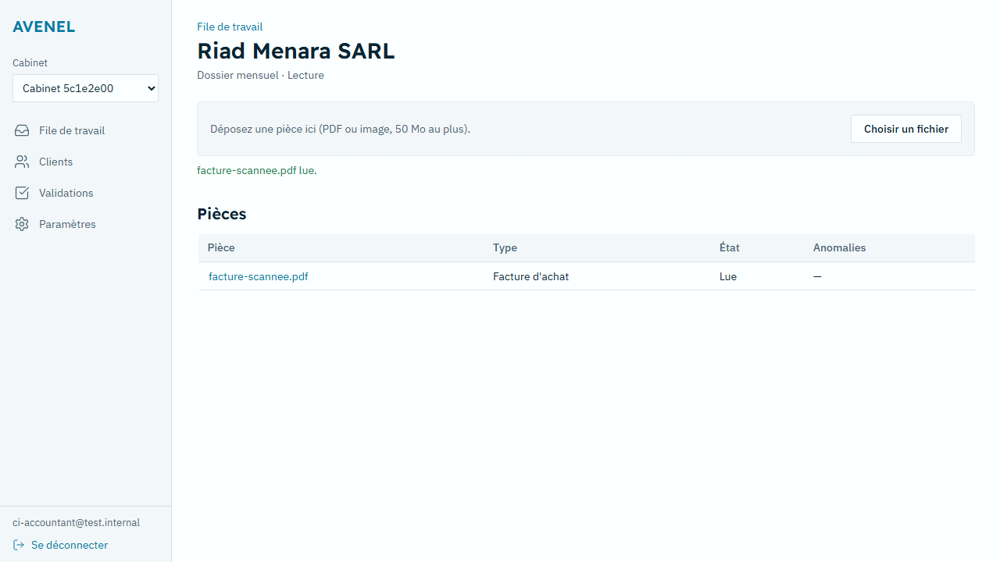
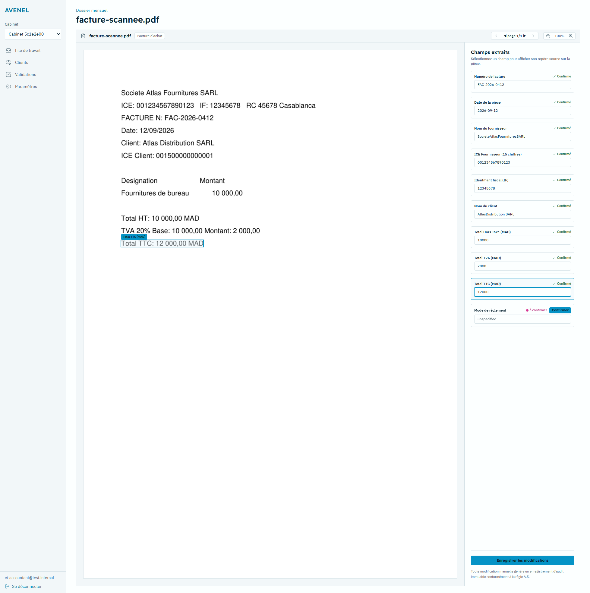
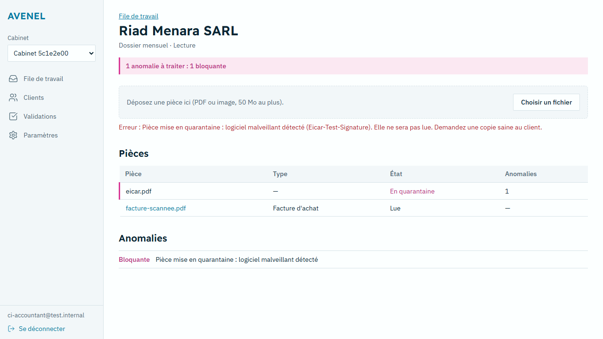

# Phase 2 completion report — intake and reading

**Date:** 6 November 2026 · **Plan:** `docs/plans/phase-2-completion.md` · **Repository:** `../avenel-split` (commits after `958c173`, not pushed)

`make ci` exited **0** locally, including 6 browser tests against the docker-compose stack (2 new for Phase 2). Phase 2 meets its Part G exit criteria, with the limits listed under Unverified and Stubbed. Stopped here for review; Phase 3 not started.

## Exit criteria

| Criterion | Evidence | Result |
|---|---|---|
| Field-level accuracy report on the 300-document fixture set | `docs/benchmarks/phase-2-accuracy-report.md`: full 300-document run, local OCR on degraded synthetic images. Invoice no. 100 %, date 99.67 %, supplier ICE 99.33 %, HT/TVA/TTC 100 %, **0 silent errors**; supplier IF 79.33 % (Arabic 1.7 %) | Generated (synthetic only) |
| Residency router refuses disallowed calls | `tests/unit/test_residency_router.py::test_residency_router_refuses_disallowed_external_calls` | Pass |
| No provider call in tests | Router refuses every non-Moroccan region while pytest runs; the codebase has no provider HTTP client at all (see Stubbed) | Pass |
| Upload, malware scan, exact duplicates, page rendering, OCR, classifier/extractor, bboxes, validation, viewer with overlay, field correction | E2E `e2e/phase2-intake.spec.ts` on the real stack (below) + pytest | Pass |

## What the reality check found, and what changed

Driving the API with a real Keycloak token against compose showed that **no document could be read in the deployed stack**, although every step returned 200:

1. **No way to upload from a browser.** Filesystem storage pointed to a missing `/v1/storage/uploads` route; MinIO images are no longer published. → `PUT /v1/documents/{id}/content` (your decision): size and SHA-256 must match the init declaration (they were never verified before), originals write-once.
2. **API could not write its storage directory** (`PermissionError`, non-root container) → every upload 500. → Volume `/var/lib/avenel/storage` owned by the app user.
3. **ClamAV paused intake.** clamd kept the image's March 2026 signatures; freshclam downloaded new ones but could not notify clamd. → freshclam notifies clamd over TCP; the guard-28 health gate now requires `intake_paused:false` and asks clamd to reload.
4. **OCR silently read nothing.** `libxcb.so.1` missing in the API image → OpenCV/RapidOCR import failed → the error was caught → PDF bytes decoded as text → empty extraction marked `read`. → Libraries added; a real PDF that cannot be rendered now returns 422 and an unavailable OCR engine 503, with nothing written (`tests/api/test_document_reading_real_pdf.py`; both tests fail on the old code).
5. **The viewer could not show pages** (JSON link to a missing `/v1/storage/files` route). → `GET /v1/documents/{id}/pages/{n}/image` (PNG, scope-first).
6. **The document viewer drew a fake invoice** (hard-coded "Société Atlas SARL", ICE, totals) whenever no page image was available, and an earlier e2e assertion was satisfied by it. → Replaced with "Image de la page indisponible."; the e2e now requires the decoded `` and **measures** the field box against the API bbox (`api=[0.0992,0.359,0.3226,0.3738]`, `drawn=[0.099,0.359,0.323,0.374]`).
7. Smaller: documents were created as `purchase_invoice` before classification (now `NULL` until classified); quarantine message was English (now French, E.8); retention period for originals added to the pack as `needs_expert` (`TODO(EXPERT)`, not applied).

New screens: monthly file (`/files/:id`, from a Queue row: documents with state and anomalies, upload with SHA-256 computed in the browser, issue strip) and document review (`/documents/:id`, page image, fields with boxes, "à confirmer", correction).

## Raw output of `make ci`

Full log: `docs/reports/phase-2/make-ci.log` (1124 lines, exit code on the last line).

<details><summary>make ci — full output</summary>

```
.venv/Scripts/python.exe -m ruff check avenel apps scripts
All checks passed!
.venv/Scripts/python.exe scripts/check_no_tax_literals.py
[LINT PASSED] No forbidden numeric tax literals, hardcoded identifier regexes, or account seeds found in application code.
.venv/Scripts/python.exe scripts/check_migration_hashes.py
SUCCESS: All 16 frozen migrations (001�008) verified intact.
.venv/Scripts/python.exe scripts/check_test_count.py
[TEST COUNT CHECK] Collected: 239 | Required Baseline: 230
[INFO] Updated test count baseline to 239.
[TEST COUNT CHECK PASSED] Test count maintained or increased.
.venv/Scripts/python.exe scripts/generate_expert_sign_off.py --check
PASS: C:\Users\21263\Downloads\avenel-split\docs\pilot\expert-sign-off-sheet.md is up to date with 29 needs_expert rules.
.venv/Scripts/python.exe -m mypy avenel apps/api scripts
Success: no issues found in 88 source files
npx @stoplight/spectral-cli lint contracts/openapi.yaml --ruleset .spectral.yaml
No results with a severity of 'error' found!
.venv/Scripts/python.exe scripts/rls_check.py
Applying migration 001_core from 001_core.up.sql...
Applied 001_core successfully.
Applying migration 002_rls from 002_rls.up.sql...
Applied 002_rls successfully.
Applying migration 003_append_only from 003_append_only.up.sql...
Applied 003_append_only successfully.
Applying migration 004_fx_rates from 004_fx_rates.up.sql...
Applied 004_fx_rates successfully.
Applying migration 005_rounding_directions from 005_rounding_directions.up.sql...
Applied 005_rounding_directions successfully.
Applying migration 006_reconciliation_refinements from 006_reconciliation_refinements.up.sql...
Applied 006_reconciliation_refinements successfully.
Applying migration 007_active_bq_proposal_unique from 007_active_bq_proposal_unique.up.sql...
Applied 007_active_bq_proposal_unique successfully.
Applying migration 008_round_trips_and_approval_policy from 008_round_trips_and_approval_policy.up.sql...
Applied 008_round_trips_and_approval_policy successfully.
Applying migration 009_review_metrics_and_rate_limits from 009_review_metrics_and_rate_limits.up.sql...
Applied 009_review_metrics_and_rate_limits successfully.
Applying migration 010_issue_supersede_and_round_trip_grants from 010_issue_supersede_and_round_trip_grants.up.sql...
Applied 010_issue_supersede_and_round_trip_grants successfully.
Found 31 tables with tenant_id:
  - accounting_periods: rls_enabled=True, rls_forced=True, policies=1
  - agent_runs: rls_enabled=True, rls_forced=True, policies=1
  - approvals: rls_enabled=True, rls_forced=True, policies=1
  - audit_events: rls_enabled=True, rls_forced=True, policies=1
  - bank_accounts: rls_enabled=True, rls_forced=True, policies=1
  - bank_statements: rls_enabled=True, rls_forced=True, policies=1
  - bank_transactions: rls_enabled=True, rls_forced=True, policies=1
  - chart_accounts: rls_enabled=True, rls_forced=True, policies=1
  - client_entities: rls_enabled=True, rls_forced=True, policies=1
  - client_tax_mappings: rls_enabled=True, rls_forced=True, policies=1
  - counterparties: rls_enabled=True, rls_forced=True, policies=1
  - document_versions: rls_enabled=True, rls_forced=True, policies=1
  - documents: rls_enabled=True, rls_forced=True, policies=1
  - evidence_records: rls_enabled=True, rls_forced=True, policies=1
  - export_profiles: rls_enabled=True, rls_forced=True, policies=1
  - export_round_trips: rls_enabled=True, rls_forced=True, policies=1
  - exports: rls_enabled=True, rls_forced=True, policies=1
  - extractions: rls_enabled=True, rls_forced=True, policies=1
  - fx_rates: rls_enabled=True, rls_forced=True, policies=1
  - idempotency_keys: rls_enabled=True, rls_forced=True, policies=1
  - issues: rls_enabled=True, rls_forced=True, policies=1
  - journal_lines: rls_enabled=True, rls_forced=True, policies=1
  - journal_proposals: rls_enabled=True, rls_forced=True, policies=1
  - membership_client_scopes: rls_enabled=True, rls_forced=True, policies=1
  - memberships: rls_enabled=True, rls_forced=True, policies=1
  - provider_calls: rls_enabled=True, rls_forced=True, policies=1
  - reconciliation_match_items: rls_enabled=True, rls_forced=True, policies=1
  - reconciliation_matches: rls_enabled=True, rls_forced=True, policies=1
  - review_effort_metrics: rls_enabled=True, rls_forced=True, policies=1
  - usage_records: rls_enabled=True, rls_forced=True, policies=1
  - work_requests: rls_enabled=True, rls_forced=True, policies=1

[RLS-CHECK PASSED] All 31 tables with tenant_id have forced RLS and tenant policy.
.venv/Scripts/python.exe scripts/verify_audit_chain.py --seed
Applying migration 001_core from 001_core.up.sql...
Applied 001_core successfully.
Applying migration 002_rls from 002_rls.up.sql...
Applied 002_rls successfully.
Applying migration 003_append_only from 003_append_only.up.sql...
Applied 003_append_only successfully.
Applying migration 004_fx_rates from 004_fx_rates.up.sql...
Applied 004_fx_rates successfully.
Applying migration 005_rounding_directions from 005_rounding_directions.up.sql...
Applied 005_rounding_directions successfully.
Applying migration 006_reconciliation_refinements from 006_reconciliation_refinements.up.sql...
Applied 006_reconciliation_refinements successfully.
Applying migration 007_active_bq_proposal_unique from 007_active_bq_proposal_unique.up.sql...
Applied 007_active_bq_proposal_unique successfully.
Applying migration 008_round_trips_and_approval_policy from 008_round_trips_and_approval_policy.up.sql...
Applied 008_round_trips_and_approval_policy successfully.
Applying migration 009_review_metrics_and_rate_limits from 009_review_metrics_and_rate_limits.up.sql...
Applied 009_review_metrics_and_rate_limits successfully.
Applying migration 010_issue_supersede_and_round_trip_grants from 010_issue_supersede_and_round_trip_grants.up.sql...
Applied 010_issue_supersede_and_round_trip_grants successfully.
[AUDIT-VERIFY] Seeded 5 audit events for test tenant 9417e8e0-9d2b-4279-bd20-32481c2d01a6
  - Tenant 9417e8e0-9d2b-4279-bd20-32481c2d01a6: verified 5 audit events in linear sequence.

[AUDIT-VERIFY PASSED] All 5 audit events across 1 tenant(s) verified linear and intact.
.venv/Scripts/python.exe -m pytest -v tests
C:\Users\21263\Downloads\avenel-split\.venv\Lib\site-packages\pytest_asyncio\plugin.py:300: PytestDeprecationWarning: The configuration option "asyncio_default_fixture_loop_scope" is unset.
The event loop scope for asynchronous fixtures will default to the "fixture" caching scope. Future versions of pytest-asyncio will default the loop scope for asynchronous fixtures to "function" scope. Set the default fixture loop scope explicitly in order to avoid unexpected behavior in the future. Valid fixture loop scopes are: "function", "class", "module", "package", "session"

  warnings.warn(PytestDeprecationWarning(_DEFAULT_FIXTURE_LOOP_SCOPE_UNSET))
============================= test session starts =============================
platform win32 -- Python 3.12.2, pytest-9.2.0, pluggy-1.7.0 -- C:\Users\21263\Downloads\avenel-split\.venv\Scripts\python.exe
cachedir: .pytest_cache
hypothesis profile 'default'
rootdir: C:\Users\21263\Downloads\avenel-split
configfile: pytest.ini
plugins: anyio-4.16.0, hypothesis-6.170.14, platformdirs-4.14.3, asyncio-1.4.1.post1
asyncio: mode=Mode.STRICT, debug=False, asyncio_default_fixture_loop_scope=None, asyncio_default_test_loop_scope=function
collecting ... collected 238 items

tests/api/test_audit_chain_verifies.py::test_audit_chain_verifies_after_phase1_operations PASSED [  0%]
tests/api/test_auth_jwt.py::test_jwt_valid_signature_authenticates PASSED [  0%]
tests/api/test_auth_jwt.py::test_jwt_expired_token_gets_401 PASSED       [  1%]
tests/api/test_auth_jwt.py::test_jwt_wrong_audience_gets_401 PASSED      [  1%]
tests/api/test_auth_jwt.py::test_jwt_wrong_issuer_gets_401 PASSED        [  2%]
tests/api/test_auth_jwt.py::test_jwt_forged_signature_gets_401 PASSED    [  2%]
tests/api/test_auth_jwt.py::test_jwt_immature_nbf_gets_401 PASSED        [  2%]
tests/api/test_auth_jwt.py::test_mfa_enforced_for_professional_registration PASSED [  3%]
tests/api/test_auth_jwt.py::test_operator_access_lifecycle_and_expiry PASSED [  3%]
tests/api/test_chart_import_file.py::test_import_file_four_quadrants PASSED [  4%]
tests/api/test_chart_import_file.py::test_import_file_xlsx PASSED        [  4%]
tests/api/test_chart_import_file.py::test_import_file_rejects_other_formats PASSED [  5%]
tests/api/test_chart_import_file.py::test_import_file_rejects_corrupt_xlsx PASSED [  5%]
tests/api/test_client_user_scoping.py::test_client_user_cannot_see_unscoped_company PASSED [  5%]
tests/api/test_compliance.py::test_compliance_dpa_and_cndp_generation PASSED [  6%]
tests/api/test_cross_tenant_isolation.py::test_cross_tenant_isolation_every_endpoint_returns_404 PASSED [  6%]
tests/api/test_document_content_upload.py::test_upload_then_process_over_http_only PASSED [  7%]
tests/api/test_document_content_upload.py::test_original_is_write_once PASSED [  7%]
tests/api/test_document_content_upload.py::test_bytes_must_match_declared_size_and_hash PASSED [  7%]
tests/api/test_document_content_upload.py::test_scope_first_404_and_401 PASSED [  8%]
tests/api/test_document_reading_real_pdf.py::test_real_pdf_is_read_with_bboxes[text-pdf] PASSED [  8%]
tests/api/test_document_reading_real_pdf.py::test_real_pdf_is_read_with_bboxes[scanned-pdf] PASSED [  9%]
tests/api/test_document_reading_real_pdf.py::test_page_image_scope_rules PASSED [  9%]
tests/api/test_document_reading_real_pdf.py::test_unrenderable_pdf_fails_loudly PASSED [ 10%]
tests/api/test_document_reading_real_pdf.py::test_ocr_engine_unavailable_returns_503 PASSED [ 10%]
tests/api/test_documents_intake.py::test_document_intake_full_pipeline_success PASSED [ 10%]
tests/api/test_documents_intake.py::test_exact_duplicate_document_resubmitted_returns_200 PASSED [ 11%]
tests/api/test_documents_intake.py::test_same_file_different_client_entities_creates_two_separate_documents PASSED [ 11%]
tests/api/test_documents_intake.py::test_malware_quarantined_with_immutable_evidence PASSED [ 12%]
tests/api/test_documents_intake.py::test_clamav_stale_or_scanner_down_intake_paused PASSED [ 12%]
tests/api/test_documents_intake.py::test_field_correction_generates_immutable_evidence PASSED [ 13%]
tests/api/test_documents_intake.py::test_scope_first_and_role_permissions PASSED [ 13%]
tests/api/test_health_ready.py::test_health_ready_reports_database_ok PASSED [ 13%]
tests/api/test_health_ready.py::test_health_ready_returns_503_when_database_unreachable PASSED [ 14%]
tests/api/test_idempotency.py::test_missing_idempotency_key_returns_400 PASSED [ 14%]
tests/api/test_idempotency.py::test_idempotent_replay_returns_cached_response PASSED [ 15%]
tests/api/test_idempotency.py::test_same_key_different_body_returns_422 PASSED [ 15%]
tests/api/test_idempotency.py::test_concurrent_in_flight_returns_409 PASSED [ 15%]
tests/api/test_idempotency.py::test_non_mutating_get_does_not_require_idempotency_key PASSED [ 16%]
tests/api/test_periods_and_chart.py::test_periods_overlap_protection_returns_409 PASSED [ 16%]
tests/api/test_periods_and_chart.py::test_chart_accounts_seed_and_import PASSED [ 17%]
tests/api/test_phase1_matrix.py::test_phase1_matrix_four_quadrants[get_session-GET-/v1/me-None-200] PASSED [ 17%]
tests/api/test_phase1_matrix.py::test_phase1_matrix_four_quadrants[list_client_entities-GET-/v1/client-entities-None-200] PASSED [ 18%]
tests/api/test_phase1_matrix.py::test_phase1_matrix_four_quadrants[create_client_entity-POST-/v1/client-entities-payload2-201] PASSED [ 18%]
tests/api/test_phase1_matrix.py::test_phase1_matrix_four_quadrants[get_client_entity-GET-/v1/client-entities/{c1_id}-None-200] PASSED [ 18%]
tests/api/test_phase1_matrix.py::test_phase1_matrix_four_quadrants[put_client_entity-PUT-/v1/client-entities/{c1_id}-payload4-200] PASSED [ 19%]
tests/api/test_phase1_matrix.py::test_phase1_matrix_four_quadrants[patch_client_entity-PATCH-/v1/client-entities/{c1_id}-payload5-200] PASSED [ 19%]
tests/api/test_phase1_matrix.py::test_phase1_matrix_four_quadrants[archive_client_entity-POST-/v1/client-entities/{c1_archive_id}/archive-payload6-200] PASSED [ 20%]
tests/api/test_phase1_matrix.py::test_phase1_matrix_four_quadrants[list_accounting_periods-GET-/v1/client-entities/{c1_id}/periods-None-200] PASSED [ 20%]
tests/api/test_phase1_matrix.py::test_phase1_matrix_four_quadrants[open_accounting_period-POST-/v1/client-entities/{c1_id}/periods-payload8-201] PASSED [ 21%]
tests/api/test_phase1_matrix.py::test_phase1_matrix_four_quadrants[list_chart_accounts-GET-/v1/client-entities/{c1_id}/chart-accounts-None-200] PASSED [ 21%]
tests/api/test_phase1_matrix.py::test_phase1_matrix_four_quadrants[seed_cgnc_chart-POST-/v1/client-entities/{c1_id}/chart-accounts/seed-cgnc-payload10-200] PASSED [ 21%]
tests/api/test_phase1_matrix.py::test_phase1_matrix_four_quadrants[import_chart_accounts-POST-/v1/client-entities/{c1_id}/chart-accounts/import-payload11-200] PASSED [ 22%]
tests/api/test_phase1_matrix.py::test_phase1_matrix_four_quadrants[get_dpa-GET-/v1/compliance/dpa-None-200] PASSED [ 22%]
tests/api/test_phase1_matrix.py::test_phase1_matrix_four_quadrants[get_cndp-GET-/v1/compliance/cndp-dossier-None-200] PASSED [ 23%]
tests/api/test_phase5_api.py::test_api_record_round_trip_permissions_and_mfa PASSED [ 23%]
tests/api/test_phase5_api.py::test_api_decide_approval_mfa_5_minute_and_stale_hash PASSED [ 23%]
tests/api/test_phase5_api.py::test_api_issue_acknowledge_endpoint PASSED [ 24%]
tests/api/test_proposals_api.py::test_proposal_generate_retrieve_and_list PASSED [ 24%]
tests/api/test_proposals_api.py::test_proposal_revision_flow_and_no_per_entry_approval PASSED [ 25%]
tests/api/test_proposals_api.py::test_proposal_role_based_access PASSED  [ 25%]
tests/api/test_review_effort_metrics.py::test_internal_metrics_rbac_owner_and_operator_allowed PASSED [ 26%]
tests/api/test_review_effort_metrics.py::test_no_identifier_values_in_metrics_responses PASSED [ 26%]
tests/api/test_role_action_matrix.py::test_role_action_matrix_create_client PASSED [ 26%]
tests/api/test_role_action_matrix.py::test_role_action_matrix_update_client PASSED [ 27%]
tests/api/test_role_action_matrix.py::test_role_action_matrix_archive_client PASSED [ 27%]
tests/api/test_role_action_matrix.py::test_role_action_matrix_periods PASSED [ 28%]
tests/api/test_role_action_matrix.py::test_role_action_matrix_chart PASSED [ 28%]
tests/api/test_security_headers_and_rate_limits.py::test_security_headers_present_on_all_responses PASSED [ 28%]
tests/api/test_security_headers_and_rate_limits.py::test_rate_limiting_enforced_on_auth_endpoint PASSED [ 29%]
tests/api/test_shared_rate_limiter.py::test_shared_rate_limiter_two_workers PASSED [ 29%]
tests/api/test_tenant_context.py::test_db_spec_function_definitions PASSED [ 30%]
tests/api/test_tenant_context.py::test_no_tenant_context_sees_zero_rows PASSED [ 30%]
tests/api/test_tenant_context.py::test_app_never_runs_query_without_tenant_context PASSED [ 31%]
tests/api/test_tenant_context.py::test_api_unauthenticated_request_refused_before_query PASSED [ 31%]
tests/api/test_xlsx_safety.py::test_xlsx_valid_parse PASSED              [ 31%]
tests/api/test_xlsx_safety.py::test_xlsx_file_size_limit PASSED          [ 32%]
tests/api/test_xlsx_safety.py::test_csv_file_size_limit PASSED           [ 32%]
tests/api/test_xlsx_safety.py::test_xlsx_row_limit PASSED                [ 33%]
tests/api/test_xlsx_safety.py::test_csv_row_limit PASSED                 [ 33%]
tests/api/test_xlsx_safety.py::test_xlsx_zip_bomb_rejection PASSED       [ 34%]
tests/api/test_xlsx_safety.py::test_xlsx_xxe_payload_rejection PASSED    [ 34%]
tests/approvals/test_approvals.py::test_approval_request_refused_on_zero_proposals PASSED [ 34%]
tests/approvals/test_approvals.py::test_approval_request_refused_on_blocking_issues PASSED [ 35%]
tests/approvals/test_approvals.py::test_approval_request_refused_on_unbalanced_proposals PASSED [ 35%]
tests/approvals/test_approvals.py::test_approval_full_flow_segregation_and_registration PASSED [ 36%]
tests/approvals/test_approvals.py::test_unacknowledged_review_issues_blocks_approval PASSED [ 36%]
tests/approvals/test_approvals.py::test_subject_hash_stable_on_approval_status_transition PASSED [ 36%]
tests/approvals/test_approvals.py::test_altering_accepted_match_after_approval_refuses_export PASSED [ 37%]
tests/approvals/test_approvals.py::test_single_person_policy_configured_on_client_entities PASSED [ 37%]
tests/bank/test_bank_statement_parsing.py::test_csv_bank_statement_parsing_valid_balance PASSED [ 38%]
tests/bank/test_bank_statement_parsing.py::test_csv_bank_statement_parsing_balance_break_detected PASSED [ 38%]
tests/bank/test_bank_statement_parsing.py::test_xlsx_bank_statement_parsing PASSED [ 39%]
tests/bank/test_bank_statement_parsing.py::test_ingest_statement_with_balance_break_raises_blocking_issue PASSED [ 39%]
tests/bank/test_bank_statement_parsing.py::test_bank_statement_fixture_stubs_awaiting_real_samples PASSED [ 39%]
tests/bank/test_rib.py::test_moroccan_rib_key_calculation_and_validation PASSED [ 40%]
tests/bank/test_rib.py::test_moroccan_rib_invalid_length_or_characters PASSED [ 40%]
tests/bank/test_rib.py::test_rib_cleaning_and_formatting PASSED          [ 41%]
tests/bank/test_rib.py::test_rib_masking_and_sha256 PASSED               [ 41%]
tests/bank/test_rib.py::test_rib_encryption_roundtrip PASSED             [ 42%]
tests/bank/test_rib.py::test_known_bank_codes_loaded_from_jurisdiction_pack PASSED [ 42%]
tests/bank/test_rib.py::test_app_refuses_to_start_without_rib_encryption_key PASSED [ 42%]
tests/bank/test_rib.py::test_rib_encrypted_never_in_api_response_or_logs PASSED [ 43%]
tests/evaluation/test_synthetic_pipeline.py::test_synthetic_corpus_count_and_report_header_reconciliation PASSED [ 43%]
tests/evaluation/test_synthetic_pipeline.py::test_mixed_inv_002_raises_totals_inconsistent_validator PASSED [ 44%]
tests/evaluation/test_synthetic_pipeline.py::test_synthetic_pipeline_per_field_exact_match PASSED [ 44%]
tests/exports/test_golden_exports.py::test_golden_sage100_csv_byte_identical PASSED [ 44%]
tests/exports/test_golden_exports.py::test_golden_sage100_pnm_byte_identical PASSED [ 45%]
tests/exports/test_golden_exports.py::test_golden_odoo_csv_byte_identical PASSED [ 45%]
tests/exports/test_golden_exports.py::test_evidence_pack_zip_bundle_and_artifacts PASSED [ 46%]
tests/exports/test_golden_exports.py::test_bundle_evidence_pack_zip_with_source_documents PASSED [ 46%]
tests/exports/test_golden_exports.py::test_export_does_not_modify_export_profile PASSED [ 47%]
tests/exports/test_golden_exports.py::test_manual_record_round_trip PASSED [ 47%]
tests/exports/test_golden_exports.py::test_reexport_idempotent_no_double_billing PASSED [ 47%]
tests/exports/test_golden_exports.py::test_download_token_verification_and_expiry PASSED [ 48%]
tests/exports/test_golden_exports.py::test_download_records_audit_event PASSED [ 48%]
tests/guards/test_negative_guards.py::test_tax_literal_linter_fails_on_planted_rate PASSED [ 49%]
tests/guards/test_negative_guards.py::test_linter_fails_on_planted_identifier_regex PASSED [ 49%]
tests/guards/test_negative_guards.py::test_linter_fails_on_planted_account_seed PASSED [ 50%]
tests/guards/test_negative_guards.py::test_spectral_fails_on_planted_nullable_true PASSED [ 50%]
tests/guards/test_negative_guards.py::test_rls_check_fails_on_planted_unprotected_table PASSED [ 50%]
tests/integration/test_keycloak_jwks.py::test_keycloak_real_token_issuance_caching_and_rotation PASSED [ 51%]
tests/integration/test_migrations.py::test_migrations_forward_and_rollback_cycle PASSED [ 51%]
tests/integration/test_migrations.py::test_migrate_down_refuses_in_production PASSED [ 52%]
tests/invariants/test_c4_invariants.py::test_invariant_2_cross_client_composite_fk_rejection PASSED [ 52%]
tests/invariants/test_c4_invariants.py::test_invariant_8_segregation_of_duties_and_registration PASSED [ 52%]
tests/invariants/test_c4_invariants.py::test_invariant_9_overlapping_periods_and_chart_accounts_rejected PASSED [ 53%]
tests/invariants/test_c4_invariants.py::test_unique_nulls_not_distinct_duplicates_rejected PASSED [ 53%]
tests/invariants/test_c4_invariants.py::test_export_fk_requires_approval PASSED [ 54%]
tests/invariants/test_c4_invariants.py::test_invariant_7_export_refused_on_hash_mismatch PASSED [ 54%]
tests/issues/test_issues.py::test_issue_lifecycle_assign_resolve_and_rules PASSED [ 55%]
tests/issues/test_issues.py::test_issue_portal_request_and_client_answer PASSED [ 55%]
tests/issues/test_issues.py::test_acknowledge_review_issue_workflow PASSED [ 55%]
tests/proposals/test_bq_proposal_lifecycle.py::test_bq_proposal_full_lifecycle_and_db_unique_index PASSED [ 56%]
tests/proposals/test_duplicates.py::test_duplicate_window_reads_from_pack PASSED [ 56%]
tests/proposals/test_duplicates.py::test_probable_duplicate_detected_by_exact_invoice_number PASSED [ 57%]
tests/proposals/test_duplicates.py::test_probable_duplicate_detected_by_amount_and_date_window PASSED [ 57%]
tests/proposals/test_duplicates.py::test_negative_monthly_rent_30_days_apart_not_flagged PASSED [ 57%]
tests/proposals/test_duplicates.py::test_negative_two_different_suppliers_same_amount_never_flagged PASSED [ 58%]
tests/proposals/test_duplicates.py::test_record_duplicate_issues_inserts_duplicate_probable PASSED [ 58%]
tests/proposals/test_golden_bank_proposals.py::test_golden_bank_proposal_supplier_payment PASSED [ 59%]
tests/proposals/test_golden_bank_proposals.py::test_golden_bank_proposal_customer_receipt_with_vat_withheld PASSED [ 59%]
tests/proposals/test_golden_bank_proposals.py::test_golden_bank_proposal_bank_fees_and_commissions PASSED [ 60%]
tests/proposals/test_golden_bank_proposals.py::test_bank_fees_missing_mapping_raises_account_unmapped PASSED [ 60%]
tests/proposals/test_golden_bank_proposals.py::test_golden_bank_proposal_unmatched_line_with_suspense_account PASSED [ 60%]
tests/proposals/test_golden_bank_proposals.py::test_golden_bank_proposal_customer_receipt_is_only_withholding PASSED [ 61%]
tests/proposals/test_golden_bank_proposals.py::test_golden_bank_proposal_customer_receipt_combined_withholding PASSED [ 61%]
tests/proposals/test_golden_proposals.py::test_golden_standard_purchase_invoice PASSED [ 62%]
tests/proposals/test_golden_proposals.py::test_golden_multi_rate_purchase_invoice PASSED [ 62%]
tests/proposals/test_golden_proposals.py::test_golden_sales_invoice PASSED [ 63%]
tests/proposals/test_golden_proposals.py::test_golden_purchase_credit_note_reversing_purchase PASSED [ 63%]
tests/proposals/test_golden_proposals.py::test_golden_sales_credit_note PASSED [ 63%]
tests/proposals/test_golden_proposals.py::test_golden_fixed_asset_acquisition PASSED [ 64%]
tests/proposals/test_golden_proposals.py::test_golden_non_deductible_vat_by_cash_limit PASSED [ 64%]
tests/proposals/test_golden_proposals.py::test_golden_non_deductible_vat_by_nature PASSED [ 65%]
tests/proposals/test_golden_proposals.py::test_golden_auto_entrepreneur_supplier_no_vat_lines PASSED [ 65%]
tests/proposals/test_golden_proposals.py::test_golden_prorata_deduction_using_client_entities_vat_prorata PASSED [ 65%]
tests/proposals/test_golden_proposals.py::test_golden_foreign_currency_eur_with_residual PASSED [ 66%]
tests/proposals/test_golden_proposals.py::test_evidence_refs_with_only_rule_refs_rejected PASSED [ 66%]
tests/proposals/test_golden_proposals.py::test_missing_approved_tax_mapping_raises_account_unmapped PASSED [ 67%]
tests/proposals/test_golden_proposals.py::test_missing_fx_rate_raises_fx_rate_missing PASSED [ 67%]
tests/proposals/test_golden_proposals.py::test_golden_foreign_currency_eur_with_negative_residual_credited_to_gain_account PASSED [ 68%]
tests/proposals/test_golden_proposals.py::test_multi_rate_14_percent_accepted_in_2025 PASSED [ 68%]
tests/proposals/test_golden_proposals.py::test_multi_rate_14_percent_rejected_in_2026 PASSED [ 68%]
tests/proposals/test_golden_proposals.py::test_account_suggester_ma_only_without_local_model_falls_back_to_counterparty_history PASSED [ 69%]
tests/proposals/test_golden_proposals.py::test_account_suggester_low_confidence_raises_account_low_confidence_issue PASSED [ 69%]
tests/proposals/test_hypothesis_proposals.py::test_hypothesis_every_proposal_balances_and_has_evidence PASSED [ 70%]
tests/proposals/test_hypothesis_proposals.py::test_hypothesis_every_bank_proposal_balances_and_has_evidence PASSED [ 70%]
tests/reconciliation/test_reconciliation.py::test_reconciliation_exact_single_match PASSED [ 71%]
tests/reconciliation/test_reconciliation.py::test_reconciliation_withheld_vat_match_and_difference_kind PASSED [ 71%]
tests/reconciliation/test_reconciliation.py::test_reconciliation_withheld_vat_unmapped_account_raises_account_unmapped_issue PASSED [ 71%]
tests/reconciliation/test_reconciliation.py::test_reconciliation_no_bank_line_in_two_accepted_matches PASSED [ 72%]
tests/reconciliation/test_reconciliation.py::test_reconciliation_withholding_other_5_pct_is_detected PASSED [ 72%]
tests/reconciliation/test_reconciliation.py::test_reconciliation_combined_withholding_is_and_vat_detected PASSED [ 73%]
tests/rls/test_app_privileges.py::test_avenel_app_role_attributes PASSED [ 73%]
tests/rls/test_app_privileges.py::test_avenel_app_is_not_table_owner PASSED [ 73%]
tests/rls/test_app_privileges.py::test_permission_denied_on_append_only_tables_with_triggers_dropped PASSED [ 74%]
tests/rls/test_app_role_privileges_match_code.py::test_every_write_in_app_code_is_granted_to_avenel_app PASSED [ 74%]
tests/rls/test_app_role_privileges_match_code.py::test_avenel_app_can_select_every_table_it_writes PASSED [ 75%]
tests/rls/test_rls.py::test_make_rls_check_passes PASSED                 [ 75%]
tests/rls/test_rls.py::test_tenant_isolation_and_row_level_security PASSED [ 76%]
tests/rls/test_session_resolution_as_app_role.py::test_resolve_user_session_works_as_avenel_app PASSED [ 76%]
tests/rls/test_session_resolution_as_app_role.py::test_resolve_user_session_as_avenel_app_unknown_subject_is_none PASSED [ 76%]
tests/security/test_auth_test_mode_gate.py::test_subject_header_rejected_outside_test_mode PASSED [ 77%]
tests/security/test_auth_test_mode_gate.py::test_plain_bearer_rejected_outside_test_mode PASSED [ 77%]
tests/security/test_auth_test_mode_gate.py::test_forged_mfa_headers_rejected_outside_test_mode PASSED [ 78%]
tests/security/test_auth_test_mode_gate.py::test_subject_header_still_works_in_test_mode PASSED [ 78%]
tests/security/test_auth_test_mode_gate.py::test_jwt_with_stale_auth_time_cannot_decide_even_with_forged_header PASSED [ 78%]
tests/security/test_production_realm_secrets.py::test_production_realm_export_exists PASSED [ 79%]
tests/security/test_production_realm_secrets.py::test_production_realm_contains_no_static_totp_secret_or_credentials PASSED [ 79%]
tests/security/test_production_realm_secrets.py::test_production_realm_enforces_secure_otp_policy PASSED [ 80%]
tests/security/test_production_realm_secrets.py::test_test_totp_secret_confined_to_ci_test_realm_and_fixtures PASSED [ 80%]
tests/triggers/test_append_only.py::test_audit_events_is_append_only PASSED [ 81%]
tests/triggers/test_append_only.py::test_evidence_records_is_append_only PASSED [ 81%]
tests/triggers/test_append_only.py::test_frozen_proposal_lines_cannot_be_mutated PASSED [ 81%]
tests/triggers/test_append_only.py::test_cannot_move_line_to_another_proposal PASSED [ 82%]
tests/triggers/test_audit_chain.py::test_audit_event_hash_chaining PASSED [ 82%]
tests/triggers/test_audit_chain.py::test_audit_verify_on_seeded_data_passes PASSED [ 83%]
tests/triggers/test_audit_chain.py::test_audit_verify_detects_tampering_and_exits_non_zero PASSED [ 83%]
tests/triggers/test_audit_concurrent.py::test_concurrent_audit_inserts_chain_stays_linear PASSED [ 84%]
tests/triggers/test_balance_trigger.py::test_balanced_proposal_commits_successfully PASSED [ 84%]
tests/triggers/test_balance_trigger.py::test_unbalanced_proposal_fails_on_commit PASSED [ 84%]
tests/triggers/test_balance_trigger.py::test_proposal_with_single_line_fails_on_commit PASSED [ 85%]
tests/triggers/test_balance_trigger.py::test_line_with_both_debit_and_credit_rejected PASSED [ 85%]
tests/triggers/test_document_versions_malware_scan.py::test_malware_scan_column_removed_from_document_versions PASSED [ 86%]
tests/triggers/test_document_versions_malware_scan.py::test_document_versions_current_view_reflects_evidence_records PASSED [ 86%]
tests/unit/test_deterministic_validation.py::test_validation_all_clean_purchase_invoice PASSED [ 86%]
tests/unit/test_deterministic_validation.py::test_validation_missing_mandatory_purchase_mention PASSED [ 87%]
tests/unit/test_deterministic_validation.py::test_validation_arithmetic_inconsistency_blocks PASSED [ 87%]
tests/unit/test_deterministic_validation.py::test_validation_unknown_vat_rate_blocks PASSED [ 88%]
tests/unit/test_deterministic_validation.py::test_validation_auto_entrepreneur_charging_vat PASSED [ 88%]
tests/unit/test_deterministic_validation.py::test_validation_cash_limit_exceeded PASSED [ 89%]
tests/unit/test_deterministic_validation.py::test_validation_period_mismatch PASSED [ 89%]
tests/unit/test_hashing.py::test_canonical_json_formatting PASSED        [ 89%]
tests/unit/test_hashing.py::test_proposal_set_hash_determinism PASSED    [ 90%]
tests/unit/test_jurisdiction_pack.py::test_jurisdiction_pack_schema_validation PASSED [ 90%]
tests/unit/test_jurisdiction_pack.py::test_part_i_items_present_and_needs_expert PASSED [ 91%]
tests/unit/test_jurisdiction_pack.py::test_every_rule_has_non_empty_source PASSED [ 91%]
tests/unit/test_residency_router.py::test_residency_policy_region_allowlist PASSED [ 92%]
tests/unit/test_residency_router.py::test_residency_router_refuses_disallowed_external_calls PASSED [ 92%]
tests/unit/test_residency_router.py::test_zero_provider_calls_in_tests PASSED [ 92%]
tests/unit/test_residency_router.py::test_pii_sanitization_for_external_calls PASSED [ 93%]
tests/unit/test_s3_storage.py::test_s3_storage_initialization_defaults PASSED [ 93%]
tests/unit/test_s3_storage.py::test_s3_put_object_with_sse PASSED        [ 94%]
tests/unit/test_s3_storage.py::test_s3_put_original_with_object_lock_compliance PASSED [ 94%]
tests/unit/test_s3_storage.py::test_s3_put_object_graceful_fallback_when_object_lock_unsupported PASSED [ 94%]
tests/unit/test_s3_storage.py::test_s3_get_object_success_and_not_found PASSED [ 95%]
tests/unit/test_s3_storage.py::test_s3_presigned_urls PASSED             [ 95%]
tests/unit/test_s3_storage.py::test_s3_object_exists PASSED              [ 96%]
tests/unit/test_s3_storage.py::test_storage_factory_selection PASSED     [ 96%]
tests/unit/test_scanner.py::test_clean_document_scan_in_fixture_mode PASSED [ 97%]
tests/unit/test_scanner.py::test_eicar_signature_detection PASSED        [ 97%]
tests/unit/test_scanner.py::test_scanner_unavailable_fail_safe_quarantine PASSED [ 97%]
tests/unit/test_scanner.py::test_clamav_signature_status_fresh_and_stale PASSED [ 98%]
tests/unit/test_scanner.py::test_check_intake_health_paused_when_stale PASSED [ 98%]
tests/unit/test_scanner.py::test_check_intake_health_paused_when_scanner_down PASSED [ 99%]
tests/unit/test_scanner.py::test_check_intake_health_active_when_fresh PASSED [ 99%]
tests/unit/test_scanner.py::test_clamd_reply_nul_terminator_is_stripped PASSED [100%]

============================== warnings summary ===============================
.venv\Lib\site-packages\fastapi\testclient.py:1
  C:\Users\21263\Downloads\avenel-split\.venv\Lib\site-packages\fastapi\testclient.py:1: StarletteDeprecationWarning: Using `httpx` with `starlette.testclient` is deprecated; install `httpx2` instead.
    from starlette.testclient import TestClient as TestClient  # noqa

.venv\Lib\site-packages\fitz\__init__.py:17
  C:\Users\21263\Downloads\avenel-split\.venv\Lib\site-packages\fitz\__init__.py:17: FutureWarning: The `fitz` API is deprecated and will be removed in future. Use `import pymupdf` instead.
    warnings.warn(

-- Docs: https://docs.pytest.org/en/stable/how-to/capture-warnings.html
================= 238 passed, 2 warnings in 142.53s (0:02:22) =================
npx openapi-typescript contracts/openapi.yaml -o src/api/schema.d.ts
✨ openapi-typescript 7.13.0
🚀 contracts/openapi.yaml → src/api/schema.d.ts [222.1ms]
git diff --exit-code -- src/api/schema.d.ts
npx tsc -b --noEmit
npm run build

> avenel-web@1.0.0 build
> tsc -b && vite build

vite v5.4.21 building for production...
transforming...
✓ 1617 modules transformed.
rendering chunks...
computing gzip size...
dist/index.html                   0.47 kB │ gzip:  0.29 kB
dist/assets/index-D02u-sa5.css   23.04 kB │ gzip:  5.01 kB
dist/assets/index-B8HpVn0A.js   134.97 kB │ gzip: 37.27 kB
dist/assets/vendor-BWYUuZrD.js  163.87 kB │ gzip: 53.45 kB
✓ built in 5.29s
npx vitest run --reporter=default --reporter=json --outputFile=.vitest-results.json

 RUN  v2.1.9 C:/Users/21263/Downloads/avenel-split

 ✓ src/auth/oidc.test.ts (7 tests) 20ms
 ✓ scripts/guards/check_css_palette.test.mjs (4 tests) 19ms
 ✓ scripts/guards/guards.test.mjs (9 tests) 28ms
stderr | src/screens/QueueScreen.test.tsx > QueueScreen states (stubbed fetch) > shows the error state when the API is unreachable
⚠️ React Router Future Flag Warning: React Router will begin wrapping state updates in `React.startTransition` in v7. You can use the `v7_startTransition` future flag to opt-in early. For more information, see https://reactrouter.com/v6/upgrading/future#v7_starttransition.
⚠️ React Router Future Flag Warning: Relative route resolution within Splat routes is changing in v7. You can use the `v7_relativeSplatPath` future flag to opt-in early. For more information, see https://reactrouter.com/v6/upgrading/future#v7_relativesplatpath.

stderr | src/components/domain/ReconciliationScreen.test.tsx > ReconciliationScreen component > triggers onAcceptMatch when clicking Rapprocher button
Warning: An update to ReconciliationScreen inside a test was not wrapped in act(...).

When testing, code that causes React state updates should be wrapped into act(...):

act(() => {
  /* fire events that update state */
});
/* assert on the output */

This ensures that you're testing the behavior the user would see in the browser. Learn more at https://reactjs.org/link/wrap-tests-with-act
    at ReconciliationScreen (C:\Users\21263\Downloads\avenel-split\src\components\domain\ReconciliationScreen.tsx:15:3)

stderr | src/components/domain/ReconciliationScreen.test.tsx > ReconciliationScreen component > triggers onRejectMatch when clicking Rejeter button
Warning: An update to ReconciliationScreen inside a test was not wrapped in act(...).

When testing, code that causes React state updates should be wrapped into act(...):

act(() => {
  /* fire events that update state */
});
/* assert on the output */

This ensures that you're testing the behavior the user would see in the browser. Learn more at https://reactjs.org/link/wrap-tests-with-act
    at ReconciliationScreen (C:\Users\21263\Downloads\avenel-split\src\components\domain\ReconciliationScreen.tsx:15:3)

stderr | src/components/domain/ReconciliationScreen.test.tsx > ReconciliationScreen component > accepts match on Enter keypress
Warning: An update to ReconciliationScreen inside a test was not wrapped in act(...).

When testing, code that causes React state updates should be wrapped into act(...):

act(() => {
  /* fire events that update state */
});
/* assert on the output */

This ensures that you're testing the behavior the user would see in the browser. Learn more at https://reactjs.org/link/wrap-tests-with-act
    at ReconciliationScreen (C:\Users\21263\Downloads\avenel-split\src\components\domain\ReconciliationScreen.tsx:15:3)

stderr | src/components/domain/ReconciliationScreen.test.tsx > ReconciliationScreen component > rejects match on Escape keypress
Warning: An update to ReconciliationScreen inside a test was not wrapped in act(...).

When testing, code that causes React state updates should be wrapped into act(...):

act(() => {
  /* fire events that update state */
});
/* assert on the output */

This ensures that you're testing the behavior the user would see in the browser. Learn more at https://reactjs.org/link/wrap-tests-with-act
    at ReconciliationScreen (C:\Users\21263\Downloads\avenel-split\src\components\domain\ReconciliationScreen.tsx:15:3)

 ✓ src/components/domain/ReconciliationScreen.test.tsx (5 tests) 672ms
   ✓ ReconciliationScreen component > renders bank lines and candidate matches correctly 318ms
stderr | src/screens/QueueScreen.test.tsx > QueueScreen states (stubbed fetch) > shows the loading state first
Warning: An update to AuthProvider inside a test was not wrapped in act(...).

When testing, code that causes React state updates should be wrapped into act(...):

act(() => {
  /* fire events that update state */
});
/* assert on the output */

This ensures that you're testing the behavior the user would see in the browser. Learn more at https://reactjs.org/link/wrap-tests-with-act
    at AuthProvider (C:\Users\21263\Downloads\avenel-split\src\auth\AuthProvider.tsx:10:25)
    at Router (C:\Users\21263\Downloads\avenel-split\node_modules\react-router\dist\umd\react-router.development.js:1203:17)
    at MemoryRouter (C:\Users\21263\Downloads\avenel-split\node_modules\react-router\dist\umd\react-router.development.js:1097:7)

 ✓ src/screens/QueueScreen.test.tsx (4 tests) 273ms
 ✓ src/components/domain/ProposalReview.test.tsx (6 tests) 1172ms
   ✓ ProposalReview Component > renders balanced entry with accounts, totals and balance badge 318ms
   ✓ ProposalReview Component > removes any approve action button and confirms no per-entry approval endpoint exists 330ms
 ✓ src/components/domain/Phase5Screens.test.tsx (11 tests) 1544ms
   ✓ Phase 5 UI Components > ApprovalScreen > renders dossier metadata, balanced totals, and allows approval when eligible 480ms

 Test Files  7 passed (7)
      Tests  46 passed (46)
   Start at  13:33:27
   Duration  10.12s (transform 1.63s, setup 8.95s, collect 3.75s, tests 3.73s, environment 28.04s, prepare 3.27s)

JSON report written to C:/Users/21263/Downloads/avenel-split/.vitest-results.json
node scripts/guards/check_web_test_count.mjs
check_web_test_count: 46/46 passed, baseline 46
node scripts/guards/check_css_palette.mjs
check_css_palette: 1 file(s), 0 violation(s)
node scripts/guards/no_test_code_in_prod.mjs
no_test_code_in_prod: 0 violation(s)
node scripts/guards/no_e2e_interception.mjs
no_e2e_interception: 0 violation(s)
node scripts/guards/no_legacy_terms.mjs
no_legacy_terms: 0 violation(s)
docker compose up -d --build postgres keycloak clamav freshclam ocr migrate seed api worker web
Compose can now delegate builds to bake for better performance.
 To do so, set COMPOSE_BAKE=true.
#0 building with "desktop-linux" instance using docker driver

#1 [migrate internal] load build definition from Dockerfile.api
#1 transferring dockerfile: 2.14kB 0.0s done
#1 DONE 0.0s

#2 [migrate] resolve image config for docker-image://docker.io/docker/dockerfile:1
#2 DONE 1.0s

#3 [migrate] docker-image://docker.io/docker/dockerfile:1@sha256:4edf897a3ffa55b89f906fc8cc78afdb3f1834cc9c7083565e611a8a7d5fe99e
#3 CACHED

#4 [migrate internal] load metadata for docker.io/library/python:3.12-slim
#4 DONE 0.0s

#5 [migrate internal] load .dockerignore
#5 transferring context: 2B done
#5 DONE 0.0s

#6 [migrate builder 1/5] FROM docker.io/library/python:3.12-slim
#6 DONE 0.0s

#7 [migrate internal] load build context
#7 transferring context: 24.96kB 2.2s done
#7 DONE 2.3s

#8 [migrate builder 5/5] RUN pip install --no-cache-dir --user -r requirements.txt
#8 CACHED

#9 [migrate runner  2/11] WORKDIR /app
#9 CACHED

#10 [migrate runner  3/11] RUN apt-get update && apt-get install -y --no-install-recommends     libpq5     ca-certificates     libxcb1     libgl1     libglib2.0-0     && rm -rf /var/lib/apt/lists/*
#10 CACHED

#11 [migrate builder 2/5] WORKDIR /build
#11 CACHED

#12 [migrate builder 3/5] RUN apt-get update && apt-get install -y --no-install-recommends     build-essential     libpq-dev     && rm -rf /var/lib/apt/lists/*
#12 CACHED

#13 [migrate builder 4/5] COPY requirements.txt .
#13 CACHED

#14 [migrate runner  4/11] RUN groupadd -g 10001 appgroup &&     useradd -u 10001 -g appgroup -s /bin/false -m appuser
#14 CACHED

#15 [migrate runner  5/11] COPY --from=builder --chown=appuser:appgroup /root/.local /home/appuser/.local
#15 CACHED

#16 [migrate runner  6/11] COPY --chown=appuser:appgroup avenel /app/avenel
#16 DONE 0.3s

#17 [migrate runner  7/11] COPY --chown=appuser:appgroup apps /app/apps
#17 DONE 0.1s

#18 [migrate runner  8/11] COPY --chown=appuser:appgroup jurisdiction /app/jurisdiction
#18 DONE 0.1s

#19 [migrate runner  9/11] COPY --chown=appuser:appgroup db /app/db
#19 DONE 0.1s

#20 [migrate runner 10/11] COPY --chown=appuser:appgroup contracts /app/contracts
#20 DONE 0.1s

#21 [migrate runner 11/11] RUN mkdir -p /var/lib/avenel/storage && chown appuser:appgroup /var/lib/avenel/storage
#21 DONE 0.5s

#22 [migrate] exporting to image
#22 exporting layers
#22 exporting layers 0.3s done
#22 writing image sha256:5b964d8579997a2035d376b81de3aaae76e9d711a02025ae92167e9eb85b8b94 done
#22 naming to docker.io/library/avenel-split-migrate done
#22 DONE 0.3s

#23 [migrate] resolving provenance for metadata file
#23 DONE 0.0s

#24 [seed internal] load build definition from Dockerfile.api
#24 transferring dockerfile: 2.14kB done
#24 DONE 0.0s

#2 [seed] resolve image config for docker-image://docker.io/docker/dockerfile:1
#2 DONE 1.3s

#3 [seed] docker-image://docker.io/docker/dockerfile:1@sha256:4edf897a3ffa55b89f906fc8cc78afdb3f1834cc9c7083565e611a8a7d5fe99e
#3 CACHED

#4 [seed internal] load metadata for docker.io/library/python:3.12-slim
#4 DONE 0.0s

#25 [seed internal] load .dockerignore
#25 transferring context: 2B done
#25 DONE 0.0s

#6 [seed builder 1/5] FROM docker.io/library/python:3.12-slim
#6 DONE 0.0s

#26 [seed internal] load build context
#26 transferring context: 7.33kB 0.0s done
#26 DONE 0.0s

#27 [seed runner  7/11] COPY --chown=appuser:appgroup apps /app/apps
#27 CACHED

#28 [seed builder 4/5] COPY requirements.txt .
#28 CACHED

#29 [seed runner  9/11] COPY --chown=appuser:appgroup db /app/db
#29 CACHED

#10 [seed runner  3/11] RUN apt-get update && apt-get install -y --no-install-recommends     libpq5     ca-certificates     libxcb1     libgl1     libglib2.0-0     && rm -rf /var/lib/apt/lists/*
#10 CACHED

#11 [seed builder 2/5] WORKDIR /build
#11 CACHED

#14 [seed runner  4/11] RUN groupadd -g 10001 appgroup &&     useradd -u 10001 -g appgroup -s /bin/false -m appuser
#14 CACHED

#30 [seed runner 10/11] COPY --chown=appuser:appgroup contracts /app/contracts
#30 CACHED

#9 [seed runner  2/11] WORKDIR /app
#9 CACHED

#31 [seed runner  8/11] COPY --chown=appuser:appgroup jurisdiction /app/jurisdiction
#31 CACHED

#32 [seed runner  6/11] COPY --chown=appuser:appgroup avenel /app/avenel
#32 CACHED

#12 [seed builder 3/5] RUN apt-get update && apt-get install -y --no-install-recommends     build-essential     libpq-dev     && rm -rf /var/lib/apt/lists/*
#12 CACHED

#33 [seed runner  5/11] COPY --from=builder --chown=appuser:appgroup /root/.local /home/appuser/.local
#33 CACHED

#34 [seed builder 5/5] RUN pip install --no-cache-dir --user -r requirements.txt
#34 CACHED

#35 [seed runner 11/11] RUN mkdir -p /var/lib/avenel/storage && chown appuser:appgroup /var/lib/avenel/storage
#35 CACHED

#36 [seed] exporting to image
#36 exporting layers done
#36 writing image sha256:3f7a379d5d0f6733c69228e6e056afc7947e8ef3ad871a3d8e193e8dac219f5d done
#36 naming to docker.io/library/avenel-split-seed done
#36 DONE 0.0s

#37 [seed] resolving provenance for metadata file
#37 DONE 0.0s

#38 [api internal] load build definition from Dockerfile.api
#38 transferring dockerfile: 2.14kB 0.0s done
#38 DONE 0.0s

#2 [api] resolve image config for docker-image://docker.io/docker/dockerfile:1
#2 DONE 1.6s

#3 [api] docker-image://docker.io/docker/dockerfile:1@sha256:4edf897a3ffa55b89f906fc8cc78afdb3f1834cc9c7083565e611a8a7d5fe99e
#3 CACHED

#4 [api internal] load metadata for docker.io/library/python:3.12-slim
#4 DONE 0.0s

#39 [api internal] load .dockerignore
#39 transferring context: 2B 0.0s done
#39 DONE 0.0s

#6 [api builder 1/5] FROM docker.io/library/python:3.12-slim
#6 DONE 0.0s

#40 [api internal] load build context
#40 transferring context: 7.33kB 0.0s done
#40 DONE 0.1s

#12 [api builder 3/5] RUN apt-get update && apt-get install -y --no-install-recommends     build-essential     libpq-dev     && rm -rf /var/lib/apt/lists/*
#12 CACHED

#41 [api builder 4/5] COPY requirements.txt .
#41 CACHED

#14 [api runner  4/11] RUN groupadd -g 10001 appgroup &&     useradd -u 10001 -g appgroup -s /bin/false -m appuser
#14 CACHED

#11 [api builder 2/5] WORKDIR /build
#11 CACHED

#42 [api runner  8/11] COPY --chown=appuser:appgroup jurisdiction /app/jurisdiction
#42 CACHED

#43 [api runner  9/11] COPY --chown=appuser:appgroup db /app/db
#43 CACHED

#44 [api runner  7/11] COPY --chown=appuser:appgroup apps /app/apps
#44 CACHED

#45 [api runner 10/11] COPY --chown=appuser:appgroup contracts /app/contracts
#45 CACHED

#10 [api runner  3/11] RUN apt-get update && apt-get install -y --no-install-recommends     libpq5     ca-certificates     libxcb1     libgl1     libglib2.0-0     && rm -rf /var/lib/apt/lists/*
#10 CACHED

#9 [api runner  2/11] WORKDIR /app
#9 CACHED

#46 [api runner  5/11] COPY --from=builder --chown=appuser:appgroup /root/.local /home/appuser/.local
#46 CACHED

#47 [api builder 5/5] RUN pip install --no-cache-dir --user -r requirements.txt
#47 CACHED

#48 [api runner  6/11] COPY --chown=appuser:appgroup avenel /app/avenel
#48 CACHED

#49 [api runner 11/11] RUN mkdir -p /var/lib/avenel/storage && chown appuser:appgroup /var/lib/avenel/storage
#49 CACHED

#50 [api] exporting to image
#50 exporting layers done
#50 writing image sha256:184906e57b92abbb29707bc063137dd871a0a4b1783bc3ca6f3faa69fb9b711c done
#50 naming to docker.io/library/avenel-split-api done
#50 DONE 0.0s

#51 [api] resolving provenance for metadata file
#51 DONE 0.0s

#52 [worker internal] load build definition from Dockerfile.api
#52 transferring dockerfile: 2.14kB 0.0s done
#52 DONE 0.0s

#53 [web internal] load build definition from Dockerfile.web
#53 transferring dockerfile: 690B 0.0s done
#53 DONE 0.0s

#2 [web] resolve image config for docker-image://docker.io/docker/dockerfile:1
#2 DONE 2.0s

#3 [web] docker-image://docker.io/docker/dockerfile:1@sha256:4edf897a3ffa55b89f906fc8cc78afdb3f1834cc9c7083565e611a8a7d5fe99e
#3 CACHED

#54 [web internal] load metadata for docker.io/library/node:20-alpine
#54 ...

#4 [worker internal] load metadata for docker.io/library/python:3.12-slim
#4 DONE 0.0s

#55 [worker internal] load .dockerignore
#55 transferring context: 2B 0.0s done
#55 DONE 0.1s

#6 [worker builder 1/5] FROM docker.io/library/python:3.12-slim
#6 DONE 0.0s

#56 [worker internal] load build context
#56 transferring context: 7.33kB 0.0s done
#56 DONE 0.0s

#57 [worker runner  5/11] COPY --from=builder --chown=appuser:appgroup /root/.local /home/appuser/.local
#57 CACHED

#58 [worker runner  7/11] COPY --chown=appuser:appgroup apps /app/apps
#58 CACHED

#59 [worker runner 10/11] COPY --chown=appuser:appgroup contracts /app/contracts
#59 CACHED

#9 [worker runner  2/11] WORKDIR /app
#9 CACHED

#11 [worker builder 2/5] WORKDIR /build
#11 CACHED

#12 [worker builder 3/5] RUN apt-get update && apt-get install -y --no-install-recommends     build-essential     libpq-dev     && rm -rf /var/lib/apt/lists/*
#12 CACHED

#60 [worker runner  6/11] COPY --chown=appuser:appgroup avenel /app/avenel
#60 CACHED

#61 [worker builder 5/5] RUN pip install --no-cache-dir --user -r requirements.txt
#61 CACHED

#62 [worker builder 4/5] COPY requirements.txt .
#62 CACHED

#63 [worker runner  9/11] COPY --chown=appuser:appgroup db /app/db
#63 CACHED

#14 [worker runner  4/11] RUN groupadd -g 10001 appgroup &&     useradd -u 10001 -g appgroup -s /bin/false -m appuser
#14 CACHED

#64 [worker runner  8/11] COPY --chown=appuser:appgroup jurisdiction /app/jurisdiction
#64 CACHED

#10 [worker runner  3/11] RUN apt-get update && apt-get install -y --no-install-recommends     libpq5     ca-certificates     libxcb1     libgl1     libglib2.0-0     && rm -rf /var/lib/apt/lists/*
#10 CACHED

#65 [worker runner 11/11] RUN mkdir -p /var/lib/avenel/storage && chown appuser:appgroup /var/lib/avenel/storage
#65 CACHED

#66 [worker] exporting to image
#66 exporting layers done
#66 writing image sha256:f0f22d105dff7acde2a279f5b2486a8f476ba1d3386c378000f1c2f525ef828a done
#66 naming to docker.io/library/avenel-split-worker 0.0s done
#66 DONE 0.0s

#67 [web internal] load metadata for docker.io/nginxinc/nginx-unprivileged:alpine
#67 ...

#68 [worker] resolving provenance for metadata file
#68 DONE 0.0s

#54 [web internal] load metadata for docker.io/library/node:20-alpine
#54 ...

#67 [web internal] load metadata for docker.io/nginxinc/nginx-unprivileged:alpine
#67 DONE 0.8s

#54 [web internal] load metadata for docker.io/library/node:20-alpine
#54 DONE 0.9s

#69 [web internal] load .dockerignore
#69 transferring context: 2B done
#69 DONE 0.0s

#70 [web builder 1/6] FROM docker.io/library/node:20-alpine@sha256:fb4cd12c85ee03686f6af5362a0b0d56d50c58a04632e6c0fb8363f609372293
#70 DONE 0.0s

#71 [web runner 1/3] FROM docker.io/nginxinc/nginx-unprivileged:alpine@sha256:b5047b9b76845eac124358373c6852377c52e4b05834a47647e955dd91cb8f1e
#71 DONE 0.0s

#72 [web internal] load build context
#72 transferring context: 65.75MB 5.0s
#72 transferring context: 120.52MB 10.0s
#72 transferring context: 189.05MB 15.1s
#72 transferring context: 246.57MB 20.2s
#72 transferring context: 315.70MB 25.3s
#72 transferring context: 384.09MB 30.4s
#72 transferring context: 444.30MB 35.5s
#72 transferring context: 502.28MB 40.5s
#72 transferring context: 569.77MB 45.6s
#72 transferring context: 608.99MB 50.7s
#72 transferring context: 666.89MB 55.7s
#72 transferring context: 726.49MB 60.9s
#72 transferring context: 771.21MB 65.9s
#72 transferring context: 814.70MB 71.0s
#72 transferring context: 882.37MB 76.2s
#72 transferring context: 946.87MB 81.3s
#72 transferring context: 956.42MB 82.2s done
#72 DONE 82.3s

#73 [web builder 2/6] WORKDIR /build
#73 CACHED

#74 [web builder 3/6] COPY package*.json ./
#74 CACHED

#75 [web builder 4/6] RUN npm ci --no-audit
#75 CACHED

#76 [web builder 5/6] COPY . .
#76 DONE 10.1s

#77 [web builder 6/6] RUN npm run build
#77 0.814 
#77 0.814 > avenel-web@1.0.0 build
#77 0.814 > tsc -b && vite build
#77 0.814 
#77 9.560 vite v5.4.21 building for production...
#77 9.645 transforming...
#77 14.33 ✓ 1617 modules transformed.
#77 14.50 rendering chunks...
#77 14.52 computing gzip size...
#77 14.54 dist/index.html                   0.47 kB │ gzip:  0.29 kB
#77 14.54 dist/assets/index-D02u-sa5.css   23.04 kB │ gzip:  5.01 kB
#77 14.54 dist/assets/index-B8HpVn0A.js   134.97 kB │ gzip: 37.27 kB
#77 14.54 dist/assets/vendor-BWYUuZrD.js  163.87 kB │ gzip: 53.45 kB
#77 14.54 ✓ built in 4.93s
#77 DONE 14.6s

#71 [web runner 1/3] FROM docker.io/nginxinc/nginx-unprivileged:alpine@sha256:b5047b9b76845eac124358373c6852377c52e4b05834a47647e955dd91cb8f1e
#71 CACHED

#78 [web runner 2/3] COPY --from=builder /build/dist /usr/share/nginx/html
#78 DONE 0.0s

#79 [web runner 3/3] COPY docker/nginx.conf /etc/nginx/nginx.conf
#79 DONE 0.1s

#80 [web] exporting to image
#80 exporting layers 0.1s done
#80 writing image sha256:dbae0d364cfb3efa72173d670b4394b9ef7d2e82d9fb8a24b6283073b82aae1e done
#80 naming to docker.io/library/avenel-split-web done
#80 DONE 0.1s

#81 [web] resolving provenance for metadata file
#81 DONE 0.0s
 api  Built
 migrate  Built
 seed  Built
 web  Built
 worker  Built
 Network avenel-split_default  Creating
 Network avenel-split_default  Created
 Volume "avenel-split_clamav_db"  Creating
 Volume "avenel-split_clamav_db"  Created
 Volume "avenel-split_docstore"  Creating
 Volume "avenel-split_docstore"  Created
 Volume "avenel-split_pgdata"  Creating
 Volume "avenel-split_pgdata"  Created
 Container avenel-postgres  Creating
 Container avenel-freshclam  Creating
 Container avenel-ocr-stub  Creating
 Container avenel-keycloak  Creating
 Container avenel-clamav  Creating
 Container avenel-ocr-stub  Created
 Container avenel-postgres  Created
 Container avenel-migrate  Creating
 Container avenel-keycloak  Created
 Container avenel-freshclam  Created
 Container avenel-migrate  Created
 Container avenel-seed  Creating
 Container avenel-seed  Created
 Container avenel-clamav  Created
 Container avenel-api  Creating
 Container avenel-api  Created
 Container avenel-web  Creating
 Container avenel-worker  Creating
 Container avenel-worker  Created
 Container avenel-web  Created
 Container avenel-postgres  Starting
 Container avenel-ocr-stub  Starting
 Container avenel-clamav  Starting
 Container avenel-keycloak  Starting
 Container avenel-freshclam  Starting
 Container avenel-ocr-stub  Started
 Container avenel-clamav  Started
 Container avenel-freshclam  Started
 Container avenel-postgres  Started
 Container avenel-postgres  Waiting
 Container avenel-keycloak  Started
 Container avenel-postgres  Healthy
 Container avenel-migrate  Starting
 Container avenel-migrate  Started
 Container avenel-migrate  Waiting
 Container avenel-migrate  Exited
 Container avenel-seed  Starting
 Container avenel-seed  Started
 Container avenel-seed  Waiting
 Container avenel-keycloak  Waiting
 Container avenel-clamav  Waiting
 Container avenel-seed  Exited
 Container avenel-clamav  Healthy
 Container avenel-keycloak  Healthy
 Container avenel-api  Starting
 Container avenel-api  Started
 Container avenel-api  Waiting
 Container avenel-api  Waiting
 Container avenel-api  Healthy
 Container avenel-worker  Starting
 Container avenel-api  Healthy
 Container avenel-web  Starting
 Container avenel-worker  Started
 Container avenel-web  Started
node scripts/guards/wait_for_stack.mjs
wait_for_stack: intake paused (ClamAV signatures not fresh yet), asking clamd to reload
wait_for_stack: api /health/ready green: http://localhost:8000/health/ready {"status":"ready","service":"avenel-api","database":"ok","kms":"ok","clamav":"ok","intake_paused":false}
wait_for_stack: keycloak realm green: http://localhost:8080/realms/avenel/.well-known/openid-configuration {"issuer":"http://localhost:8080/realms/avenel","authorization_endpoint":"http://localhost:8080/realms/avenel/protocol/openid-connect/auth","token_endpoint":"ht
wait_for_stack: web /healthz (nginx) green: http://localhost:5173/healthz healthy 
npx playwright install chromium
rm -rf docs/reports/phase-5c-1/e2e-browser-api-requests.log .e2e-state
npx playwright test --grep-invert @api-down

Running 5 tests using 1 worker

2026-11-06T12:38:01.281Z [login-queue] GET http://localhost:8000/v1/client-entities -> 200 bearer_jwt=true
2026-11-06T12:38:01.285Z [login-queue] GET http://localhost:8000/v1/work-requests -> 200 bearer_jwt=true
2026-11-06T12:38:01.289Z [login-queue] GET http://localhost:8000/v1/me -> 200 bearer_jwt=true
[login-queue] direct GET http://localhost:8000/v1/me -> 200 tenant_id=5c1e2e00-0000-4000-8000-0000000000a1 role=accountant
  ok 1 [chromium] › e2e\login-queue.spec.ts:6:1 › accountant logs in with TOTP, sees seeded queue from the API, logs out (7.4s)
2026-11-06T12:38:30.462Z [phase1-accountant] GET http://localhost:8000/v1/client-entities -> 200 bearer_jwt=true
2026-11-06T12:38:30.463Z [phase1-accountant] GET http://localhost:8000/v1/me -> 200 bearer_jwt=true
2026-11-06T12:38:30.490Z [phase1-accountant] GET http://localhost:8000/v1/client-entities -> 200 bearer_jwt=true
2026-11-06T12:38:30.583Z [phase1-accountant] GET http://localhost:8000/v1/work-requests -> 200 bearer_jwt=true
2026-11-06T12:38:31.092Z [phase1-accountant] POST http://localhost:8000/v1/client-entities -> 201 bearer_jwt=true
2026-11-06T12:38:31.122Z [phase1-accountant] GET http://localhost:8000/v1/client-entities -> 200 bearer_jwt=true
2026-11-06T12:38:31.696Z [phase1-accountant] GET http://localhost:8000/v1/client-entities/bdca8748-14b5-4179-89ae-83e141381284 -> 200 bearer_jwt=true
2026-11-06T12:38:31.761Z [phase1-accountant] GET http://localhost:8000/v1/client-entities/bdca8748-14b5-4179-89ae-83e141381284/chart-accounts -> 200 bearer_jwt=true
2026-11-06T12:38:31.762Z [phase1-accountant] GET http://localhost:8000/v1/client-entities/bdca8748-14b5-4179-89ae-83e141381284/periods -> 200 bearer_jwt=true
2026-11-06T12:38:31.846Z [phase1-accountant] POST http://localhost:8000/v1/client-entities/bdca8748-14b5-4179-89ae-83e141381284/periods -> 201 bearer_jwt=true
2026-11-06T12:38:31.878Z [phase1-accountant] GET http://localhost:8000/v1/client-entities/bdca8748-14b5-4179-89ae-83e141381284/periods -> 200 bearer_jwt=true
2026-11-06T12:38:32.070Z [phase1-accountant] POST http://localhost:8000/v1/client-entities/bdca8748-14b5-4179-89ae-83e141381284/periods -> 409 bearer_jwt=true body={"type":"about:blank","title":"Conflit d'état","status":409,"detail":"La période 2026-10 existe déjà pour cette entreprise.","instance":"/v1/client-entities/bdca8748-14b5-4179-89ae-83e141381284/periods"}
2026-11-06T12:38:32.589Z [phase1-accountant] POST http://localhost:8000/v1/client-entities/bdca8748-14b5-4179-89ae-83e141381284/chart-accounts/seed-cgnc -> 200 bearer_jwt=true
2026-11-06T12:38:32.617Z [phase1-accountant] GET http://localhost:8000/v1/client-entities/bdca8748-14b5-4179-89ae-83e141381284/chart-accounts -> 200 bearer_jwt=true
2026-11-06T12:38:33.149Z [phase1-accountant] POST http://localhost:8000/v1/client-entities/bdca8748-14b5-4179-89ae-83e141381284/chart-accounts/import-file -> 200 bearer_jwt=true
2026-11-06T12:38:33.177Z [phase1-accountant] GET http://localhost:8000/v1/client-entities/bdca8748-14b5-4179-89ae-83e141381284/chart-accounts -> 200 bearer_jwt=true
2026-11-06T12:38:33.309Z [phase1-accountant] GET http://localhost:8000/v1/compliance/dpa -> 200 bearer_jwt=true
2026-11-06T12:38:33.478Z [phase1-accountant] GET http://localhost:8000/v1/compliance/cndp-dossier -> 200 bearer_jwt=true
  ok 2 [chromium] › e2e\phase1-clients.spec.ts:21:1 › accountant: create company, open period, overlap refused, CGNC + file import, DPA/CNDP (31.4s)
2026-11-06T12:38:34.882Z [phase1-client-user] GET http://localhost:8000/v1/work-requests -> 200 bearer_jwt=true
2026-11-06T12:38:34.895Z [phase1-client-user] GET http://localhost:8000/v1/client-entities -> 200 bearer_jwt=true
2026-11-06T12:38:34.906Z [phase1-client-user] GET http://localhost:8000/v1/me -> 200 bearer_jwt=true
2026-11-06T12:38:35.043Z [phase1-client-user] GET http://localhost:8000/v1/client-entities -> 200 bearer_jwt=true
[phase1-client-user] direct GET http://localhost:8000/v1/client-entities/e114742a-6ddd-4c06-8707-f50d93249a23 -> 404
2026-11-06T12:38:35.287Z [phase1-client-user] GET http://localhost:8000/v1/client-entities/e114742a-6ddd-4c06-8707-f50d93249a23 -> 404 bearer_jwt=true body={"type":"about:blank","title":"Ressource introuvable","status":404,"detail":"Entreprise cliente introuvable.","instance":"/v1/client-entities/e114742a-6ddd-4c06-8707-f50d93249a23"}
  ok 3 [chromium] › e2e\phase1-clients.spec.ts:101:1 › client user sees only the company in scope (browser and API) (1.7s)
2026-11-06T12:39:00.394Z [phase2-accountant] GET http://localhost:8000/v1/work-requests -> 200 bearer_jwt=true
2026-11-06T12:39:00.397Z [phase2-accountant] GET http://localhost:8000/v1/client-entities -> 200 bearer_jwt=true
2026-11-06T12:39:00.399Z [phase2-accountant] GET http://localhost:8000/v1/me -> 200 bearer_jwt=true
2026-11-06T12:39:00.459Z [phase2-accountant] GET http://localhost:8000/v1/work-requests/628a5b1e-7056-4884-a871-6039c02ce157 -> 200 bearer_jwt=true
2026-11-06T12:39:00.484Z [phase2-accountant] GET http://localhost:8000/v1/client-entities/e114742a-6ddd-4c06-8707-f50d93249a23 -> 200 bearer_jwt=true
2026-11-06T12:39:00.638Z [phase2-accountant] GET http://localhost:8000/v1/work-requests/628a5b1e-7056-4884-a871-6039c02ce157/documents -> 200 bearer_jwt=true
2026-11-06T12:39:00.638Z [phase2-accountant] GET http://localhost:8000/v1/work-requests/628a5b1e-7056-4884-a871-6039c02ce157/issues -> 200 bearer_jwt=true
2026-11-06T12:39:02.017Z [phase2-accountant] POST http://localhost:8000/v1/work-requests/628a5b1e-7056-4884-a871-6039c02ce157/uploads -> 201 bearer_jwt=true
2026-11-06T12:39:03.745Z [phase2-accountant] PUT http://localhost:8000/v1/documents/be0e49b7-0714-45b0-8b0f-0294495e053d/content -> 200 bearer_jwt=true
2026-11-06T12:39:11.276Z [phase2-accountant] POST http://localhost:8000/v1/documents/be0e49b7-0714-45b0-8b0f-0294495e053d:complete-upload -> 200 bearer_jwt=true
2026-11-06T12:39:11.358Z [phase2-accountant] GET http://localhost:8000/v1/work-requests/628a5b1e-7056-4884-a871-6039c02ce157 -> 200 bearer_jwt=true
2026-11-06T12:39:11.450Z [phase2-accountant] GET http://localhost:8000/v1/client-entities/e114742a-6ddd-4c06-8707-f50d93249a23 -> 200 bearer_jwt=true
2026-11-06T12:39:11.581Z [phase2-accountant] GET http://localhost:8000/v1/work-requests/628a5b1e-7056-4884-a871-6039c02ce157/issues -> 200 bearer_jwt=true
2026-11-06T12:39:11.595Z [phase2-accountant] GET http://localhost:8000/v1/work-requests/628a5b1e-7056-4884-a871-6039c02ce157/documents -> 200 bearer_jwt=true
2026-11-06T12:39:11.975Z [phase2-accountant] GET http://localhost:8000/v1/documents/be0e49b7-0714-45b0-8b0f-0294495e053d -> 200 bearer_jwt=true
2026-11-06T12:39:12.065Z [phase2-accountant] GET http://localhost:8000/v1/documents/be0e49b7-0714-45b0-8b0f-0294495e053d/extraction -> 200 bearer_jwt=true
2026-11-06T12:39:12.178Z [phase2-accountant] GET http://localhost:8000/v1/documents/be0e49b7-0714-45b0-8b0f-0294495e053d/pages/1/image -> 200 bearer_jwt=true
2026-11-06T12:39:12.369Z [phase2-accountant] GET http://localhost:8000/v1/documents/be0e49b7-0714-45b0-8b0f-0294495e053d/pages/2/image -> 404 bearer_jwt=true body={"type":"about:blank","title":"Ressource introuvable","status":404,"detail":"Page introuvable.","instance":"/v1/documents/be0e49b7-0714-45b0-8b0f-0294495e053d/pages/2/image"}
[phase2-accountant] total_ttc bbox api=[0.0992,0.359,0.3226,0.3738] drawn=[0.099,0.359,0.323,0.374]
2026-11-06T12:39:13.789Z [phase2-accountant] PATCH http://localhost:8000/v1/documents/be0e49b7-0714-45b0-8b0f-0294495e053d/extraction -> 200 bearer_jwt=true
2026-11-06T12:39:13.852Z [phase2-accountant] GET http://localhost:8000/v1/documents/be0e49b7-0714-45b0-8b0f-0294495e053d -> 200 bearer_jwt=true
2026-11-06T12:39:13.957Z [phase2-accountant] GET http://localhost:8000/v1/documents/be0e49b7-0714-45b0-8b0f-0294495e053d/extraction -> 200 bearer_jwt=true
2026-11-06T12:39:14.009Z [phase2-accountant] GET http://localhost:8000/v1/documents/be0e49b7-0714-45b0-8b0f-0294495e053d/pages/1/image -> 200 bearer_jwt=true
2026-11-06T12:39:14.148Z [phase2-accountant] GET http://localhost:8000/v1/documents/be0e49b7-0714-45b0-8b0f-0294495e053d/pages/2/image -> 404 bearer_jwt=true body={"type":"about:blank","title":"Ressource introuvable","status":404,"detail":"Page introuvable.","instance":"/v1/documents/be0e49b7-0714-45b0-8b0f-0294495e053d/pages/2/image"}
2026-11-06T12:39:14.735Z [phase2-accountant] GET http://localhost:8000/v1/work-requests/628a5b1e-7056-4884-a871-6039c02ce157 -> 200 bearer_jwt=true
2026-11-06T12:39:14.756Z [phase2-accountant] GET http://localhost:8000/v1/client-entities/e114742a-6ddd-4c06-8707-f50d93249a23 -> 200 bearer_jwt=true
2026-11-06T12:39:14.837Z [phase2-accountant] GET http://localhost:8000/v1/work-requests/628a5b1e-7056-4884-a871-6039c02ce157/issues -> 200 bearer_jwt=true
2026-11-06T12:39:14.848Z [phase2-accountant] GET http://localhost:8000/v1/work-requests/628a5b1e-7056-4884-a871-6039c02ce157/documents -> 200 bearer_jwt=true
2026-11-06T12:39:14.972Z [phase2-accountant] POST http://localhost:8000/v1/work-requests/628a5b1e-7056-4884-a871-6039c02ce157/uploads -> 201 bearer_jwt=true
2026-11-06T12:39:15.013Z [phase2-accountant] PUT http://localhost:8000/v1/documents/8a2ba4ca-fb54-4616-9273-931f481f2d18/content -> 200 bearer_jwt=true
2026-11-06T12:39:15.070Z [phase2-accountant] POST http://localhost:8000/v1/documents/8a2ba4ca-fb54-4616-9273-931f481f2d18:complete-upload -> 422 bearer_jwt=true body={"type":"about:blank","title":"Entité non traitable","status":422,"detail":"Pièce mise en quarantaine : logiciel malveillant détecté (Eicar-Test-Signature). Elle ne sera pas lue. Demandez une copie saine au client.","instance":"/v1/documents/8a2ba4ca-fb54-4616-9273-931f481f2d18:complete-upload"}
2026-11-06T12:39:15.096Z [phase2-accountant] GET http://localhost:8000/v1/work-requests/628a5b1e-7056-4884-a871-6039c02ce157 -> 200 bearer_jwt=true
2026-11-06T12:39:15.165Z [phase2-accountant] GET http://localhost:8000/v1/client-entities/e114742a-6ddd-4c06-8707-f50d93249a23 -> 200 bearer_jwt=true
2026-11-06T12:39:15.258Z [phase2-accountant] GET http://localhost:8000/v1/work-requests/628a5b1e-7056-4884-a871-6039c02ce157/documents -> 200 bearer_jwt=true
2026-11-06T12:39:15.259Z [phase2-accountant] GET http://localhost:8000/v1/work-requests/628a5b1e-7056-4884-a871-6039c02ce157/issues -> 200 bearer_jwt=true
  ok 4 [chromium] › e2e\phase2-intake.spec.ts:26:1 › accountant uploads a scanned invoice, it is read, reviewed and corrected (40.2s)
2026-11-06T12:39:16.933Z [phase2-client-user] GET http://localhost:8000/v1/work-requests -> 200 bearer_jwt=true
2026-11-06T12:39:16.958Z [phase2-client-user] GET http://localhost:8000/v1/client-entities -> 200 bearer_jwt=true
2026-11-06T12:39:16.960Z [phase2-client-user] GET http://localhost:8000/v1/me -> 200 bearer_jwt=true
[phase2-client-user] direct GET http://localhost:8000/v1/documents/be0e49b7-0714-45b0-8b0f-0294495e053d -> 404
[phase2-client-user] direct GET http://localhost:8000/v1/documents/be0e49b7-0714-45b0-8b0f-0294495e053d/extraction -> 404
[phase2-client-user] direct GET http://localhost:8000/v1/documents/be0e49b7-0714-45b0-8b0f-0294495e053d/pages/1/image -> 404
2026-11-06T12:39:17.473Z [phase2-client-user] GET http://localhost:8000/v1/documents/be0e49b7-0714-45b0-8b0f-0294495e053d -> 404 bearer_jwt=true body=
  ok 5 [chromium] › e2e\phase2-intake.spec.ts:105:1 › client user cannot open a document of another company (1.8s)

  5 passed (1.4m)
docker compose stop api
 Container avenel-api  Stopping
 Container avenel-api  Stopped
npx playwright test --grep @api-down

Running 1 test using 1 worker

2026-11-06T12:39:32.774Z [api-down] GET http://localhost:8000/v1/work-requests -> FAILED net::ERR_CONNECTION_REFUSED
2026-11-06T12:39:32.776Z [api-down] GET http://localhost:8000/v1/client-entities -> FAILED net::ERR_CONNECTION_REFUSED
2026-11-06T12:39:32.778Z [api-down] GET http://localhost:8000/v1/me -> FAILED net::ERR_CONNECTION_REFUSED
  ok 1 [chromium] › e2e\queue-api-down.spec.ts:6:1 › @api-down queue shows the error state when the API is down (9.3s)

  1 passed (10.6s)
docker compose start api
 Container avenel-postgres  Waiting
 Container avenel-postgres  Healthy
 Container avenel-migrate  Starting
 Container avenel-migrate  Started
 Container avenel-migrate  Waiting
 Container avenel-migrate  Exited
 Container avenel-seed  Starting
 Container avenel-seed  Started
 Container avenel-seed  Waiting
 Container avenel-keycloak  Waiting
 Container avenel-clamav  Waiting
 Container avenel-clamav  Healthy
 Container avenel-keycloak  Healthy
 Container avenel-seed  Exited
 Container avenel-api  Starting
 Container avenel-api  Started
C:/ProgramData/chocolatey/lib/make/tools/install/bin/make.exe e2e-down
make[1]: Entering directory 'C:/Users/21263/Downloads/avenel-split'
docker compose logs --no-color --timestamps api > docs/reports/phase-5c-1/e2e-api-container.log 2>&1 || true
docker compose down -v
 Container avenel-freshclam  Stopping
 Container avenel-web  Stopping
 Container avenel-ocr-stub  Stopping
 Container avenel-worker  Stopping
 Container avenel-freshclam  Stopped
 Container avenel-freshclam  Removing
 Container avenel-freshclam  Removed
 Container avenel-web  Stopped
 Container avenel-web  Removing
 Container avenel-web  Removed
 Container avenel-worker  Stopped
 Container avenel-worker  Removing
 Container avenel-worker  Removed
 Container avenel-api  Stopping
 Container avenel-ocr-stub  Stopped
 Container avenel-ocr-stub  Removing
 Container avenel-ocr-stub  Removed
 Container avenel-api  Stopped
 Container avenel-api  Removing
 Container avenel-api  Removed
 Container avenel-keycloak  Stopping
 Container avenel-seed  Stopping
 Container avenel-clamav  Stopping
 Container avenel-seed  Stopped
 Container avenel-seed  Removing
 Container avenel-seed  Removed
 Container avenel-migrate  Stopping
 Container avenel-migrate  Stopped
 Container avenel-migrate  Removing
 Container avenel-migrate  Removed
 Container avenel-postgres  Stopping
 Container avenel-clamav  Stopped
 Container avenel-clamav  Removing
 Container avenel-clamav  Removed
 Container avenel-postgres  Stopped
 Container avenel-postgres  Removing
 Container avenel-postgres  Removed
 Container avenel-keycloak  Stopped
 Container avenel-keycloak  Removing
 Container avenel-keycloak  Removed
 Network avenel-split_default  Removing
 Volume avenel-split_docstore  Removing
 Volume avenel-split_clamav_db  Removing
 Volume avenel-split_pgdata  Removing
 Volume avenel-split_docstore  Removed
 Volume avenel-split_clamav_db  Removed
 Volume avenel-split_pgdata  Removed
 Network avenel-split_default  Removed
make[1]: Leaving directory 'C:/Users/21263/Downloads/avenel-split'
MAKE_CI_EXIT=0
```

</details>

## E2E request log (Phase 2 tests)

**Browser side** (`page.on('response')`, observation only):

```
2026-11-06T12:39:00.394Z [phase2-accountant] GET http://localhost:8000/v1/work-requests -> 200 bearer_jwt=true
2026-11-06T12:39:00.397Z [phase2-accountant] GET http://localhost:8000/v1/client-entities -> 200 bearer_jwt=true
2026-11-06T12:39:00.399Z [phase2-accountant] GET http://localhost:8000/v1/me -> 200 bearer_jwt=true
2026-11-06T12:39:00.459Z [phase2-accountant] GET http://localhost:8000/v1/work-requests/628a5b1e-7056-4884-a871-6039c02ce157 -> 200 bearer_jwt=true
2026-11-06T12:39:00.484Z [phase2-accountant] GET http://localhost:8000/v1/client-entities/e114742a-6ddd-4c06-8707-f50d93249a23 -> 200 bearer_jwt=true
2026-11-06T12:39:00.638Z [phase2-accountant] GET http://localhost:8000/v1/work-requests/628a5b1e-7056-4884-a871-6039c02ce157/documents -> 200 bearer_jwt=true
2026-11-06T12:39:00.638Z [phase2-accountant] GET http://localhost:8000/v1/work-requests/628a5b1e-7056-4884-a871-6039c02ce157/issues -> 200 bearer_jwt=true
2026-11-06T12:39:02.017Z [phase2-accountant] POST http://localhost:8000/v1/work-requests/628a5b1e-7056-4884-a871-6039c02ce157/uploads -> 201 bearer_jwt=true
2026-11-06T12:39:03.745Z [phase2-accountant] PUT http://localhost:8000/v1/documents/be0e49b7-0714-45b0-8b0f-0294495e053d/content -> 200 bearer_jwt=true
2026-11-06T12:39:11.276Z [phase2-accountant] POST http://localhost:8000/v1/documents/be0e49b7-0714-45b0-8b0f-0294495e053d:complete-upload -> 200 bearer_jwt=true
2026-11-06T12:39:11.358Z [phase2-accountant] GET http://localhost:8000/v1/work-requests/628a5b1e-7056-4884-a871-6039c02ce157 -> 200 bearer_jwt=true
2026-11-06T12:39:11.450Z [phase2-accountant] GET http://localhost:8000/v1/client-entities/e114742a-6ddd-4c06-8707-f50d93249a23 -> 200 bearer_jwt=true
2026-11-06T12:39:11.581Z [phase2-accountant] GET http://localhost:8000/v1/work-requests/628a5b1e-7056-4884-a871-6039c02ce157/issues -> 200 bearer_jwt=true
2026-11-06T12:39:11.595Z [phase2-accountant] GET http://localhost:8000/v1/work-requests/628a5b1e-7056-4884-a871-6039c02ce157/documents -> 200 bearer_jwt=true
2026-11-06T12:39:11.975Z [phase2-accountant] GET http://localhost:8000/v1/documents/be0e49b7-0714-45b0-8b0f-0294495e053d -> 200 bearer_jwt=true
2026-11-06T12:39:12.065Z [phase2-accountant] GET http://localhost:8000/v1/documents/be0e49b7-0714-45b0-8b0f-0294495e053d/extraction -> 200 bearer_jwt=true
2026-11-06T12:39:12.178Z [phase2-accountant] GET http://localhost:8000/v1/documents/be0e49b7-0714-45b0-8b0f-0294495e053d/pages/1/image -> 200 bearer_jwt=true
2026-11-06T12:39:12.369Z [phase2-accountant] GET http://localhost:8000/v1/documents/be0e49b7-0714-45b0-8b0f-0294495e053d/pages/2/image -> 404 bearer_jwt=true body={"type":"about:blank","title":"Ressource introuvable","status":404,
2026-11-06T12:39:13.789Z [phase2-accountant] PATCH http://localhost:8000/v1/documents/be0e49b7-0714-45b0-8b0f-0294495e053d/extraction -> 200 bearer_jwt=true
2026-11-06T12:39:13.852Z [phase2-accountant] GET http://localhost:8000/v1/documents/be0e49b7-0714-45b0-8b0f-0294495e053d -> 200 bearer_jwt=true
2026-11-06T12:39:13.957Z [phase2-accountant] GET http://localhost:8000/v1/documents/be0e49b7-0714-45b0-8b0f-0294495e053d/extraction -> 200 bearer_jwt=true
2026-11-06T12:39:14.009Z [phase2-accountant] GET http://localhost:8000/v1/documents/be0e49b7-0714-45b0-8b0f-0294495e053d/pages/1/image -> 200 bearer_jwt=true
2026-11-06T12:39:14.148Z [phase2-accountant] GET http://localhost:8000/v1/documents/be0e49b7-0714-45b0-8b0f-0294495e053d/pages/2/image -> 404 bearer_jwt=true body={"type":"about:blank","title":"Ressource introuvable","status":404,
2026-11-06T12:39:14.735Z [phase2-accountant] GET http://localhost:8000/v1/work-requests/628a5b1e-7056-4884-a871-6039c02ce157 -> 200 bearer_jwt=true
2026-11-06T12:39:14.756Z [phase2-accountant] GET http://localhost:8000/v1/client-entities/e114742a-6ddd-4c06-8707-f50d93249a23 -> 200 bearer_jwt=true
2026-11-06T12:39:14.837Z [phase2-accountant] GET http://localhost:8000/v1/work-requests/628a5b1e-7056-4884-a871-6039c02ce157/issues -> 200 bearer_jwt=true
2026-11-06T12:39:14.848Z [phase2-accountant] GET http://localhost:8000/v1/work-requests/628a5b1e-7056-4884-a871-6039c02ce157/documents -> 200 bearer_jwt=true
2026-11-06T12:39:14.972Z [phase2-accountant] POST http://localhost:8000/v1/work-requests/628a5b1e-7056-4884-a871-6039c02ce157/uploads -> 201 bearer_jwt=true
2026-11-06T12:39:15.013Z [phase2-accountant] PUT http://localhost:8000/v1/documents/8a2ba4ca-fb54-4616-9273-931f481f2d18/content -> 200 bearer_jwt=true
2026-11-06T12:39:15.070Z [phase2-accountant] POST http://localhost:8000/v1/documents/8a2ba4ca-fb54-4616-9273-931f481f2d18:complete-upload -> 422 bearer_jwt=true body={"type":"about:blank","title":"Entité non traitable","status":4
2026-11-06T12:39:15.096Z [phase2-accountant] GET http://localhost:8000/v1/work-requests/628a5b1e-7056-4884-a871-6039c02ce157 -> 200 bearer_jwt=true
2026-11-06T12:39:15.165Z [phase2-accountant] GET http://localhost:8000/v1/client-entities/e114742a-6ddd-4c06-8707-f50d93249a23 -> 200 bearer_jwt=true
2026-11-06T12:39:15.258Z [phase2-accountant] GET http://localhost:8000/v1/work-requests/628a5b1e-7056-4884-a871-6039c02ce157/documents -> 200 bearer_jwt=true
2026-11-06T12:39:15.259Z [phase2-accountant] GET http://localhost:8000/v1/work-requests/628a5b1e-7056-4884-a871-6039c02ce157/issues -> 200 bearer_jwt=true
2026-11-06T12:39:16.933Z [phase2-client-user] GET http://localhost:8000/v1/work-requests -> 200 bearer_jwt=true
2026-11-06T12:39:16.958Z [phase2-client-user] GET http://localhost:8000/v1/client-entities -> 200 bearer_jwt=true
2026-11-06T12:39:16.960Z [phase2-client-user] GET http://localhost:8000/v1/me -> 200 bearer_jwt=true
2026-11-06T12:39:17.473Z [phase2-client-user] GET http://localhost:8000/v1/documents/be0e49b7-0714-45b0-8b0f-0294495e053d -> 404 bearer_jwt=true body=
```

**API container side** (uvicorn access log, `/v1/documents` and `/v1/work-requests` requests of the run):

```
2026-11-06T12:38:01.280298881Z INFO:     192.168.32.1:57206 - "GET /v1/work-requests HTTP/1.1" 200 OK
2026-11-06T12:38:30.581910799Z INFO:     192.168.32.1:56964 - "GET /v1/work-requests HTTP/1.1" 200 OK
2026-11-06T12:38:34.879447556Z INFO:     192.168.32.1:57016 - "GET /v1/work-requests HTTP/1.1" 200 OK
2026-11-06T12:39:00.393127541Z INFO:     192.168.32.1:37132 - "GET /v1/work-requests HTTP/1.1" 200 OK
2026-11-06T12:39:00.458336321Z INFO:     192.168.32.1:37132 - "GET /v1/work-requests/628a5b1e-7056-4884-a871-6039c02ce157 HTTP/1.1" 200 OK
2026-11-06T12:39:00.588894857Z INFO:     192.168.32.1:37118 - "GET /v1/work-requests/628a5b1e-7056-4884-a871-6039c02ce157/documents HTTP/1.1" 200 OK
2026-11-06T12:39:00.589258246Z INFO:     192.168.32.1:37112 - "GET /v1/work-requests/628a5b1e-7056-4884-a871-6039c02ce157/issues HTTP/1.1" 200 OK
2026-11-06T12:39:02.015946007Z INFO:     192.168.32.1:37118 - "POST /v1/work-requests/628a5b1e-7056-4884-a871-6039c02ce157/uploads HTTP/1.1" 201 Created
2026-11-06T12:39:02.512200132Z INFO:     192.168.32.1:37112 - "PUT /v1/documents/be0e49b7-0714-45b0-8b0f-0294495e053d/content HTTP/1.1" 200 OK
2026-11-06T12:39:11.270469048Z INFO:     192.168.32.1:37118 - "POST /v1/documents/be0e49b7-0714-45b0-8b0f-0294495e053d%3Acomplete-upload HTTP/1.1" 200 OK
2026-11-06T12:39:11.356045380Z INFO:     192.168.32.1:37118 - "GET /v1/work-requests/628a5b1e-7056-4884-a871-6039c02ce157 HTTP/1.1" 200 OK
2026-11-06T12:39:11.578912896Z INFO:     192.168.32.1:33924 - "GET /v1/work-requests/628a5b1e-7056-4884-a871-6039c02ce157/issues HTTP/1.1" 200 OK
2026-11-06T12:39:11.594751196Z INFO:     192.168.32.1:37118 - "GET /v1/work-requests/628a5b1e-7056-4884-a871-6039c02ce157/documents HTTP/1.1" 200 OK
2026-11-06T12:39:11.973674871Z INFO:     192.168.32.1:33924 - "GET /v1/documents/be0e49b7-0714-45b0-8b0f-0294495e053d HTTP/1.1" 200 OK
2026-11-06T12:39:12.062507515Z INFO:     192.168.32.1:37118 - "GET /v1/documents/be0e49b7-0714-45b0-8b0f-0294495e053d/extraction HTTP/1.1" 200 OK
2026-11-06T12:39:12.164017566Z INFO:     192.168.32.1:33924 - "GET /v1/documents/be0e49b7-0714-45b0-8b0f-0294495e053d/pages/1/image HTTP/1.1" 200 OK
2026-11-06T12:39:12.285269188Z INFO:     192.168.32.1:33930 - "GET /v1/documents/be0e49b7-0714-45b0-8b0f-0294495e053d/pages/1/image HTTP/1.1" 401 Unauthorized
2026-11-06T12:39:12.311200939Z INFO:     192.168.32.1:37118 - "GET /v1/documents/be0e49b7-0714-45b0-8b0f-0294495e053d/pages/2/image HTTP/1.1" 404 Not Found
2026-11-06T12:39:12.892376113Z INFO:     192.168.32.1:33932 - "GET /v1/documents/be0e49b7-0714-45b0-8b0f-0294495e053d/extraction HTTP/1.1" 200 OK
2026-11-06T12:39:13.783800267Z INFO:     192.168.32.1:37118 - "PATCH /v1/documents/be0e49b7-0714-45b0-8b0f-0294495e053d/extraction HTTP/1.1" 200 OK
2026-11-06T12:39:13.851910075Z INFO:     192.168.32.1:37118 - "GET /v1/documents/be0e49b7-0714-45b0-8b0f-0294495e053d HTTP/1.1" 200 OK
2026-11-06T12:39:13.954205099Z INFO:     192.168.32.1:37118 - "GET /v1/documents/be0e49b7-0714-45b0-8b0f-0294495e053d/extraction HTTP/1.1" 200 OK
2026-11-06T12:39:14.007909236Z INFO:     192.168.32.1:37118 - "GET /v1/documents/be0e49b7-0714-45b0-8b0f-0294495e053d/pages/1/image HTTP/1.1" 200 OK
2026-11-06T12:39:14.069729619Z INFO:     192.168.32.1:33930 - "GET /v1/documents/be0e49b7-0714-45b0-8b0f-0294495e053d/pages/1/image HTTP/1.1" 401 Unauthorized
2026-11-06T12:39:14.088648573Z INFO:     192.168.32.1:37118 - "GET /v1/documents/be0e49b7-0714-45b0-8b0f-0294495e053d/pages/2/image HTTP/1.1" 404 Not Found
2026-11-06T12:39:14.661964797Z INFO:     192.168.32.1:33932 - "GET /v1/documents/be0e49b7-0714-45b0-8b0f-0294495e053d/extraction HTTP/1.1" 200 OK
2026-11-06T12:39:14.734170031Z INFO:     192.168.32.1:37118 - "GET /v1/work-requests/628a5b1e-7056-4884-a871-6039c02ce157 HTTP/1.1" 200 OK
2026-11-06T12:39:14.836335029Z INFO:     192.168.32.1:33924 - "GET /v1/work-requests/628a5b1e-7056-4884-a871-6039c02ce157/issues HTTP/1.1" 200 OK
2026-11-06T12:39:14.848831582Z INFO:     192.168.32.1:37118 - "GET /v1/work-requests/628a5b1e-7056-4884-a871-6039c02ce157/documents HTTP/1.1" 200 OK
2026-11-06T12:39:14.972286321Z INFO:     192.168.32.1:37118 - "POST /v1/work-requests/628a5b1e-7056-4884-a871-6039c02ce157/uploads HTTP/1.1" 201 Created
2026-11-06T12:39:15.012553433Z INFO:     192.168.32.1:33924 - "PUT /v1/documents/8a2ba4ca-fb54-4616-9273-931f481f2d18/content HTTP/1.1" 200 OK
2026-11-06T12:39:15.066787352Z INFO:     192.168.32.1:33934 - "POST /v1/documents/8a2ba4ca-fb54-4616-9273-931f481f2d18%3Acomplete-upload HTTP/1.1" 422 Unprocessable Entity
2026-11-06T12:39:15.096489350Z INFO:     192.168.32.1:33924 - "GET /v1/work-requests/628a5b1e-7056-4884-a871-6039c02ce157 HTTP/1.1" 200 OK
2026-11-06T12:39:15.257204142Z INFO:     192.168.32.1:33924 - "GET /v1/work-requests/628a5b1e-7056-4884-a871-6039c02ce157/documents HTTP/1.1" 200 OK
2026-11-06T12:39:15.257886074Z INFO:     192.168.32.1:33934 - "GET /v1/work-requests/628a5b1e-7056-4884-a871-6039c02ce157/issues HTTP/1.1" 200 OK
2026-11-06T12:39:16.928493455Z INFO:     192.168.32.1:33942 - "GET /v1/work-requests HTTP/1.1" 200 OK
2026-11-06T12:39:17.205828325Z INFO:     192.168.32.1:33932 - "GET /v1/documents/be0e49b7-0714-45b0-8b0f-0294495e053d HTTP/1.1" 404 Not Found
2026-11-06T12:39:17.260543575Z INFO:     192.168.32.1:33932 - "GET /v1/documents/be0e49b7-0714-45b0-8b0f-0294495e053d/extraction HTTP/1.1" 404 Not Found
2026-11-06T12:39:17.349630609Z INFO:     192.168.32.1:33932 - "GET /v1/documents/be0e49b7-0714-45b0-8b0f-0294495e053d/pages/1/image HTTP/1.1" 404 Not Found
2026-11-06T12:39:17.455910216Z INFO:     192.168.32.1:33942 - "GET /v1/documents/be0e49b7-0714-45b0-8b0f-0294495e053d HTTP/1.1" 404 Not Found
```

## Screenshots

| Upload read in the browser | Review: page image and field box | EICAR quarantined |
|---|---|---|
|  |  |  |

## Unverified

- **GitHub CI** for these commits (not pushed).
- **Accuracy on real documents.** The 300 documents are synthetic; Part H gates are binding only on a real labelled corpus, which does not exist. Arabic supplier IF extraction is weak (1.7 %); misses are caught and sent to review.
- **Supplier names lose spaces** in OCR ("SocieteAtlasFournituresSARL"); a person corrects them (shown in the e2e).
- **Multi-page documents, TIFF/JPEG uploads and duplicate re-upload in the browser** are covered by pytest only, not by the e2e.
- **Production S3 path** for uploads and page images (only the filesystem backend runs in compose; S3 has unit tests with a stubbed client).
- **ClamAV in production**: the freshclam→clamd notification is set in the dev compose only; `docker-compose.prod.yml` still has the env-name mismatch noted in 5c-1.
- **Retention (Object Lock retain-until)** is not applied until an expert confirms the period.
- **Classifier copy**: the UI labels for `doc_type`, document states and issue codes are mine (not in E.8).

## Stubbed

- **No LLM provider is implemented.** The provider router has no network client; an allowed call without an injected handler returns `{"status": "mock_success"}` and is recorded as succeeded. Extraction is local OCR + rules, which matches the default `MA_ONLY` policy. This should be made to refuse rather than "succeed" before any provider is configured.
- **Worker:** still a sleep loop; intake runs inline in `complete-upload`.
- **OCR container in compose** (`ocr` service) is a placeholder `http.server`; the real OCR runs inside the API process.
- **Seed data** via `scripts/seed_e2e.py`.
