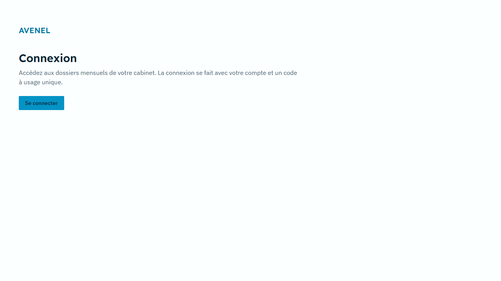
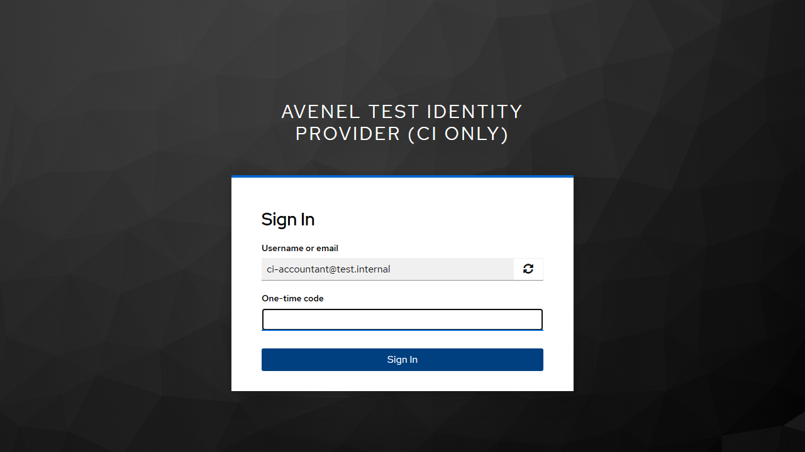
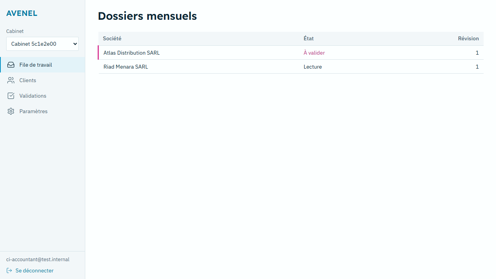
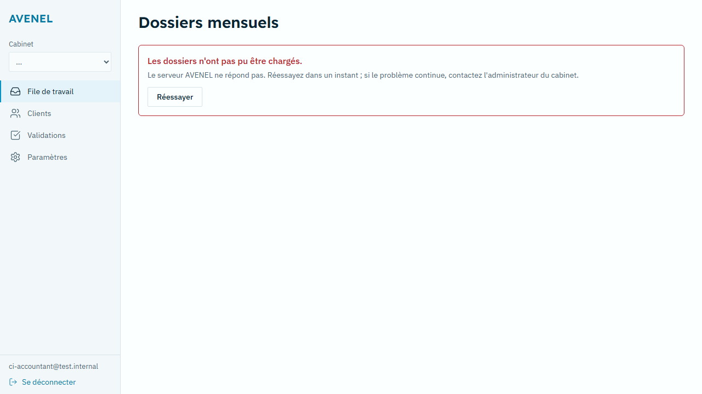

# Phase 5c-1 report — separation, real auth, honest CI

**Date:** 4 November 2026 · **Repository:** `../avenel-split` (new, not pushed) · **Plan:** `docs/plans/phase-5c-1.md`

`make ci` exited **0** locally (Windows 11, Docker Desktop 28.1.1, GNU make 4.4 via Chocolatey, Python 3.12 venv, Node 22) including the docker-compose e2e job. The fiscai repository was not modified, rewritten or pushed (only `docs/plans/phase-5c-1.md` was written there, before approval, as requested).

## What changed, by numbered item

1. **New repository.** `git clone --no-local fiscai ../avenel-split`, then `git filter-repo --invert-paths` dropping FiscAI-only paths from all history (`fintech-research/`, `apps/web/`, `.claude/`, `src/pages`, `src/services`, `src/mocks`, FiscAI `src/lib` modules and components, `e2e/journey*`, `make.*` shims, the implementation zip). `42191be` is the root commit, so "from 42191be onward" is the whole history (32 commits). No remote is configured. Mixed files (`src/App.tsx`, `src/index.css`, `tailwind.config.js`, …) keep their old FiscAI versions in history; only their current versions are clean.
2. **FiscAI code removed.** Remaining FiscAI pages, layout, i18n catalogue, models, stores, UI primitives, `README.md`, `/pilot`, `/viewer`, `PilotDemoPage` and the FiscAI-styled UI kit. `index.html` and `package.json` renamed to AVENEL. Removed tests are listed in `TESTS_REMOVED.md`; new Vitest baseline `src/.test_count_baseline` (46) enforced by `scripts/guards/check_web_test_count.mjs`. `avenel/extraction/synthetic_pipeline.py` (a test harness importing `tests.fixtures`) moved to `tests/evaluation/` (file move, no logic change). AVENEL screen components without API wiring (Review, Reconciliation, Approval, Export, Portal, Metrics) are kept but not routed; `defaultMockMetrics` removed.
3. **ADR-002** (`docs/adr/ADR-002-frontend-location.md`). ARCHITECTURE.md changed only in C.2 (Web row), C.3 (layout) and Part K 25–28 (`git diff 8427e3a -- ARCHITECTURE.md` shows nothing else). The sentence "The following 24 binding architectural decisions…" was left as is, per the instruction to change nothing else.
4. **Design system.** `src/styles/fonts.css` (`@font-face` for Readex Pro 600, IBM Plex Sans 400/500/600, IBM Plex Sans Arabic 400 from `/public/fonts`). `tailwind.config.js` `theme.colors` replaced with Part E tokens plus `transparent`/`currentColor`; `boxShadow`, `ringColor`, `borderColor` defaults set to Part E; Tailwind preflight vendored (`src/styles/preflight.css`) so its placeholder colour is `ink-2` instead of default gray. Invented arbitrary colours (`#D93874`, `#FFF0F5`, `#9E1B4C`, `#02435c`, …) and default-palette classes in the kept screens mapped mechanically to Part E tokens. `scripts/guards/check_css_palette.mjs` fails on any default-palette class or any colour literal in the built CSS that is not a Part E token (with opacity variants); self-tested in `scripts/guards/check_css_palette.test.mjs`.
5. **Browser auth.** `oidc-client-ts` Authorization Code + PKCE (S256) against the compose Keycloak (`src/auth/oidc.ts`, `AuthProvider.tsx`). Tokens in an `InMemoryWebStorage` user store. Silent renew via refresh token (`automaticSilentRenew`), `/silent-renew` iframe fallback. Logout via `signoutRedirect` to `/`. Step-up: `requireFreshMfa()` re-runs login with `prompt=login`, `max_age=300` unless the access token has `amr` OTP and `auth_time` ≤ 300 s (`hasFreshMfa`, unit-tested). `/` is the login; every other route is under `RequireAuth`. Test realm: PKCE S256, redirect URIs for `:5173`, audience mapper `avenel-api`, fixed user id, generated test password. Compose Keycloak imports the realm.
   - **Backend auth bypass fixed (approved):** subject-header / plain-token auth and client-supplied MFA headers now require `AVENEL_AUTH_TEST_MODE=1`, set only in `tests/conftest.py`. 5 tests in `tests/security/test_auth_test_mode_gate.py`; 3 fail on the old code (output in this report).
6. **App shell + Queue.** Rail 220 px (File de travail, Clients, Validations, Paramètres), firm switcher, logout. Queue calls `GET /v1/work-requests` and `GET /v1/client-entities` through `openapi-fetch` typed by `src/api/schema.d.ts` generated from `contracts/openapi.yaml` (`make web-gen-api` fails on drift). Loading, empty and error states; error state proven with the API container stopped.
7. **CI guards (Part K 25–28)** in `scripts/guards/`, wired into `make guards` / `make e2e` and `.github/workflows/ci.yml` (new `e2e-stack` job). Each guard has planted-violation self-tests (`scripts/guards/guards.test.mjs`). Compose gained `migrate`, `seed`, `api`, `worker`, `web`.
8. **E2E against the real stack.** `e2e/login-queue.spec.ts` and `e2e/queue-api-down.spec.ts` (logs below).
9. **Corrections.** `docs/reports/phase-5b-corrections.md` (13 items). `docs/pilot/go-live-checklist.md` jalon 8 gained four checks.

### Integration bugs found and fixed (each with a failing test first)

| Bug | Effect | Fix | Test |
|---|---|---|---|
| Header/plain-token auth with client-asserted MFA, no environment gate (`apps/api/deps.py`) | Anyone knowing a subject could act as that user and pass step-up | Gate on `AVENEL_AUTH_TEST_MODE` | `tests/security/test_auth_test_mode_gate.py` |
| `resolve_user_session` read `memberships` before setting tenant context (`avenel/tenancy/auth.py`) | Every real login 401 when connected as `avenel_app` (C.5) | Transaction-local `set_config` for the resolved tenant before the read | `tests/rls/test_session_resolution_as_app_role.py` |
| `/health/ready` used a temporary `get_db()` generator (`apps/api/main.py`) | 500 on every call | Own connection in the handler, `psycopg.Error` → 503 | `tests/api/test_health_ready.py` |
| clamd reply `stream: OK\0` stored in JSONB (`avenel/documents/scanner.py`) | Every upload fails against a real ClamAV | Strip NUL | `tests/unit/test_scanner.py::test_clamd_reply_nul_terminator_is_stripped` |
| Pytest suite reached any clamd on `localhost:3310` | Results depended on whether Docker was running (A.2.7) | `tests/conftest.py` pins `AVENEL_CLAMAV_PORT=1` | existing scanner/intake tests |
| `clamav/clamav:1.4.1@sha256:7bc5…` and the MinIO pin do not exist in their registries | Stack could not start | ClamAV → `1.4.3@sha256:75fb5f…` (both compose files); MinIO left, not in e2e | `docker buildx imagetools inspect` |
| ClamAV healthcheck `clamdscan --ping 127.0.0.1:3310` invalid; freshclam `-d` exits; web healthcheck hits `::1` | Containers never healthy | `clamdcheck.sh` + start period; `--foreground`; `127.0.0.1` | compose `ps` |
| Keycloak 26 health on port 9000, not 8080 | Keycloak never healthy | Healthcheck port 9000, `KC_HEALTH_ENABLED` | compose `ps` |

## Raw output of `make ci`

Full log committed at `docs/reports/phase-5c-1/make-ci.log` (997 lines, exit code on the last line). Unedited:

<details><summary>make ci — full output</summary>

```
.venv/Scripts/python.exe -m ruff check avenel apps scripts
All checks passed!
.venv/Scripts/python.exe scripts/check_no_tax_literals.py
[LINT PASSED] No forbidden numeric tax literals, hardcoded identifier regexes, or account seeds found in application code.
.venv/Scripts/python.exe scripts/check_migration_hashes.py
SUCCESS: All 16 frozen migrations (001�008) verified intact.
.venv/Scripts/python.exe scripts/check_test_count.py
[TEST COUNT CHECK] Collected: 224 | Required Baseline: 224
[TEST COUNT CHECK PASSED] Test count maintained or increased.
.venv/Scripts/python.exe scripts/generate_expert_sign_off.py --check
PASS: C:\Users\21263\Downloads\avenel-split\docs\pilot\expert-sign-off-sheet.md is up to date with 28 needs_expert rules.
.venv/Scripts/python.exe -m mypy avenel apps/api scripts
Success: no issues found in 88 source files
npx @stoplight/spectral-cli lint contracts/openapi.yaml --ruleset .spectral.yaml
No results with a severity of 'error' found!
.venv/Scripts/python.exe scripts/rls_check.py
Applying migration 001_core from 001_core.up.sql...
Applied 001_core successfully.
Applying migration 002_rls from 002_rls.up.sql...
Applied 002_rls successfully.
Applying migration 003_append_only from 003_append_only.up.sql...
Applied 003_append_only successfully.
Applying migration 004_fx_rates from 004_fx_rates.up.sql...
Applied 004_fx_rates successfully.
Applying migration 005_rounding_directions from 005_rounding_directions.up.sql...
Applied 005_rounding_directions successfully.
Applying migration 006_reconciliation_refinements from 006_reconciliation_refinements.up.sql...
Applied 006_reconciliation_refinements successfully.
Applying migration 007_active_bq_proposal_unique from 007_active_bq_proposal_unique.up.sql...
Applied 007_active_bq_proposal_unique successfully.
Applying migration 008_round_trips_and_approval_policy from 008_round_trips_and_approval_policy.up.sql...
Applied 008_round_trips_and_approval_policy successfully.
Applying migration 009_review_metrics_and_rate_limits from 009_review_metrics_and_rate_limits.up.sql...
Applied 009_review_metrics_and_rate_limits successfully.
Found 31 tables with tenant_id:
  - accounting_periods: rls_enabled=True, rls_forced=True, policies=1
  - agent_runs: rls_enabled=True, rls_forced=True, policies=1
  - approvals: rls_enabled=True, rls_forced=True, policies=1
  - audit_events: rls_enabled=True, rls_forced=True, policies=1
  - bank_accounts: rls_enabled=True, rls_forced=True, policies=1
  - bank_statements: rls_enabled=True, rls_forced=True, policies=1
  - bank_transactions: rls_enabled=True, rls_forced=True, policies=1
  - chart_accounts: rls_enabled=True, rls_forced=True, policies=1
  - client_entities: rls_enabled=True, rls_forced=True, policies=1
  - client_tax_mappings: rls_enabled=True, rls_forced=True, policies=1
  - counterparties: rls_enabled=True, rls_forced=True, policies=1
  - document_versions: rls_enabled=True, rls_forced=True, policies=1
  - documents: rls_enabled=True, rls_forced=True, policies=1
  - evidence_records: rls_enabled=True, rls_forced=True, policies=1
  - export_profiles: rls_enabled=True, rls_forced=True, policies=1
  - export_round_trips: rls_enabled=True, rls_forced=True, policies=1
  - exports: rls_enabled=True, rls_forced=True, policies=1
  - extractions: rls_enabled=True, rls_forced=True, policies=1
  - fx_rates: rls_enabled=True, rls_forced=True, policies=1
  - idempotency_keys: rls_enabled=True, rls_forced=True, policies=1
  - issues: rls_enabled=True, rls_forced=True, policies=1
  - journal_lines: rls_enabled=True, rls_forced=True, policies=1
  - journal_proposals: rls_enabled=True, rls_forced=True, policies=1
  - membership_client_scopes: rls_enabled=True, rls_forced=True, policies=1
  - memberships: rls_enabled=True, rls_forced=True, policies=1
  - provider_calls: rls_enabled=True, rls_forced=True, policies=1
  - reconciliation_match_items: rls_enabled=True, rls_forced=True, policies=1
  - reconciliation_matches: rls_enabled=True, rls_forced=True, policies=1
  - review_effort_metrics: rls_enabled=True, rls_forced=True, policies=1
  - usage_records: rls_enabled=True, rls_forced=True, policies=1
  - work_requests: rls_enabled=True, rls_forced=True, policies=1

[RLS-CHECK PASSED] All 31 tables with tenant_id have forced RLS and tenant policy.
.venv/Scripts/python.exe scripts/verify_audit_chain.py --seed
Applying migration 001_core from 001_core.up.sql...
Applied 001_core successfully.
Applying migration 002_rls from 002_rls.up.sql...
Applied 002_rls successfully.
Applying migration 003_append_only from 003_append_only.up.sql...
Applied 003_append_only successfully.
Applying migration 004_fx_rates from 004_fx_rates.up.sql...
Applied 004_fx_rates successfully.
Applying migration 005_rounding_directions from 005_rounding_directions.up.sql...
Applied 005_rounding_directions successfully.
Applying migration 006_reconciliation_refinements from 006_reconciliation_refinements.up.sql...
Applied 006_reconciliation_refinements successfully.
Applying migration 007_active_bq_proposal_unique from 007_active_bq_proposal_unique.up.sql...
Applied 007_active_bq_proposal_unique successfully.
Applying migration 008_round_trips_and_approval_policy from 008_round_trips_and_approval_policy.up.sql...
Applied 008_round_trips_and_approval_policy successfully.
Applying migration 009_review_metrics_and_rate_limits from 009_review_metrics_and_rate_limits.up.sql...
Applied 009_review_metrics_and_rate_limits successfully.
[AUDIT-VERIFY] Seeded 5 audit events for test tenant d30c9c8d-1b82-4c70-bd98-c647c98c71ac
  - Tenant d30c9c8d-1b82-4c70-bd98-c647c98c71ac: verified 5 audit events in linear sequence.

[AUDIT-VERIFY PASSED] All 5 audit events across 1 tenant(s) verified linear and intact.
.venv/Scripts/python.exe -m pytest -v tests
C:\Users\21263\Downloads\avenel-split\.venv\Lib\site-packages\pytest_asyncio\plugin.py:300: PytestDeprecationWarning: The configuration option "asyncio_default_fixture_loop_scope" is unset.
The event loop scope for asynchronous fixtures will default to the "fixture" caching scope. Future versions of pytest-asyncio will default the loop scope for asynchronous fixtures to "function" scope. Set the default fixture loop scope explicitly in order to avoid unexpected behavior in the future. Valid fixture loop scopes are: "function", "class", "module", "package", "session"

  warnings.warn(PytestDeprecationWarning(_DEFAULT_FIXTURE_LOOP_SCOPE_UNSET))
============================= test session starts =============================
platform win32 -- Python 3.12.2, pytest-9.2.0, pluggy-1.7.0 -- C:\Users\21263\Downloads\avenel-split\.venv\Scripts\python.exe
cachedir: .pytest_cache
hypothesis profile 'default'
rootdir: C:\Users\21263\Downloads\avenel-split
configfile: pytest.ini
plugins: anyio-4.16.0, hypothesis-6.170.14, platformdirs-4.14.3, asyncio-1.4.1.post1
asyncio: mode=Mode.STRICT, debug=False, asyncio_default_fixture_loop_scope=None, asyncio_default_test_loop_scope=function
collecting ... collected 223 items

tests/api/test_audit_chain_verifies.py::test_audit_chain_verifies_after_phase1_operations PASSED [  0%]
tests/api/test_auth_jwt.py::test_jwt_valid_signature_authenticates PASSED [  0%]
tests/api/test_auth_jwt.py::test_jwt_expired_token_gets_401 PASSED       [  1%]
tests/api/test_auth_jwt.py::test_jwt_wrong_audience_gets_401 PASSED      [  1%]
tests/api/test_auth_jwt.py::test_jwt_wrong_issuer_gets_401 PASSED        [  2%]
tests/api/test_auth_jwt.py::test_jwt_forged_signature_gets_401 PASSED    [  2%]
tests/api/test_auth_jwt.py::test_jwt_immature_nbf_gets_401 PASSED        [  3%]
tests/api/test_auth_jwt.py::test_mfa_enforced_for_professional_registration PASSED [  3%]
tests/api/test_auth_jwt.py::test_operator_access_lifecycle_and_expiry PASSED [  4%]
tests/api/test_client_user_scoping.py::test_client_user_cannot_see_unscoped_company PASSED [  4%]
tests/api/test_compliance.py::test_compliance_dpa_and_cndp_generation PASSED [  4%]
tests/api/test_cross_tenant_isolation.py::test_cross_tenant_isolation_every_endpoint_returns_404 PASSED [  5%]
tests/api/test_documents_intake.py::test_document_intake_full_pipeline_success PASSED [  5%]
tests/api/test_documents_intake.py::test_exact_duplicate_document_resubmitted_returns_200 PASSED [  6%]
tests/api/test_documents_intake.py::test_same_file_different_client_entities_creates_two_separate_documents PASSED [  6%]
tests/api/test_documents_intake.py::test_malware_quarantined_with_immutable_evidence PASSED [  7%]
tests/api/test_documents_intake.py::test_clamav_stale_or_scanner_down_intake_paused PASSED [  7%]
tests/api/test_documents_intake.py::test_field_correction_generates_immutable_evidence PASSED [  8%]
tests/api/test_documents_intake.py::test_scope_first_and_role_permissions PASSED [  8%]
tests/api/test_health_ready.py::test_health_ready_reports_database_ok PASSED [  8%]
tests/api/test_health_ready.py::test_health_ready_returns_503_when_database_unreachable PASSED [  9%]
tests/api/test_idempotency.py::test_missing_idempotency_key_returns_400 PASSED [  9%]
tests/api/test_idempotency.py::test_idempotent_replay_returns_cached_response PASSED [ 10%]
tests/api/test_idempotency.py::test_same_key_different_body_returns_422 PASSED [ 10%]
tests/api/test_idempotency.py::test_concurrent_in_flight_returns_409 PASSED [ 11%]
tests/api/test_idempotency.py::test_non_mutating_get_does_not_require_idempotency_key PASSED [ 11%]
tests/api/test_periods_and_chart.py::test_periods_overlap_protection_returns_409 PASSED [ 12%]
tests/api/test_periods_and_chart.py::test_chart_accounts_seed_and_import PASSED [ 12%]
tests/api/test_phase1_matrix.py::test_phase1_matrix_four_quadrants[get_session-GET-/v1/me-None-200] PASSED [ 13%]
tests/api/test_phase1_matrix.py::test_phase1_matrix_four_quadrants[list_client_entities-GET-/v1/client-entities-None-200] PASSED [ 13%]
tests/api/test_phase1_matrix.py::test_phase1_matrix_four_quadrants[create_client_entity-POST-/v1/client-entities-payload2-201] PASSED [ 13%]
tests/api/test_phase1_matrix.py::test_phase1_matrix_four_quadrants[get_client_entity-GET-/v1/client-entities/{c1_id}-None-200] PASSED [ 14%]
tests/api/test_phase1_matrix.py::test_phase1_matrix_four_quadrants[put_client_entity-PUT-/v1/client-entities/{c1_id}-payload4-200] PASSED [ 14%]
tests/api/test_phase1_matrix.py::test_phase1_matrix_four_quadrants[patch_client_entity-PATCH-/v1/client-entities/{c1_id}-payload5-200] PASSED [ 15%]
tests/api/test_phase1_matrix.py::test_phase1_matrix_four_quadrants[archive_client_entity-POST-/v1/client-entities/{c1_archive_id}/archive-payload6-200] PASSED [ 15%]
tests/api/test_phase1_matrix.py::test_phase1_matrix_four_quadrants[list_accounting_periods-GET-/v1/client-entities/{c1_id}/periods-None-200] PASSED [ 16%]
tests/api/test_phase1_matrix.py::test_phase1_matrix_four_quadrants[open_accounting_period-POST-/v1/client-entities/{c1_id}/periods-payload8-201] PASSED [ 16%]
tests/api/test_phase1_matrix.py::test_phase1_matrix_four_quadrants[list_chart_accounts-GET-/v1/client-entities/{c1_id}/chart-accounts-None-200] PASSED [ 17%]
tests/api/test_phase1_matrix.py::test_phase1_matrix_four_quadrants[seed_cgnc_chart-POST-/v1/client-entities/{c1_id}/chart-accounts/seed-cgnc-payload10-200] PASSED [ 17%]
tests/api/test_phase1_matrix.py::test_phase1_matrix_four_quadrants[import_chart_accounts-POST-/v1/client-entities/{c1_id}/chart-accounts/import-payload11-200] PASSED [ 17%]
tests/api/test_phase1_matrix.py::test_phase1_matrix_four_quadrants[get_dpa-GET-/v1/compliance/dpa-None-200] PASSED [ 18%]
tests/api/test_phase1_matrix.py::test_phase1_matrix_four_quadrants[get_cndp-GET-/v1/compliance/cndp-dossier-None-200] PASSED [ 18%]
tests/api/test_phase5_api.py::test_api_record_round_trip_permissions_and_mfa PASSED [ 19%]
tests/api/test_phase5_api.py::test_api_decide_approval_mfa_5_minute_and_stale_hash PASSED [ 19%]
tests/api/test_phase5_api.py::test_api_issue_acknowledge_endpoint PASSED [ 20%]
tests/api/test_proposals_api.py::test_proposal_generate_retrieve_and_list PASSED [ 20%]
tests/api/test_proposals_api.py::test_proposal_revision_flow_and_no_per_entry_approval PASSED [ 21%]
tests/api/test_proposals_api.py::test_proposal_role_based_access PASSED  [ 21%]
tests/api/test_review_effort_metrics.py::test_internal_metrics_rbac_owner_and_operator_allowed PASSED [ 21%]
tests/api/test_review_effort_metrics.py::test_no_identifier_values_in_metrics_responses PASSED [ 22%]
tests/api/test_role_action_matrix.py::test_role_action_matrix_create_client PASSED [ 22%]
tests/api/test_role_action_matrix.py::test_role_action_matrix_update_client PASSED [ 23%]
tests/api/test_role_action_matrix.py::test_role_action_matrix_archive_client PASSED [ 23%]
tests/api/test_role_action_matrix.py::test_role_action_matrix_periods PASSED [ 24%]
tests/api/test_role_action_matrix.py::test_role_action_matrix_chart PASSED [ 24%]
tests/api/test_security_headers_and_rate_limits.py::test_security_headers_present_on_all_responses PASSED [ 25%]
tests/api/test_security_headers_and_rate_limits.py::test_rate_limiting_enforced_on_auth_endpoint PASSED [ 25%]
tests/api/test_shared_rate_limiter.py::test_shared_rate_limiter_two_workers PASSED [ 26%]
tests/api/test_tenant_context.py::test_db_spec_function_definitions PASSED [ 26%]
tests/api/test_tenant_context.py::test_no_tenant_context_sees_zero_rows PASSED [ 26%]
tests/api/test_tenant_context.py::test_app_never_runs_query_without_tenant_context PASSED [ 27%]
tests/api/test_tenant_context.py::test_api_unauthenticated_request_refused_before_query PASSED [ 27%]
tests/api/test_xlsx_safety.py::test_xlsx_valid_parse PASSED              [ 28%]
tests/api/test_xlsx_safety.py::test_xlsx_file_size_limit PASSED          [ 28%]
tests/api/test_xlsx_safety.py::test_csv_file_size_limit PASSED           [ 29%]
tests/api/test_xlsx_safety.py::test_xlsx_row_limit PASSED                [ 29%]
tests/api/test_xlsx_safety.py::test_csv_row_limit PASSED                 [ 30%]
tests/api/test_xlsx_safety.py::test_xlsx_zip_bomb_rejection PASSED       [ 30%]
tests/api/test_xlsx_safety.py::test_xlsx_xxe_payload_rejection PASSED    [ 30%]
tests/approvals/test_approvals.py::test_approval_request_refused_on_zero_proposals PASSED [ 31%]
tests/approvals/test_approvals.py::test_approval_request_refused_on_blocking_issues PASSED [ 31%]
tests/approvals/test_approvals.py::test_approval_request_refused_on_unbalanced_proposals PASSED [ 32%]
tests/approvals/test_approvals.py::test_approval_full_flow_segregation_and_registration PASSED [ 32%]
tests/approvals/test_approvals.py::test_unacknowledged_review_issues_blocks_approval PASSED [ 33%]
tests/approvals/test_approvals.py::test_subject_hash_stable_on_approval_status_transition PASSED [ 33%]
tests/approvals/test_approvals.py::test_altering_accepted_match_after_approval_refuses_export PASSED [ 34%]
tests/approvals/test_approvals.py::test_single_person_policy_configured_on_client_entities PASSED [ 34%]
tests/bank/test_bank_statement_parsing.py::test_csv_bank_statement_parsing_valid_balance PASSED [ 34%]
tests/bank/test_bank_statement_parsing.py::test_csv_bank_statement_parsing_balance_break_detected PASSED [ 35%]
tests/bank/test_bank_statement_parsing.py::test_xlsx_bank_statement_parsing PASSED [ 35%]
tests/bank/test_bank_statement_parsing.py::test_ingest_statement_with_balance_break_raises_blocking_issue PASSED [ 36%]
tests/bank/test_bank_statement_parsing.py::test_bank_statement_fixture_stubs_awaiting_real_samples PASSED [ 36%]
tests/bank/test_rib.py::test_moroccan_rib_key_calculation_and_validation PASSED [ 37%]
tests/bank/test_rib.py::test_moroccan_rib_invalid_length_or_characters PASSED [ 37%]
tests/bank/test_rib.py::test_rib_cleaning_and_formatting PASSED          [ 38%]
tests/bank/test_rib.py::test_rib_masking_and_sha256 PASSED               [ 38%]
tests/bank/test_rib.py::test_rib_encryption_roundtrip PASSED             [ 39%]
tests/bank/test_rib.py::test_known_bank_codes_loaded_from_jurisdiction_pack PASSED [ 39%]
tests/bank/test_rib.py::test_app_refuses_to_start_without_rib_encryption_key PASSED [ 39%]
tests/bank/test_rib.py::test_rib_encrypted_never_in_api_response_or_logs PASSED [ 40%]
tests/evaluation/test_synthetic_pipeline.py::test_synthetic_corpus_count_and_report_header_reconciliation PASSED [ 40%]
tests/evaluation/test_synthetic_pipeline.py::test_mixed_inv_002_raises_totals_inconsistent_validator PASSED [ 41%]
tests/evaluation/test_synthetic_pipeline.py::test_synthetic_pipeline_per_field_exact_match PASSED [ 41%]
tests/exports/test_golden_exports.py::test_golden_sage100_csv_byte_identical PASSED [ 42%]
tests/exports/test_golden_exports.py::test_golden_sage100_pnm_byte_identical PASSED [ 42%]
tests/exports/test_golden_exports.py::test_golden_odoo_csv_byte_identical PASSED [ 43%]
tests/exports/test_golden_exports.py::test_evidence_pack_zip_bundle_and_artifacts PASSED [ 43%]
tests/exports/test_golden_exports.py::test_bundle_evidence_pack_zip_with_source_documents PASSED [ 43%]
tests/exports/test_golden_exports.py::test_export_does_not_modify_export_profile PASSED [ 44%]
tests/exports/test_golden_exports.py::test_manual_record_round_trip PASSED [ 44%]
tests/exports/test_golden_exports.py::test_reexport_idempotent_no_double_billing PASSED [ 45%]
tests/exports/test_golden_exports.py::test_download_token_verification_and_expiry PASSED [ 45%]
tests/exports/test_golden_exports.py::test_download_records_audit_event PASSED [ 46%]
tests/guards/test_negative_guards.py::test_tax_literal_linter_fails_on_planted_rate PASSED [ 46%]
tests/guards/test_negative_guards.py::test_linter_fails_on_planted_identifier_regex PASSED [ 47%]
tests/guards/test_negative_guards.py::test_linter_fails_on_planted_account_seed PASSED [ 47%]
tests/guards/test_negative_guards.py::test_spectral_fails_on_planted_nullable_true PASSED [ 47%]
tests/guards/test_negative_guards.py::test_rls_check_fails_on_planted_unprotected_table PASSED [ 48%]
tests/integration/test_keycloak_jwks.py::test_keycloak_real_token_issuance_caching_and_rotation PASSED [ 48%]
tests/integration/test_migrations.py::test_migrations_forward_and_rollback_cycle PASSED [ 49%]
tests/integration/test_migrations.py::test_migrate_down_refuses_in_production PASSED [ 49%]
tests/invariants/test_c4_invariants.py::test_invariant_2_cross_client_composite_fk_rejection PASSED [ 50%]
tests/invariants/test_c4_invariants.py::test_invariant_8_segregation_of_duties_and_registration PASSED [ 50%]
tests/invariants/test_c4_invariants.py::test_invariant_9_overlapping_periods_and_chart_accounts_rejected PASSED [ 51%]
tests/invariants/test_c4_invariants.py::test_unique_nulls_not_distinct_duplicates_rejected PASSED [ 51%]
tests/invariants/test_c4_invariants.py::test_export_fk_requires_approval PASSED [ 52%]
tests/invariants/test_c4_invariants.py::test_invariant_7_export_refused_on_hash_mismatch PASSED [ 52%]
tests/issues/test_issues.py::test_issue_lifecycle_assign_resolve_and_rules PASSED [ 52%]
tests/issues/test_issues.py::test_issue_portal_request_and_client_answer PASSED [ 53%]
tests/issues/test_issues.py::test_acknowledge_review_issue_workflow PASSED [ 53%]
tests/proposals/test_bq_proposal_lifecycle.py::test_bq_proposal_full_lifecycle_and_db_unique_index PASSED [ 54%]
tests/proposals/test_duplicates.py::test_duplicate_window_reads_from_pack PASSED [ 54%]
tests/proposals/test_duplicates.py::test_probable_duplicate_detected_by_exact_invoice_number PASSED [ 55%]
tests/proposals/test_duplicates.py::test_probable_duplicate_detected_by_amount_and_date_window PASSED [ 55%]
tests/proposals/test_duplicates.py::test_negative_monthly_rent_30_days_apart_not_flagged PASSED [ 56%]
tests/proposals/test_duplicates.py::test_negative_two_different_suppliers_same_amount_never_flagged PASSED [ 56%]
tests/proposals/test_duplicates.py::test_record_duplicate_issues_inserts_duplicate_probable PASSED [ 56%]
tests/proposals/test_golden_bank_proposals.py::test_golden_bank_proposal_supplier_payment PASSED [ 57%]
tests/proposals/test_golden_bank_proposals.py::test_golden_bank_proposal_customer_receipt_with_vat_withheld PASSED [ 57%]
tests/proposals/test_golden_bank_proposals.py::test_golden_bank_proposal_bank_fees_and_commissions PASSED [ 58%]
tests/proposals/test_golden_bank_proposals.py::test_bank_fees_missing_mapping_raises_account_unmapped PASSED [ 58%]
tests/proposals/test_golden_bank_proposals.py::test_golden_bank_proposal_unmatched_line_with_suspense_account PASSED [ 59%]
tests/proposals/test_golden_bank_proposals.py::test_golden_bank_proposal_customer_receipt_is_only_withholding PASSED [ 59%]
tests/proposals/test_golden_bank_proposals.py::test_golden_bank_proposal_customer_receipt_combined_withholding PASSED [ 60%]
tests/proposals/test_golden_proposals.py::test_golden_standard_purchase_invoice PASSED [ 60%]
tests/proposals/test_golden_proposals.py::test_golden_multi_rate_purchase_invoice PASSED [ 60%]
tests/proposals/test_golden_proposals.py::test_golden_sales_invoice PASSED [ 61%]
tests/proposals/test_golden_proposals.py::test_golden_purchase_credit_note_reversing_purchase PASSED [ 61%]
tests/proposals/test_golden_proposals.py::test_golden_sales_credit_note PASSED [ 62%]
tests/proposals/test_golden_proposals.py::test_golden_fixed_asset_acquisition PASSED [ 62%]
tests/proposals/test_golden_proposals.py::test_golden_non_deductible_vat_by_cash_limit PASSED [ 63%]
tests/proposals/test_golden_proposals.py::test_golden_non_deductible_vat_by_nature PASSED [ 63%]
tests/proposals/test_golden_proposals.py::test_golden_auto_entrepreneur_supplier_no_vat_lines PASSED [ 64%]
tests/proposals/test_golden_proposals.py::test_golden_prorata_deduction_using_client_entities_vat_prorata PASSED [ 64%]
tests/proposals/test_golden_proposals.py::test_golden_foreign_currency_eur_with_residual PASSED [ 65%]
tests/proposals/test_golden_proposals.py::test_evidence_refs_with_only_rule_refs_rejected PASSED [ 65%]
tests/proposals/test_golden_proposals.py::test_missing_approved_tax_mapping_raises_account_unmapped PASSED [ 65%]
tests/proposals/test_golden_proposals.py::test_missing_fx_rate_raises_fx_rate_missing PASSED [ 66%]
tests/proposals/test_golden_proposals.py::test_golden_foreign_currency_eur_with_negative_residual_credited_to_gain_account PASSED [ 66%]
tests/proposals/test_golden_proposals.py::test_multi_rate_14_percent_accepted_in_2025 PASSED [ 67%]
tests/proposals/test_golden_proposals.py::test_multi_rate_14_percent_rejected_in_2026 PASSED [ 67%]
tests/proposals/test_golden_proposals.py::test_account_suggester_ma_only_without_local_model_falls_back_to_counterparty_history PASSED [ 68%]
tests/proposals/test_golden_proposals.py::test_account_suggester_low_confidence_raises_account_low_confidence_issue PASSED [ 68%]
tests/proposals/test_hypothesis_proposals.py::test_hypothesis_every_proposal_balances_and_has_evidence PASSED [ 69%]
tests/proposals/test_hypothesis_proposals.py::test_hypothesis_every_bank_proposal_balances_and_has_evidence PASSED [ 69%]
tests/reconciliation/test_reconciliation.py::test_reconciliation_exact_single_match PASSED [ 69%]
tests/reconciliation/test_reconciliation.py::test_reconciliation_withheld_vat_match_and_difference_kind PASSED [ 70%]
tests/reconciliation/test_reconciliation.py::test_reconciliation_withheld_vat_unmapped_account_raises_account_unmapped_issue PASSED [ 70%]
tests/reconciliation/test_reconciliation.py::test_reconciliation_no_bank_line_in_two_accepted_matches PASSED [ 71%]
tests/reconciliation/test_reconciliation.py::test_reconciliation_withholding_other_5_pct_is_detected PASSED [ 71%]
tests/reconciliation/test_reconciliation.py::test_reconciliation_combined_withholding_is_and_vat_detected PASSED [ 72%]
tests/rls/test_app_privileges.py::test_avenel_app_role_attributes PASSED [ 72%]
tests/rls/test_app_privileges.py::test_avenel_app_is_not_table_owner PASSED [ 73%]
tests/rls/test_app_privileges.py::test_permission_denied_on_append_only_tables_with_triggers_dropped PASSED [ 73%]
tests/rls/test_rls.py::test_make_rls_check_passes PASSED                 [ 73%]
tests/rls/test_rls.py::test_tenant_isolation_and_row_level_security PASSED [ 74%]
tests/rls/test_session_resolution_as_app_role.py::test_resolve_user_session_works_as_avenel_app PASSED [ 74%]
tests/rls/test_session_resolution_as_app_role.py::test_resolve_user_session_as_avenel_app_unknown_subject_is_none PASSED [ 75%]
tests/security/test_auth_test_mode_gate.py::test_subject_header_rejected_outside_test_mode PASSED [ 75%]
tests/security/test_auth_test_mode_gate.py::test_plain_bearer_rejected_outside_test_mode PASSED [ 76%]
tests/security/test_auth_test_mode_gate.py::test_forged_mfa_headers_rejected_outside_test_mode PASSED [ 76%]
tests/security/test_auth_test_mode_gate.py::test_subject_header_still_works_in_test_mode PASSED [ 77%]
tests/security/test_auth_test_mode_gate.py::test_jwt_with_stale_auth_time_cannot_decide_even_with_forged_header PASSED [ 77%]
tests/security/test_production_realm_secrets.py::test_production_realm_export_exists PASSED [ 78%]
tests/security/test_production_realm_secrets.py::test_production_realm_contains_no_static_totp_secret_or_credentials PASSED [ 78%]
tests/security/test_production_realm_secrets.py::test_production_realm_enforces_secure_otp_policy PASSED [ 78%]
tests/security/test_production_realm_secrets.py::test_test_totp_secret_confined_to_ci_test_realm_and_fixtures PASSED [ 79%]
tests/triggers/test_append_only.py::test_audit_events_is_append_only PASSED [ 79%]
tests/triggers/test_append_only.py::test_evidence_records_is_append_only PASSED [ 80%]
tests/triggers/test_append_only.py::test_frozen_proposal_lines_cannot_be_mutated PASSED [ 80%]
tests/triggers/test_append_only.py::test_cannot_move_line_to_another_proposal PASSED [ 81%]
tests/triggers/test_audit_chain.py::test_audit_event_hash_chaining PASSED [ 81%]
tests/triggers/test_audit_chain.py::test_audit_verify_on_seeded_data_passes PASSED [ 82%]
tests/triggers/test_audit_chain.py::test_audit_verify_detects_tampering_and_exits_non_zero PASSED [ 82%]
tests/triggers/test_audit_concurrent.py::test_concurrent_audit_inserts_chain_stays_linear PASSED [ 82%]
tests/triggers/test_balance_trigger.py::test_balanced_proposal_commits_successfully PASSED [ 83%]
tests/triggers/test_balance_trigger.py::test_unbalanced_proposal_fails_on_commit PASSED [ 83%]
tests/triggers/test_balance_trigger.py::test_proposal_with_single_line_fails_on_commit PASSED [ 84%]
tests/triggers/test_balance_trigger.py::test_line_with_both_debit_and_credit_rejected PASSED [ 84%]
tests/triggers/test_document_versions_malware_scan.py::test_malware_scan_column_removed_from_document_versions PASSED [ 85%]
tests/triggers/test_document_versions_malware_scan.py::test_document_versions_current_view_reflects_evidence_records PASSED [ 85%]
tests/unit/test_deterministic_validation.py::test_validation_all_clean_purchase_invoice PASSED [ 86%]
tests/unit/test_deterministic_validation.py::test_validation_missing_mandatory_purchase_mention PASSED [ 86%]
tests/unit/test_deterministic_validation.py::test_validation_arithmetic_inconsistency_blocks PASSED [ 86%]
tests/unit/test_deterministic_validation.py::test_validation_unknown_vat_rate_blocks PASSED [ 87%]
tests/unit/test_deterministic_validation.py::test_validation_auto_entrepreneur_charging_vat PASSED [ 87%]
tests/unit/test_deterministic_validation.py::test_validation_cash_limit_exceeded PASSED [ 88%]
tests/unit/test_deterministic_validation.py::test_validation_period_mismatch PASSED [ 88%]
tests/unit/test_hashing.py::test_canonical_json_formatting PASSED        [ 89%]
tests/unit/test_hashing.py::test_proposal_set_hash_determinism PASSED    [ 89%]
tests/unit/test_jurisdiction_pack.py::test_jurisdiction_pack_schema_validation PASSED [ 90%]
tests/unit/test_jurisdiction_pack.py::test_part_i_items_present_and_needs_expert PASSED [ 90%]
tests/unit/test_jurisdiction_pack.py::test_every_rule_has_non_empty_source PASSED [ 91%]
tests/unit/test_residency_router.py::test_residency_policy_region_allowlist PASSED [ 91%]
tests/unit/test_residency_router.py::test_residency_router_refuses_disallowed_external_calls PASSED [ 91%]
tests/unit/test_residency_router.py::test_zero_provider_calls_in_tests PASSED [ 92%]
tests/unit/test_residency_router.py::test_pii_sanitization_for_external_calls PASSED [ 92%]
tests/unit/test_s3_storage.py::test_s3_storage_initialization_defaults PASSED [ 93%]
tests/unit/test_s3_storage.py::test_s3_put_object_with_sse PASSED        [ 93%]
tests/unit/test_s3_storage.py::test_s3_put_original_with_object_lock_compliance PASSED [ 94%]
tests/unit/test_s3_storage.py::test_s3_put_object_graceful_fallback_when_object_lock_unsupported PASSED [ 94%]
tests/unit/test_s3_storage.py::test_s3_get_object_success_and_not_found PASSED [ 95%]
tests/unit/test_s3_storage.py::test_s3_presigned_urls PASSED             [ 95%]
tests/unit/test_s3_storage.py::test_s3_object_exists PASSED              [ 95%]
tests/unit/test_s3_storage.py::test_storage_factory_selection PASSED     [ 96%]
tests/unit/test_scanner.py::test_clean_document_scan_in_fixture_mode PASSED [ 96%]
tests/unit/test_scanner.py::test_eicar_signature_detection PASSED        [ 97%]
tests/unit/test_scanner.py::test_scanner_unavailable_fail_safe_quarantine PASSED [ 97%]
tests/unit/test_scanner.py::test_clamav_signature_status_fresh_and_stale PASSED [ 98%]
tests/unit/test_scanner.py::test_check_intake_health_paused_when_stale PASSED [ 98%]
tests/unit/test_scanner.py::test_check_intake_health_paused_when_scanner_down PASSED [ 99%]
tests/unit/test_scanner.py::test_check_intake_health_active_when_fresh PASSED [ 99%]
tests/unit/test_scanner.py::test_clamd_reply_nul_terminator_is_stripped PASSED [100%]

============================== warnings summary ===============================
.venv\Lib\site-packages\fastapi\testclient.py:1
  C:\Users\21263\Downloads\avenel-split\.venv\Lib\site-packages\fastapi\testclient.py:1: StarletteDeprecationWarning: Using `httpx` with `starlette.testclient` is deprecated; install `httpx2` instead.
    from starlette.testclient import TestClient as TestClient  # noqa

-- Docs: https://docs.pytest.org/en/stable/how-to/capture-warnings.html
================= 223 passed, 1 warning in 101.35s (0:01:41) ==================
npx openapi-typescript contracts/openapi.yaml -o src/api/schema.d.ts
✨ openapi-typescript 7.13.0
🚀 contracts/openapi.yaml → src/api/schema.d.ts [125.6ms]
git diff --exit-code -- src/api/schema.d.ts
npx tsc -b --noEmit
npm run build

> avenel-web@1.0.0 build
> tsc -b && vite build

vite v5.4.21 building for production...
transforming...
✓ 1590 modules transformed.
rendering chunks...
computing gzip size...
dist/index.html                   0.47 kB │ gzip:  0.29 kB
dist/assets/index-BvidOXGP.css   22.50 kB │ gzip:  4.85 kB
dist/assets/index-BgS7rDRl.js    91.69 kB │ gzip: 25.75 kB
dist/assets/vendor-BaSD_dze.js  163.76 kB │ gzip: 53.41 kB
✓ built in 3.82s
npx vitest run --reporter=default --reporter=json --outputFile=.vitest-results.json

 RUN  v2.1.9 C:/Users/21263/Downloads/avenel-split

 ✓ scripts/guards/check_css_palette.test.mjs (4 tests) 14ms
 ✓ scripts/guards/guards.test.mjs (9 tests) 22ms
 ✓ src/auth/oidc.test.ts (7 tests) 14ms
 ✓ src/components/domain/ProposalReview.test.tsx (6 tests) 809ms
stderr | src/screens/QueueScreen.test.tsx > QueueScreen states (stubbed fetch) > shows the error state when the API is unreachable
⚠️ React Router Future Flag Warning: React Router will begin wrapping state updates in `React.startTransition` in v7. You can use the `v7_startTransition` future flag to opt-in early. For more information, see https://reactrouter.com/v6/upgrading/future#v7_starttransition.
⚠️ React Router Future Flag Warning: Relative route resolution within Splat routes is changing in v7. You can use the `v7_relativeSplatPath` future flag to opt-in early. For more information, see https://reactrouter.com/v6/upgrading/future#v7_relativesplatpath.

stderr | src/screens/QueueScreen.test.tsx > QueueScreen states (stubbed fetch) > shows the loading state first
Warning: An update to AuthProvider inside a test was not wrapped in act(...).

When testing, code that causes React state updates should be wrapped into act(...):

act(() => {
  /* fire events that update state */
});
/* assert on the output */

This ensures that you're testing the behavior the user would see in the browser. Learn more at https://reactjs.org/link/wrap-tests-with-act
    at AuthProvider (C:\Users\21263\Downloads\avenel-split\src\auth\AuthProvider.tsx:10:25)
    at Router (C:\Users\21263\Downloads\avenel-split\node_modules\react-router\dist\umd\react-router.development.js:1203:17)
    at MemoryRouter (C:\Users\21263\Downloads\avenel-split\node_modules\react-router\dist\umd\react-router.development.js:1097:7)

 ✓ src/screens/QueueScreen.test.tsx (4 tests) 205ms
stderr | src/components/domain/ReconciliationScreen.test.tsx > ReconciliationScreen component > triggers onAcceptMatch when clicking Rapprocher button
Warning: An update to ReconciliationScreen inside a test was not wrapped in act(...).

When testing, code that causes React state updates should be wrapped into act(...):

act(() => {
  /* fire events that update state */
});
/* assert on the output */

This ensures that you're testing the behavior the user would see in the browser. Learn more at https://reactjs.org/link/wrap-tests-with-act
    at ReconciliationScreen (C:\Users\21263\Downloads\avenel-split\src\components\domain\ReconciliationScreen.tsx:15:3)

stderr | src/components/domain/ReconciliationScreen.test.tsx > ReconciliationScreen component > triggers onRejectMatch when clicking Rejeter button
Warning: An update to ReconciliationScreen inside a test was not wrapped in act(...).

When testing, code that causes React state updates should be wrapped into act(...):

act(() => {
  /* fire events that update state */
});
/* assert on the output */

This ensures that you're testing the behavior the user would see in the browser. Learn more at https://reactjs.org/link/wrap-tests-with-act
    at ReconciliationScreen (C:\Users\21263\Downloads\avenel-split\src\components\domain\ReconciliationScreen.tsx:15:3)

stderr | src/components/domain/ReconciliationScreen.test.tsx > ReconciliationScreen component > accepts match on Enter keypress
Warning: An update to ReconciliationScreen inside a test was not wrapped in act(...).

When testing, code that causes React state updates should be wrapped into act(...):

act(() => {
  /* fire events that update state */
});
/* assert on the output */

This ensures that you're testing the behavior the user would see in the browser. Learn more at https://reactjs.org/link/wrap-tests-with-act
    at ReconciliationScreen (C:\Users\21263\Downloads\avenel-split\src\components\domain\ReconciliationScreen.tsx:15:3)

stderr | src/components/domain/ReconciliationScreen.test.tsx > ReconciliationScreen component > rejects match on Escape keypress
Warning: An update to ReconciliationScreen inside a test was not wrapped in act(...).

When testing, code that causes React state updates should be wrapped into act(...):

act(() => {
  /* fire events that update state */
});
/* assert on the output */

This ensures that you're testing the behavior the user would see in the browser. Learn more at https://reactjs.org/link/wrap-tests-with-act
    at ReconciliationScreen (C:\Users\21263\Downloads\avenel-split\src\components\domain\ReconciliationScreen.tsx:15:3)

 ✓ src/components/domain/ReconciliationScreen.test.tsx (5 tests) 557ms
 ✓ src/components/domain/Phase5Screens.test.tsx (11 tests) 1029ms
   ✓ Phase 5 UI Components > ApprovalScreen > renders dossier metadata, balanced totals, and allows approval when eligible 405ms

 Test Files  7 passed (7)
      Tests  46 passed (46)
   Start at  13:20:27
   Duration  7.68s (transform 1.01s, setup 6.87s, collect 2.42s, tests 2.65s, environment 26.58s, prepare 4.25s)

JSON report written to C:/Users/21263/Downloads/avenel-split/.vitest-results.json
node scripts/guards/check_web_test_count.mjs
check_web_test_count: 46/46 passed, baseline 46
node scripts/guards/check_css_palette.mjs
check_css_palette: 1 file(s), 0 violation(s)
node scripts/guards/no_test_code_in_prod.mjs
no_test_code_in_prod: 0 violation(s)
node scripts/guards/no_e2e_interception.mjs
no_e2e_interception: 0 violation(s)
node scripts/guards/no_legacy_terms.mjs
no_legacy_terms: 0 violation(s)
docker compose up -d --build postgres keycloak clamav freshclam ocr migrate seed api worker web
Compose can now delegate builds to bake for better performance.
 To do so, set COMPOSE_BAKE=true.
#0 building with "desktop-linux" instance using docker driver

#1 [migrate internal] load build definition from Dockerfile.api
#1 transferring dockerfile: 1.82kB 0.0s done
#1 DONE 0.0s

#2 [migrate] resolve image config for docker-image://docker.io/docker/dockerfile:1
#2 DONE 1.2s

#3 [migrate] docker-image://docker.io/docker/dockerfile:1@sha256:4edf897a3ffa55b89f906fc8cc78afdb3f1834cc9c7083565e611a8a7d5fe99e
#3 CACHED

#4 [migrate internal] load metadata for docker.io/library/python:3.12-slim
#4 DONE 0.0s

#5 [migrate internal] load .dockerignore
#5 transferring context: 2B done
#5 DONE 0.0s

#6 [migrate builder 1/5] FROM docker.io/library/python:3.12-slim
#6 DONE 0.0s

#7 [migrate internal] load build context
#7 transferring context: 7.16kB 3.5s done
#7 DONE 3.5s

#8 [migrate runner  2/10] WORKDIR /app
#8 CACHED

#9 [migrate builder 3/5] RUN apt-get update && apt-get install -y --no-install-recommends     build-essential     libpq-dev     && rm -rf /var/lib/apt/lists/*
#9 CACHED

#10 [migrate runner  6/10] COPY --chown=appuser:appgroup avenel /app/avenel
#10 CACHED

#11 [migrate builder 5/5] RUN pip install --no-cache-dir --user -r requirements.txt
#11 CACHED

#12 [migrate runner  5/10] COPY --from=builder --chown=appuser:appgroup /root/.local /home/appuser/.local
#12 CACHED

#13 [migrate builder 4/5] COPY requirements.txt .
#13 CACHED

#14 [migrate runner  8/10] COPY --chown=appuser:appgroup jurisdiction /app/jurisdiction
#14 CACHED

#15 [migrate runner  3/10] RUN apt-get update && apt-get install -y --no-install-recommends     libpq5     ca-certificates     && rm -rf /var/lib/apt/lists/*
#15 CACHED

#16 [migrate runner  4/10] RUN groupadd -g 10001 appgroup &&     useradd -u 10001 -g appgroup -s /bin/false -m appuser
#16 CACHED

#17 [migrate runner  9/10] COPY --chown=appuser:appgroup db /app/db
#17 CACHED

#18 [migrate builder 2/5] WORKDIR /build
#18 CACHED

#19 [migrate runner  7/10] COPY --chown=appuser:appgroup apps /app/apps
#19 CACHED

#20 [migrate runner 10/10] COPY --chown=appuser:appgroup contracts /app/contracts
#20 CACHED

#21 [migrate] exporting to image
#21 exporting layers done
#21 writing image sha256:aea8ace849c5094d8228f4c7c1a4d0d042987a718df9f4b7ec510d2b6159a286 0.1s done
#21 naming to docker.io/library/avenel-split-migrate
#21 naming to docker.io/library/avenel-split-migrate done
#21 DONE 0.1s

#22 [migrate] resolving provenance for metadata file
#22 DONE 0.0s

#23 [seed internal] load build definition from Dockerfile.api
#23 transferring dockerfile: 1.82kB done
#23 DONE 0.0s

#2 [seed] resolve image config for docker-image://docker.io/docker/dockerfile:1
#2 DONE 1.5s

#3 [seed] docker-image://docker.io/docker/dockerfile:1@sha256:4edf897a3ffa55b89f906fc8cc78afdb3f1834cc9c7083565e611a8a7d5fe99e
#3 CACHED

#4 [seed internal] load metadata for docker.io/library/python:3.12-slim
#4 DONE 0.0s

#24 [seed internal] load .dockerignore
#24 transferring context: 2B done
#24 DONE 0.0s

#6 [seed builder 1/5] FROM docker.io/library/python:3.12-slim
#6 DONE 0.0s

#25 [seed internal] load build context
#25 transferring context: 7.16kB 0.0s done
#25 DONE 0.0s

#8 [seed runner  2/10] WORKDIR /app
#8 CACHED

#16 [seed runner  4/10] RUN groupadd -g 10001 appgroup &&     useradd -u 10001 -g appgroup -s /bin/false -m appuser
#16 CACHED

#26 [seed runner  6/10] COPY --chown=appuser:appgroup avenel /app/avenel
#26 CACHED

#18 [seed builder 2/5] WORKDIR /build
#18 CACHED

#27 [seed builder 4/5] COPY requirements.txt .
#27 CACHED

#28 [seed builder 5/5] RUN pip install --no-cache-dir --user -r requirements.txt
#28 CACHED

#29 [seed runner  5/10] COPY --from=builder --chown=appuser:appgroup /root/.local /home/appuser/.local
#29 CACHED

#9 [seed builder 3/5] RUN apt-get update && apt-get install -y --no-install-recommends     build-essential     libpq-dev     && rm -rf /var/lib/apt/lists/*
#9 CACHED

#30 [seed runner  7/10] COPY --chown=appuser:appgroup apps /app/apps
#30 CACHED

#31 [seed runner  8/10] COPY --chown=appuser:appgroup jurisdiction /app/jurisdiction
#31 CACHED

#32 [seed runner  9/10] COPY --chown=appuser:appgroup db /app/db
#32 CACHED

#15 [seed runner  3/10] RUN apt-get update && apt-get install -y --no-install-recommends     libpq5     ca-certificates     && rm -rf /var/lib/apt/lists/*
#15 CACHED

#33 [seed runner 10/10] COPY --chown=appuser:appgroup contracts /app/contracts
#33 CACHED

#34 [seed] exporting to image
#34 exporting layers done
#34 writing image sha256:c3b971e8b27540e2e4d51267b6fbe98797044b11c89106968e36a0be488feef9 done
#34 naming to docker.io/library/avenel-split-seed done
#34 DONE 0.0s

#35 [seed] resolving provenance for metadata file
#35 DONE 0.0s

#36 [api internal] load build definition from Dockerfile.api
#36 transferring dockerfile: 1.82kB done
#36 DONE 0.0s

#2 [api] resolve image config for docker-image://docker.io/docker/dockerfile:1
#2 DONE 1.7s

#3 [api] docker-image://docker.io/docker/dockerfile:1@sha256:4edf897a3ffa55b89f906fc8cc78afdb3f1834cc9c7083565e611a8a7d5fe99e
#3 CACHED

#4 [api internal] load metadata for docker.io/library/python:3.12-slim
#4 DONE 0.0s

#37 [api internal] load .dockerignore
#37 transferring context: 2B done
#37 DONE 0.0s

#6 [api builder 1/5] FROM docker.io/library/python:3.12-slim
#6 DONE 0.0s

#38 [api internal] load build context
#38 transferring context: 7.16kB 0.0s done
#38 DONE 0.0s

#18 [api builder 2/5] WORKDIR /build
#18 CACHED

#16 [api runner  4/10] RUN groupadd -g 10001 appgroup &&     useradd -u 10001 -g appgroup -s /bin/false -m appuser
#16 CACHED

#9 [api builder 3/5] RUN apt-get update && apt-get install -y --no-install-recommends     build-essential     libpq-dev     && rm -rf /var/lib/apt/lists/*
#9 CACHED

#39 [api runner  9/10] COPY --chown=appuser:appgroup db /app/db
#39 CACHED

#40 [api runner  5/10] COPY --from=builder --chown=appuser:appgroup /root/.local /home/appuser/.local
#40 CACHED

#41 [api builder 5/5] RUN pip install --no-cache-dir --user -r requirements.txt
#41 CACHED

#42 [api runner  8/10] COPY --chown=appuser:appgroup jurisdiction /app/jurisdiction
#42 CACHED

#8 [api runner  2/10] WORKDIR /app
#8 CACHED

#43 [api runner  7/10] COPY --chown=appuser:appgroup apps /app/apps
#43 CACHED

#44 [api runner  6/10] COPY --chown=appuser:appgroup avenel /app/avenel
#44 CACHED

#15 [api runner  3/10] RUN apt-get update && apt-get install -y --no-install-recommends     libpq5     ca-certificates     && rm -rf /var/lib/apt/lists/*
#15 CACHED

#45 [api builder 4/5] COPY requirements.txt .
#45 CACHED

#46 [api runner 10/10] COPY --chown=appuser:appgroup contracts /app/contracts
#46 CACHED

#47 [api] exporting to image
#47 exporting layers done
#47 writing image sha256:fed46dbd16da286436f8cf7c076083ba20305233b3a7d7d06d12768988ab3445 done
#47 naming to docker.io/library/avenel-split-api done
#47 DONE 0.0s

#48 [api] resolving provenance for metadata file
#48 DONE 0.0s

#49 [worker internal] load build definition from Dockerfile.api
#49 transferring dockerfile: 1.82kB done
#49 DONE 0.0s

#50 [web internal] load build definition from Dockerfile.web
#50 transferring dockerfile: 690B done
#50 DONE 0.0s

#2 [web] resolve image config for docker-image://docker.io/docker/dockerfile:1
#2 DONE 2.0s

#3 [web] docker-image://docker.io/docker/dockerfile:1@sha256:4edf897a3ffa55b89f906fc8cc78afdb3f1834cc9c7083565e611a8a7d5fe99e
#3 CACHED

#51 [web internal] load metadata for docker.io/nginxinc/nginx-unprivileged:alpine
#51 ...

#4 [worker internal] load metadata for docker.io/library/python:3.12-slim
#4 DONE 0.0s

#52 [worker internal] load .dockerignore
#52 transferring context: 2B done
#52 DONE 0.0s

#6 [worker builder 1/5] FROM docker.io/library/python:3.12-slim
#6 DONE 0.0s

#53 [worker internal] load build context
#53 transferring context: 7.16kB 0.0s done
#53 DONE 0.0s

#54 [worker builder 4/5] COPY requirements.txt .
#54 CACHED

#16 [worker runner  4/10] RUN groupadd -g 10001 appgroup &&     useradd -u 10001 -g appgroup -s /bin/false -m appuser
#16 CACHED

#8 [worker runner  2/10] WORKDIR /app
#8 CACHED

#55 [worker runner  6/10] COPY --chown=appuser:appgroup avenel /app/avenel
#55 CACHED

#18 [worker builder 2/5] WORKDIR /build
#18 CACHED

#56 [worker runner  9/10] COPY --chown=appuser:appgroup db /app/db
#56 CACHED

#9 [worker builder 3/5] RUN apt-get update && apt-get install -y --no-install-recommends     build-essential     libpq-dev     && rm -rf /var/lib/apt/lists/*
#9 CACHED

#57 [worker runner  5/10] COPY --from=builder --chown=appuser:appgroup /root/.local /home/appuser/.local
#57 CACHED

#15 [worker runner  3/10] RUN apt-get update && apt-get install -y --no-install-recommends     libpq5     ca-certificates     && rm -rf /var/lib/apt/lists/*
#15 CACHED

#58 [worker runner  8/10] COPY --chown=appuser:appgroup jurisdiction /app/jurisdiction
#58 CACHED

#59 [worker builder 5/5] RUN pip install --no-cache-dir --user -r requirements.txt
#59 CACHED

#60 [worker runner  7/10] COPY --chown=appuser:appgroup apps /app/apps
#60 CACHED

#61 [worker runner 10/10] COPY --chown=appuser:appgroup contracts /app/contracts
#61 CACHED

#62 [worker] exporting to image
#62 exporting layers done
#62 writing image sha256:a1c8990459b621ce6959df671b9968e5d08a7c7696bc40cd945d7c4b45ce02e8 done
#62 naming to docker.io/library/avenel-split-worker done
#62 DONE 0.0s

#63 [worker] resolving provenance for metadata file
#63 DONE 0.0s

#64 [web internal] load metadata for docker.io/library/node:20-alpine
#64 DONE 0.8s

#51 [web internal] load metadata for docker.io/nginxinc/nginx-unprivileged:alpine
#51 DONE 0.8s

#65 [web internal] load .dockerignore
#65 transferring context: 2B done
#65 DONE 0.0s

#66 [web runner 1/3] FROM docker.io/nginxinc/nginx-unprivileged:alpine@sha256:b5047b9b76845eac124358373c6852377c52e4b05834a47647e955dd91cb8f1e
#66 DONE 0.0s

#67 [web builder 1/6] FROM docker.io/library/node:20-alpine@sha256:fb4cd12c85ee03686f6af5362a0b0d56d50c58a04632e6c0fb8363f609372293
#67 DONE 0.0s

#68 [web internal] load build context
#68 transferring context: 74.61MB 5.0s
#68 transferring context: 147.62MB 10.1s
#68 transferring context: 233.32MB 15.3s
#68 transferring context: 316.99MB 20.4s
#68 transferring context: 397.34MB 25.4s
#68 transferring context: 469.05MB 30.5s
#68 transferring context: 553.82MB 35.6s
#68 transferring context: 629.39MB 40.6s
#68 transferring context: 701.54MB 45.7s
#68 transferring context: 753.16MB 50.8s
#68 transferring context: 798.93MB 55.9s
#68 transferring context: 870.80MB 61.0s
#68 transferring context: 914.69MB 64.2s done
#68 DONE 64.5s

#69 [web builder 2/6] WORKDIR /build
#69 CACHED

#70 [web builder 3/6] COPY package*.json ./
#70 CACHED

#71 [web builder 4/6] RUN npm ci --no-audit
#71 CACHED

#72 [web builder 5/6] COPY . .
#72 DONE 12.7s

#73 [web builder 6/6] RUN npm run build
#73 1.273 
#73 1.273 > avenel-web@1.0.0 build
#73 1.273 > tsc -b && vite build
#73 1.273 
#73 7.006 vite v5.4.21 building for production...
#73 7.384 transforming...
#73 11.22 ✓ 1590 modules transformed.
#73 11.67 rendering chunks...
#73 11.78 computing gzip size...
#73 11.81 dist/index.html                   0.47 kB │ gzip:  0.29 kB
#73 11.81 dist/assets/index-BvidOXGP.css   22.50 kB │ gzip:  4.85 kB
#73 11.81 dist/assets/index-BgS7rDRl.js    91.69 kB │ gzip: 25.75 kB
#73 11.81 dist/assets/vendor-BaSD_dze.js  163.76 kB │ gzip: 53.41 kB
#73 11.81 ✓ built in 4.77s
#73 DONE 11.9s

#74 [web runner 2/3] COPY --from=builder /build/dist /usr/share/nginx/html
#74 CACHED

#75 [web runner 3/3] COPY docker/nginx.conf /etc/nginx/nginx.conf
#75 CACHED

#76 [web] exporting to image
#76 exporting layers done
#76 writing image sha256:7e7885b0479db8d71bab253c3e2d43501fc366f2187603c27f8453568822b2d7 done
#76 naming to docker.io/library/avenel-split-web done
#76 DONE 0.0s

#77 [web] resolving provenance for metadata file
#77 DONE 0.0s
 api  Built
 migrate  Built
 seed  Built
 web  Built
 worker  Built
 Network avenel-split_default  Creating
 Network avenel-split_default  Created
 Volume "avenel-split_clamav_db"  Creating
 Volume "avenel-split_clamav_db"  Created
 Volume "avenel-split_pgdata"  Creating
 Volume "avenel-split_pgdata"  Created
 Container avenel-freshclam  Creating
 Container avenel-keycloak  Creating
 Container avenel-postgres  Creating
 Container avenel-ocr-stub  Creating
 Container avenel-clamav  Creating
 Container avenel-ocr-stub  Created
 Container avenel-keycloak  Created
 Container avenel-clamav  Created
 Container avenel-postgres  Created
 Container avenel-migrate  Creating
 Container avenel-migrate  Created
 Container avenel-seed  Creating
 Container avenel-seed  Created
 Container avenel-api  Creating
 Container avenel-api  Created
 Container avenel-web  Creating
 Container avenel-worker  Creating
 Container avenel-web  Created
 Container avenel-worker  Created
 Container avenel-freshclam  Created
 Container avenel-freshclam  Starting
 Container avenel-postgres  Starting
 Container avenel-ocr-stub  Starting
 Container avenel-clamav  Starting
 Container avenel-keycloak  Starting
 Container avenel-postgres  Started
 Container avenel-postgres  Waiting
 Container avenel-clamav  Started
 Container avenel-freshclam  Started
 Container avenel-ocr-stub  Started
 Container avenel-keycloak  Started
 Container avenel-postgres  Healthy
 Container avenel-migrate  Starting
 Container avenel-migrate  Started
 Container avenel-migrate  Waiting
 Container avenel-migrate  Exited
 Container avenel-seed  Starting
 Container avenel-seed  Started
 Container avenel-keycloak  Waiting
 Container avenel-clamav  Waiting
 Container avenel-seed  Waiting
 Container avenel-seed  Exited
 Container avenel-clamav  Healthy
 Container avenel-keycloak  Healthy
 Container avenel-api  Starting
 Container avenel-api  Started
 Container avenel-api  Waiting
 Container avenel-api  Waiting
 Container avenel-api  Healthy
 Container avenel-api  Healthy
 Container avenel-worker  Starting
 Container avenel-web  Starting
 Container avenel-worker  Started
 Container avenel-web  Started
node scripts/guards/wait_for_stack.mjs
wait_for_stack: api /health/ready green: http://localhost:8000/health/ready {"status":"ready","service":"avenel-api","database":"ok","kms":"ok","clamav":"quarantined_fallback","intake_paused":true}
wait_for_stack: keycloak realm green: http://localhost:8080/realms/avenel/.well-known/openid-configuration {"issuer":"http://localhost:8080/realms/avenel","authorization_endpoint":"http://localhost:8080/realms/avenel/protocol/openid-connect/auth","token_endpoint":"ht
wait_for_stack: web /healthz (nginx) green: http://localhost:5173/healthz healthy 
npx playwright install chromium
rm -f docs/reports/phase-5c-1/e2e-browser-api-requests.log
npx playwright test --grep-invert @api-down

Running 1 test using 1 worker

2026-11-04T12:23:51.340Z [login-queue] GET http://localhost:8000/v1/me -> 200 bearer_jwt=true
2026-11-04T12:23:51.350Z [login-queue] GET http://localhost:8000/v1/work-requests -> 200 bearer_jwt=true
2026-11-04T12:23:51.351Z [login-queue] GET http://localhost:8000/v1/client-entities -> 200 bearer_jwt=true
[login-queue] direct GET http://localhost:8000/v1/me -> 200 tenant_id=5c1e2e00-0000-4000-8000-0000000000a1 role=accountant
  ok 1 [chromium] › e2e\login-queue.spec.ts:6:1 › accountant logs in with TOTP, sees seeded queue from the API, logs out (5.4s)

  1 passed (7.7s)
docker compose stop api
 Container avenel-api  Stopping
 Container avenel-api  Stopped
npx playwright test --grep @api-down

Running 1 test using 1 worker

2026-11-04T12:24:03.382Z [api-down] GET http://localhost:8000/v1/me -> FAILED net::ERR_CONNECTION_REFUSED
2026-11-04T12:24:03.384Z [api-down] GET http://localhost:8000/v1/work-requests -> FAILED net::ERR_CONNECTION_REFUSED
2026-11-04T12:24:03.384Z [api-down] GET http://localhost:8000/v1/client-entities -> FAILED net::ERR_CONNECTION_REFUSED
  ok 1 [chromium] › e2e\queue-api-down.spec.ts:6:1 › @api-down queue shows the error state when the API is down (6.0s)

  1 passed (7.1s)
docker compose start api
 Container avenel-postgres  Waiting
 Container avenel-postgres  Healthy
 Container avenel-migrate  Starting
 Container avenel-migrate  Started
 Container avenel-migrate  Waiting
 Container avenel-migrate  Exited
 Container avenel-seed  Starting
 Container avenel-seed  Started
 Container avenel-keycloak  Waiting
 Container avenel-clamav  Waiting
 Container avenel-seed  Waiting
 Container avenel-clamav  Healthy
 Container avenel-keycloak  Healthy
 Container avenel-seed  Exited
 Container avenel-api  Starting
 Container avenel-api  Started
C:/ProgramData/chocolatey/lib/make/tools/install/bin/make.exe e2e-down
make[1]: Entering directory 'C:/Users/21263/Downloads/avenel-split'
docker compose logs --no-color --timestamps api > docs/reports/phase-5c-1/e2e-api-container.log 2>&1 || true
docker compose down -v
 Container avenel-worker  Stopping
 Container avenel-web  Stopping
 Container avenel-freshclam  Stopping
 Container avenel-ocr-stub  Stopping
 Container avenel-freshclam  Stopped
 Container avenel-freshclam  Removing
 Container avenel-freshclam  Removed
 Container avenel-web  Stopped
 Container avenel-web  Removing
 Container avenel-web  Removed
 Container avenel-worker  Stopped
 Container avenel-worker  Removing
 Container avenel-worker  Removed
 Container avenel-api  Stopping
 Container avenel-ocr-stub  Stopped
 Container avenel-ocr-stub  Removing
 Container avenel-ocr-stub  Removed
 Container avenel-api  Stopped
 Container avenel-api  Removing
 Container avenel-api  Removed
 Container avenel-clamav  Stopping
 Container avenel-keycloak  Stopping
 Container avenel-seed  Stopping
 Container avenel-seed  Stopped
 Container avenel-seed  Removing
 Container avenel-seed  Removed
 Container avenel-migrate  Stopping
 Container avenel-migrate  Stopped
 Container avenel-migrate  Removing
 Container avenel-migrate  Removed
 Container avenel-postgres  Stopping
 Container avenel-clamav  Stopped
 Container avenel-clamav  Removing
 Container avenel-clamav  Removed
 Container avenel-postgres  Stopped
 Container avenel-postgres  Removing
 Container avenel-postgres  Removed
 Container avenel-keycloak  Stopped
 Container avenel-keycloak  Removing
 Container avenel-keycloak  Removed
 Network avenel-split_default  Removing
 Volume avenel-split_pgdata  Removing
 Volume avenel-split_clamav_db  Removing
 Volume avenel-split_pgdata  Removed
 Volume avenel-split_clamav_db  Removed
 Network avenel-split_default  Removed
make[1]: Leaving directory 'C:/Users/21263/Downloads/avenel-split'
MAKE_CI_EXIT=0
```

</details>

## E2E run log showing API requests

Two independent records of the same run.

**Browser side** (`docs/reports/phase-5c-1/e2e-browser-api-requests.log`, `page.on('response')`, observation only):

```
2026-11-04T12:23:51.340Z [login-queue] GET http://localhost:8000/v1/me -> 200 bearer_jwt=true
2026-11-04T12:23:51.350Z [login-queue] GET http://localhost:8000/v1/work-requests -> 200 bearer_jwt=true
2026-11-04T12:23:51.351Z [login-queue] GET http://localhost:8000/v1/client-entities -> 200 bearer_jwt=true
2026-11-04T12:24:03.382Z [api-down] GET http://localhost:8000/v1/me -> FAILED net::ERR_CONNECTION_REFUSED
2026-11-04T12:24:03.384Z [api-down] GET http://localhost:8000/v1/work-requests -> FAILED net::ERR_CONNECTION_REFUSED
2026-11-04T12:24:03.384Z [api-down] GET http://localhost:8000/v1/client-entities -> FAILED net::ERR_CONNECTION_REFUSED
```

**API container side** (`docs/reports/phase-5c-1/e2e-api-container.log`, uvicorn access log, filtered to `/v1`):

```
avenel-api  | 2026-11-04T12:23:50.982673654Z INFO:     192.168.32.1:46882 - "OPTIONS /v1/me HTTP/1.1" 200 OK
avenel-api  | 2026-11-04T12:23:50.992354666Z INFO:     192.168.32.1:46898 - "OPTIONS /v1/client-entities HTTP/1.1" 200 OK
avenel-api  | 2026-11-04T12:23:50.993471798Z INFO:     192.168.32.1:46896 - "OPTIONS /v1/work-requests HTTP/1.1" 200 OK
avenel-api  | 2026-11-04T12:23:51.339144351Z INFO:     192.168.32.1:46882 - "GET /v1/me HTTP/1.1" 200 OK
avenel-api  | 2026-11-04T12:23:51.343276700Z INFO:     192.168.32.1:46898 - "GET /v1/work-requests HTTP/1.1" 200 OK
avenel-api  | 2026-11-04T12:23:51.346564117Z INFO:     192.168.32.1:46902 - "GET /v1/client-entities HTTP/1.1" 200 OK
avenel-api  | 2026-11-04T12:23:51.975403574Z INFO:     192.168.32.1:46918 - "GET /v1/me HTTP/1.1" 200 OK
avenel-api  | 2026-11-04T12:23:52.016694669Z INFO:     192.168.32.1:46918 - "GET /v1/me HTTP/1.1" 401 Unauthorized
avenel-api  | 2026-11-04T12:23:52.108825461Z INFO:     192.168.32.1:46918 - "GET /v1/me HTTP/1.1" 401 Unauthorized
```

The two 401s are the test's own checks: `GET /v1/me` with no token, and with `X-Identity-Subject` set to the seeded subject.

**Auth-gate tests against the pre-fix `apps/api/deps.py`** (run during step 5):

```
FAILED tests/security/test_auth_test_mode_gate.py::test_subject_header_rejected_outside_test_mode
FAILED tests/security/test_auth_test_mode_gate.py::test_plain_bearer_rejected_outside_test_mode
FAILED tests/security/test_auth_test_mode_gate.py::test_forged_mfa_headers_rejected_outside_test_mode
3 failed, 2 passed, 1 warning in 12.71s
```

## Screenshots

| Login (`/`) | Keycloak MFA prompt | Queue (live API) | Queue, API stopped |
|---|---|---|---|
|  |  |  |  |

## Reproduce on a clean machine

Requires Git, Docker with Compose v2, GNU make, Python 3.12, Node 20+. Ports 5432, 8000, 8080, 3310, 8001 and 5173 must be free. The pytest suite launches its own PostgreSQL 16 (needs `initdb`/`postgres` on PATH or `PG_BIN`) unless `DATABASE_URL` points to a reachable one.

```bash
git clone <avenel repository url> avenel && cd avenel
```

```bash
python3.12 -m venv .venv && .venv/bin/python -m pip install -r requirements.txt ruff mypy pytest
```

```bash
npm ci --no-audit --no-fund
```

```bash
make ci
```

`make ci` runs, in order: `lint typecheck openapi-lint rls-check audit-verify test web-gen-api web-typecheck web-test css-check guards e2e`. The `e2e` target builds and starts the stack, runs `scripts/guards/wait_for_stack.mjs`, runs both Playwright files, stops the API between them, saves the API container log and tears the stack down (`docker compose down -v`). To look at the app by hand:

```bash
make e2e-up
```

Then open http://localhost:5173. The test user and its credentials are in `docker/keycloak/realm-export-test.json` (TOTP: an authenticator with the secret's raw bytes; `e2e/stack.ts` shows the computation). Stop with `make e2e-down`.

## Unverified

- **GitHub Actions.** The workflow was edited and parses as YAML, but has not run on GitHub (not pushed). The `e2e-stack` job has not run on Linux.
- **ClamAV readiness in the e2e run.** In the final clean run the readiness probe returned `"clamav":"quarantined_fallback","intake_paused":true` (signatures not yet confirmed fresh when checked). The e2e does not upload, so it passed; intake through the browser is unverified.
- **Step-up re-authentication in the browser.** `requireFreshMfa` is unit-tested; no wired screen calls it yet, so the `prompt=login&max_age=300` round trip was not run end-to-end.
- **Silent renew.** Configured; the e2e session is shorter than the access-token lifespan, so a refresh was not observed.
- **Firm switcher.** Shows the single membership `GET /v1/me` returns, labelled by tenant id (the API returns no firm name or membership list). Switching firms is not possible yet.
- **Production realm and CSP.** Only the test realm was exercised. `docker/nginx.conf` CSP lists `http://localhost:8080` for Keycloak; the production IdP host is not set.
- **`docker-compose.prod.yml`** sets `CLAMAV_HOST`/`CLAMAV_PORT`, but the code reads `AVENEL_CLAMAV_HOST`/`AVENEL_CLAMAV_PORT`. Not changed (outside this phase); the prod API would scan against `127.0.0.1`. Its MinIO pin is also unresolvable.
- **CORS** is `allow_origins=["*"]` in `apps/api/main.py`. Works with bearer tokens; not tightened in this phase.
- **Queue columns.** E.5 shows Pièces, Anomalies, Échéance, Assigné. `GET /v1/work-requests` returns none of these, so the Queue shows Société, État, Révision only. No values were invented.
- **Copy.** Rail labels ("File de travail", "Validations", "Paramètres") and Queue status labels are not in the E.8 vocabulary table; chosen by me, need review.
- **`STRATEGY.md`** does not exist in fiscai or the new repo; the new `CLAUDE.md` references it as instructed.
- **Kept screens restyled mechanically** (step 4). Not visually reviewed, since they are not routed.
- **Pytest baseline.** `scripts/check_test_count.py` reports "Collected: 224" while pytest collects and passes 223; the script's own counting method differs by one. Baseline file is 224 (auto-raised by the script).

## Stubbed

- **Worker:** `avenel/jobs/worker.py` is a sleep loop; it processes no jobs. Its container is "healthy" because the process is running.
- **OCR container:** `python -m http.server` placeholder (labelled `avenel.status=stub` in compose).
- **Queue unit tests** (`src/screens/QueueScreen.test.tsx`) stub `window.fetch`; labelled as stubbed in the file. The real-stack behaviour is covered by the e2e above.
- **Seed data:** synthetic tenant, user, two clients, periods and work requests inserted directly by `scripts/seed_e2e.py`; the work-request statuses are set by SQL, not by the workflow state machine.
- **Storage:** the compose API uses `STORAGE_BACKEND=filesystem`; MinIO is not started.
