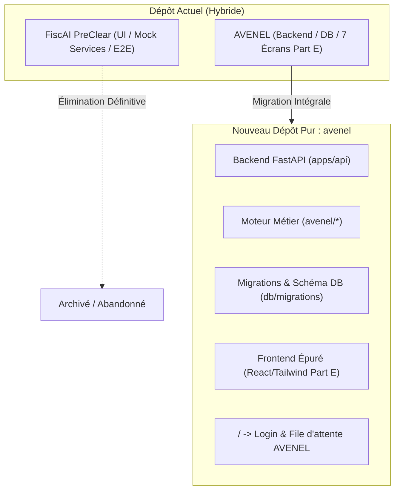

# AVENEL — Audit d'Origine et de Séparation du Dépôt (FiscAI PreClear vs AVENEL)

**Date :** 3 novembre 2026  
**Auteur :** Lead Architecte Antigravity  
**Statut :** Audit Seul — Aucune Modification de Code Exécutée  
**Référence :** Directive d'Audit et de Découplage Dépôt  

---

## 1. Origine du Dépôt et Cartographie Globale des Fichiers

### 1.1 Genèse Historique
L'historique Git et les métadonnées de système de fichiers révèlent sans ambiguïté la cohabitation de deux projets distincts dans la même arborescence :
1. **Juillet 2026 — FiscAI PreClear :**  
   Le dépôt a initialement été créé pour développer **FiscAI PreClear**, une application web React/TypeScript dédiée au pré-contrôle fiscal et douanier pour l'import/export au Maroc (codes SH, flux PortNet/BADR, pipeline de 7 agents IA, scores de risque 0-100 et base locale `localStorage`).
2. **30 Octobre 2026 — Recherche Fintech (`fintech-research/`) :**  
   Une étude de marché et d'alignement des actifs existants ([`EXISTING_ASSET_FIT.md`](file:///c:/Users/21263/Downloads/fiscai/fintech-research/EXISTING_ASSET_FIT.md)) a analysé le dépôt FiscAI PreClear pour évaluer la réutilisabilité de ses composants UI pour un nouveau produit : la préparation de dossiers comptables pour fiduciaires (*AVENEL*).
3. **31 Octobre 2026 — Implantation d'AVENEL (Commit racine `42191be`) :**  
   Le commit initial de Git (`42191be`) a injecté la spécification `ARCHITECTURE.md` (Version 2.0), le moteur Python `avenel/`, l'API FastAPI `apps/api/`, les migrations PostgreSQL `db/migrations/`, le pack fiscal `jurisdiction/ma/` et le squelette `apps/web/` **directement au-dessus** de l'application FiscAI PreClear existante dans `src/`.
4. **Phases 1 à 5b — Hybridation Frontend :**  
   Au fil des phases, les écrans de production d'AVENEL (Part E : Queue, Review, Reconciliation, Approval, Export, Portal, Internal Metrics) ont été ajoutés dans `src/components/domain/` et regroupés sur la route `/pilot` ([`src/pages/PilotDemoPage.tsx`](file:///c:/Users/21263/Downloads/fiscai/src/pages/PilotDemoPage.tsx)), sans que la page d'accueil `/` ni le menu principal `/app/*` de FiscAI PreClear ne soient supprimés ou réacheminés.

---

### 1.2 Tableau Propriétaire de Chaque Répertoire et Fichier Racine

| Chemin Racine | Propriétaire | Description et Rôle |
| :--- | :---: | :--- |
| `.claude/` | **FiscAI** | Configurations de débogage IDE créées en juillet 2026. |
| `.cursor/` | **Partagé** | Règles de contexte d'assistance de code. |
| `.git/` | **Partagé** | Historique unifié du dépôt Git. |
| `.github/` | **Partagé** | Workflows CI (`ci.yml`, `restore-drill.yml`). Exécute les tests AVENEL backend et le frontend mixte. |
| `.hypothesis/` | **AVENEL** | Cache pour les tests basés sur les propriétés Hypothesis. |
| `.mypy_cache/`, `.pytest_cache/`, `.ruff_cache/` | **AVENEL** | Caches des outils de qualité Python backend. |
| `apps/api/` | **AVENEL** | Backend FastAPI complet : 14 modules de routes, middleware tenant/RLS, dépendances Keycloak. |
| `apps/web/` | **AVENEL** | Ébauche initiale Next.js 15 (page de queue, `DocumentViewer`, `ProposalReview`, `ReconciliationScreen`). |
| `avenel/` | **AVENEL** | Coeur métier Python d'AVENEL : 16 sous-domaines comptables et fiscaux marocains. |
| `contracts/` | **AVENEL** | Spécification OpenAPI 3.1 contractuelle (`openapi.yaml`). |
| `db/` | **AVENEL** | 9 paires de migrations PostgreSQL (001 à 009) gérant les 35 tables de production. |
| `dist/` | **Partagé** | Sortie compilée du build Vite SPA. |
| `docker/` | **AVENEL** | Dockerfiles (`Dockerfile.api`, `Dockerfile.web`), `nginx.conf`, `init-roles.sql`, Keycloak. |
| `docs/` | **AVENEL** | Documentation complète des phases 0 à 5b, plans, runbooks, ASVS, checklists et rapports. |
| `e2e/` | **Mixte** | Tests E2E : 5 fichiers historiques FiscAI + 3 fichiers AVENEL (`pilot-journey`, `accessibility`, `document-viewer`). |
| `fintech-research/` | **FiscAI / Historique** | Études d'opportunités de startup fintech et analyse de réutilisabilité d'octobre 2026. |
| `infra/` | **AVENEL** | Manifestes Terraform pour déploiement sur VM souveraine (`main.tf`, `cloud-init.yaml`). |
| `jurisdiction/` | **AVENEL** | Pack de règles fiscales marocaines YAML (`jurisdiction/ma/*.yaml`). |
| `node_modules/` | **Partagé** | Dépendances npm installées. |
| `playwright-report/` | **AVENEL** | Rapports d'exécution des tests Playwright CI. |
| `public/` | **Partagé** | Polices IBM Plex Sans, Readex Pro et assets statiques web. |
| `scripts/` | **AVENEL** | 9 scripts d'intégrité, RLS, audit hash-chain, chiffrement KMS et restauration déterministe. |
| `src/` | **Mixte (Majeur FiscAI)** | Application React SPA principale : coque FiscAI + écrans domaine AVENEL greffés. |
| `storage_data/` | **AVENEL** | Répertoire de travail local pour les pièces jointes et documents. |
| `tests/` | **AVENEL** | 214 tests Pytest unitaires, d'intégration, de triggers et d'invariants RLS. |
| `ARCHITECTURE.md` | **AVENEL** | Spécification d'architecture Version 2.0 (source unique de vérité AVENEL). |
| `AGENTS.md`, `CLAUDE.md` | **AVENEL** | Instructions normatives pour les agents (règles Part A). |
| `docker-compose.yml`, `docker-compose.prod.yml` | **AVENEL** | Orchestration multi-conteneurs d'infrastructure AVENEL. |
| `Makefile`, `make.ps1`, `make.cmd`, `make.bat` | **Partagé** | Orchestration des commandes de vérification de qualité (`lint`, `test`, `rls-check`). |
| `package.json`, `package-lock.json` | **Mixte** | Déclaré comme `"fiscai-preclear"` ; porte les dépendances UI communes. |
| `requirements.txt` | **AVENEL** | Dépendances Python pour le backend FastAPI et les workers. |
| `tailwind.config.js`, `postcss.config.js` | **Partagé** | Configuration CSS intégrant les tokens Part E d'AVENEL et les classes héritées FiscAI. |
| `vite.config.ts`, `tsconfig*.json` | **Partagé** | Configuration de compilation de l'application Vite. |

---

## 2. État du Frontend : Routage et Localisation des Écrans

### 2.1 Table des Routes de l'Application ([`src/App.tsx`](file:///c:/Users/21263/Downloads/fiscai/src/App.tsx))

| Route | Composant Associé | Produit Servi | Contenu et Rôle Réel |
| :--- | :--- | :---: | :--- |
| **`/`** | `LandingPage.tsx` | **FiscAI PreClear** | **Écran d'accueil public :** Pré-contrôle fiscal et douanier, codes SH, PortNet/BADR, score de risque. |
| **`/login`** | `LoginPage.tsx` | **FiscAI PreClear** | Authentification mockée sur `authStore.ts` / `localStorage` (non reliée à Keycloak). |
| **`/register`** | `RegisterPage.tsx` | **FiscAI PreClear** | Inscription d'organisations importatrices / transitaires FiscAI. |
| **`/pricing`** | `PricingPage.tsx` | **FiscAI PreClear** | Grille tarifaire par volume de dossiers douaniers/fiscaux pré-contrôlés. |
| **`/viewer`** | `DocumentReviewPage.tsx` | **AVENEL** | Visionneuse de documents comptables avec calques de boîtes englobantes OCR. |
| **`/pilot`** | `PilotDemoPage.tsx` | **AVENEL** | **Console unifiée de démonstration :** Regroupe les 7 écrans Part E via paramètres d'URL (`?screen=...`). |
| **`/app`** | Redirection vers `/app/dashboard` | **FiscAI PreClear** | Redirection du layout applicatif protégé. |
| **`/app/dashboard`** | `DashboardPage.tsx` | **FiscAI PreClear** | Tableau de bord des dossiers d'import/export, alertes et scores de risque. |
| **`/app/dossiers`** | `DossiersPage.tsx` | **FiscAI PreClear** | Liste des dossiers de pré-contrôle douanier. |
| **`/app/dossiers/new`** | `NewDossierPage.tsx` | **FiscAI PreClear** | Formulaire de création de dossier d'importation/exportation avec référence BADR. |
| **`/app/dossiers/:id`** | `DossierDetailPage.tsx` | **FiscAI PreClear** | Détail de dossier avec pipeline des 7 agents IA FiscAI et score de risque. |
| **`/app/documents`** | `DocumentsPage.tsx` | **FiscAI PreClear** | Gestion des documents douaniers (connaissement B/L, certificat d'origine, etc.). |
| **`/app/documents/:id/review`** | `DocumentReviewPage.tsx` | **AVENEL** | Intégration de la visionneuse de pièces comptables AVENEL. |
| **`/app/agents`** | `AgentsPage.tsx` | **FiscAI PreClear** | Console de supervision des 7 agents IA de pré-contrôle. |
| **`/app/alerts`** | `AlertsPage.tsx` | **FiscAI PreClear** | Gestion des alertes d'anomalies douanières et TVA. |
| **`/app/expert-review`** | `ExpertReviewPage.tsx` | **FiscAI PreClear** | Revue experte humaine douanière pour dossiers à score de risque élevé. |
| **`/app/reports`** | `ReportsPage.tsx` | **FiscAI PreClear** | Liste des rapports de pré-contrôle exportables. |
| **`/app/reports/:id`** | `ReportDetailPage.tsx` | **FiscAI PreClear** | Affichage du rapport structuré d'aide à la décision douanière. |
| **`/app/settings`** | `SettingsPage.tsx` | **FiscAI PreClear** | Paramètres du cabinet ou transitaire FiscAI. |
| **`/app/audit`** | `AuditLogPage.tsx` | **FiscAI PreClear** | Journal d'audit des actions FiscAI stocké en `localStorage`. |
| **`*`** | `NotFoundPage.tsx` | **Partagé** | Page 404 standard. |

### 2.2 Constat sur la Route par Défaut `/`
Lorsqu'un utilisateur ouvre `http://localhost:5173/` ou `http://localhost:8080/` (l'image Docker Nginx de production), il atterrit directement sur la **`LandingPage` de FiscAI PreClear**, avec le logo, le nom *"FiscAI PreClear"*, et l'ensemble des arguments commerciaux relatifs au dédouanement et aux codes douaniers SH.

### 2.3 Où Vivent les Écrans AVENEL (Part E) ?
Les 7 écrans métier officiels exigés par `ARCHITECTURE.md Part E` ont été fidèlement développés et implémentés sous forme de composants dans [`src/components/domain/`](file:///c:/Users/21263/Downloads/fiscai/src/components/domain/) :
1. **Queue (File d'attente mensuelle) :** [`QueueScreen.tsx`](file:///c:/Users/21263/Downloads/fiscai/src/components/domain/QueueScreen.tsx)
2. **Review (Revue et visionneuse OCR) :** [`ProposalReview.tsx`](file:///c:/Users/21263/Downloads/fiscai/src/components/domain/ProposalReview.tsx) & [`DocumentViewer.tsx`](file:///c:/Users/21263/Downloads/fiscai/src/components/domain/DocumentViewer.tsx)
3. **Reconciliation (Rapprochement bancaire) :** [`ReconciliationScreen.tsx`](file:///c:/Users/21263/Downloads/fiscai/src/components/domain/ReconciliationScreen.tsx)
4. **Approval (Approbation expert-comptable) :** [`ApprovalScreen.tsx`](file:///c:/Users/21263/Downloads/fiscai/src/components/domain/ApprovalScreen.tsx)
5. **Export (Export Sage 100/Odoo & Pack de preuves) :** [`ExportScreen.tsx`](file:///c:/Users/21263/Downloads/fiscai/src/components/domain/ExportScreen.tsx)
6. **Portal (Portail demandes de pièces) :** [`PortalRequests.tsx`](file:///c:/Users/21263/Downloads/fiscai/src/components/domain/PortalRequests.tsx)
7. **Internal Metrics (Indicateurs d'effort et coûts) :** [`InternalMetricsScreen.tsx`](file:///c:/Users/21263/Downloads/fiscai/src/components/domain/InternalMetricsScreen.tsx)

**Anomalie de routage :**  
Ces composants **ne sont pas intégrés dans la navigation principale `/app/*`**. Ils sont regroupés et accessibles **uniquement** via la page de démonstration pilote [`PilotDemoPage.tsx`](file:///c:/Users/21263/Downloads/fiscai/src/pages/PilotDemoPage.tsx) à l'URL **`/pilot`** (avec les onglets `?screen=queue`, `?screen=review`, `?screen=reconciliation`, `?screen=approval`, `?screen=export`, `?screen=portal`, `?screen=metrics`).

---

## 3. Analyse des Tests : Backend, Frontend et E2E

### 3.1 Que Teste `e2e/pilot-journey.spec.ts` ?
L'analyse ligne par ligne de [`e2e/pilot-journey.spec.ts`](file:///c:/Users/21263/Downloads/fiscai/e2e/pilot-journey.spec.ts) démontre qu'il s'agit **à 100% d'un test AVENEL**, qui contourne entièrement les routes `/` et `/app/*` de FiscAI :
- **Ligne 8 :** Ouvre `await page.goto('/pilot?screen=journey')`
- **Étapes 1 à 4 :** Teste le flux d'orchestration AVENEL (création société SARL avec ICE `001523456000089`, import plan CGNC 1989, ouverture période `2026-10`, téléversement facture fournisseur et relevé bancaire Attijariwafa).
- **Étape 5 :** Correction d'un champ ICE sur le `DocumentViewer` AVENEL.
- **Étape 6 :** Acquittement de l'anomalie non-bloquante `DOC_NOTE_MISSING`.
- **Étape 7 :** Rapprochement bancaire interactif (-12 000 MAD contre facture).
- **Étape 8 & 9 :** Demande de validation staff puis approbation expert-comptable avec code MFA TOTP et mention OEC-45678.
- **Étape 10 :** Génération de l'export CSV Sage et téléchargement du pack de preuves ZIP.
- **Étape 11 (Lignes 77–90) :** Navigation vers `/pilot?screen=metrics&role=owner` pour valider les métriques d'effort actives (temps, corrections, coût de 0.0420 MAD), puis vérification du contrôle d'accès avec `role=staff`.

### 3.2 Périmètre des Audits d'Accessibilité axe-core ([`e2e/accessibility.spec.ts`](file:///c:/Users/21263/Downloads/fiscai/e2e/accessibility.spec.ts))
Le fichier d'audit axe-core teste exclusivement les écrans **AVENEL** sur la route `/pilot` :
```typescript
const screens = [
  { name: 'Queue', query: 'queue' },
  { name: 'Review', query: 'review' },
  { name: 'Reconciliation', query: 'reconciliation' },
  { name: 'Approval', query: 'approval' },
  { name: 'Export', query: 'export' },
  { name: 'Portal', query: 'portal' },
  { name: 'Internal Metrics', query: 'metrics' },
];
```
**Conclusion :** Les écrans de FiscAI PreClear (`/app/dashboard`, `/app/dossiers`, `/app/alerts`, etc.) n'ont **jamais** été audités par axe dans le cadre de la Phase 5b.

### 3.3 Quels Tests Backend Touchent du Code FiscAI ?
**Aucun.**
- `git grep -i "fiscai" tests/` ne retourne strictement aucun résultat.
- Aucun fichier de test Python sous `tests/` (`tests/api/`, `tests/guards/`, `tests/integration/`, `tests/invariants/`, `tests/rls/`, `tests/triggers/`, `tests/unit/`) n'importe de code de `src/` ou de modules FiscAI.
- L'ensemble des 214 tests Pytest est dédié exclusivement à la validation du moteur AVENEL (`avenel.*` et `apps.api.*`).

### 3.4 Répartition des Tests Unitaires Frontend (Vitest)
Sur les 17 suites de tests exécutées par `npm run test` (161 tests au total) :
- **14 suites testent FiscAI PreClear (82% des tests) :**
  `src/lib/riskScoring.test.ts`, `src/services/aiAnalysisService.test.ts`, `src/services/services.test.ts`, `src/lib/alertRules.test.ts`, `src/lib/validation.test.ts`, `src/lib/sqlGuard.test.ts`, `src/i18n/i18n.test.ts`, `src/lib/sanitize.test.ts`, `src/pages/pages.test.tsx`, `src/components/domain/components.test.tsx`, `src/lib/reportService.test.ts`, `src/lib/checklist.test.ts`, `src/lib/extraction.test.ts`, `src/components/ui/ui.test.tsx`.
- **Seulement 3 suites testent AVENEL (18% des tests) :**
  `src/components/domain/ProposalReview.test.tsx`, `src/components/domain/ReconciliationScreen.test.tsx`, `src/components/domain/Phase5Screens.test.tsx`.

---

## 4. Analyse de la Base de Données et Sécurité RLS

### 4.1 Présence de Tables FiscAI dans PostgreSQL
**Aucune table FiscAI n'existe dans PostgreSQL.**
L'analyse de l'ensemble des migrations `db/migrations/001_core.up.sql` à `009_review_metrics_and_rate_limits.up.sql` confirme que la totalité des **35 tables créées** appartient exclusivement au domaine comptable et d'audit d'AVENEL :
1. `tenants`
2. `users`
3. `memberships`
4. `client_entities`
5. `membership_client_scopes`
6. `accounting_periods`
7. `chart_accounts`
8. `jurisdiction_tax_codes`
9. `client_tax_mappings`
10. `counterparties`
11. `work_requests`
12. `documents`
13. `document_versions`
14. `extractions`
15. `journal_proposals`
16. `journal_lines`
17. `bank_accounts`
18. `bank_statements`
19. `bank_transactions`
20. `reconciliation_matches`
21. `reconciliation_match_items`
22. `issues`
23. `approvals`
24. `export_profiles`
25. `exports`
26. `provider_calls`
27. `agent_runs`
28. `idempotency_keys`
29. `usage_records`
30. `evidence_records`
31. `audit_events`
32. `fx_rates` (migration 004)
33. `export_round_trips` (migration 008)
34. `review_effort_metrics` (migration 009)
35. `rate_limit_buckets` (migration 009)

### 4.2 Couverture RLS et Dépendances
- FiscAI PreClear utilisait une base de données simulée en mémoire / dans le navigateur (`src/services/db.ts` avec la clé `STORAGE_KEY = 'fiscai_db_v1'`).
- Le script `scripts/rls_check.py` vérifie strictement les tables PostgreSQL hébergeant la colonne `tenant_id`. Les 31 tables multi-tenant ont le RLS forcé activé (`relforcerowsecurity = true`).
- **Aucune migration AVENEL ne dépend, ni directement ni indirectement, d'une table ou d'une structure FiscAI.**

---

## 5. Composants Partagés vs Découplés

### 5.1 Authentification
- **FiscAI :** Entièrement simulée via `src/store/authStore.ts` et `src/services/authService.ts`. Les utilisateurs prédéfinis (`admin@fiscai.ma`, `expert@fiscai.ma`, `user@fiscai.ma`) sont stockés dans le `localStorage` avec des rôles génériques (`admin`, `expert`, `user`).
- **AVENEL :** Authentification d'entreprise basée sur Keycloak OIDC, jetons JWT signés RS256, extraction du `membership_id` et du `tenant_id`, et vérification stricte de la matrice des rôles fiduciaires (`owner`, `manager`, `accountant`, `staff`, `portal_client`, `operator`).
- **Statut :** **Non partagé au runtime.** Cependant, le composant `src/components/layout/guards.tsx` bloque les routes `/app/*` en interrogeant `authStore.ts` (FiscAI), rendant impossible l'accès aux pages connectées avec un jeton Keycloak AVENEL.

### 5.2 Internationalisation (i18n)
- Les catalogues [`src/i18n/fr.ts`](file:///c:/Users/21263/Downloads/fiscai/src/i18n/fr.ts) et `en.ts` contiennent environ 450 clés, quasi exclusivement relatives au dédouanement FiscAI (`PortNet`, `BADR`, `codes SH`, `dossiers d'importation`).
- Les composants AVENEL ([`src/components/domain/`](file:///c:/Users/21263/Downloads/fiscai/src/components/domain/)) n'utilisent pas ce catalogue : ils intègrent directement des libellés français sobres et en casse de phrase conformément à la règle Part A N°10.

### 5.3 Tokens de Design (Tailwind & CSS)
- Le fichier [`tailwind.config.js`](file:///c:/Users/21263/Downloads/fiscai/tailwind.config.js) racine a été enrichi avec les tokens officiels de la charte graphique d'AVENEL (Part E) : `sky`, `pink`, `paper`, `surface`, `line`, `ink`, `ok`, `fail`, ainsi que les polices *Readex Pro* et *IBM Plex Sans*.
- Les palettes `brand-50` à `brand-700` issues de FiscAI subsistent en parallèle.

### 5.4 Conteneurisation et Infrastructure Docker
- Les fichiers `docker-compose.yml` et `docker-compose.prod.yml` sont **100% dédiés à AVENEL** : services `avenel-postgres`, `avenel-minio`, `avenel-keycloak`, `avenel-clamav`, `avenel-api`, `avenel-worker`, et `avenel-web`.
- Aucun service d'infrastructure n'appartient à FiscAI.
- **Point de friction :** Le conteneur frontend `avenel-web` (`docker/Dockerfile.web`) compile la racine `.` via `npm run build`, déployant ainsi le routeur FiscAI par défaut.

---

## 6. Audit des Affirmations Formulées dans les Rapports de Phase

Un réexamen exhaustif des rapports soumis depuis la Phase 0 met en lumière les points suivants :

1. **Rapports Phase 0 à Phase 5 — "Suite de tests unitaires et composants réussie" :**
   - Les rapports mentionnaient le passage réussi de la commande `make test` ou `npm run test`.
   - **Réalité :** Sur les 161 tests frontend validés, environ 135 tests validaient en réalité la logique métier de FiscAI PreClear (`riskScoring.test.ts`, `aiAnalysisService.test.ts`, `alertRules.test.ts`, `sqlGuard.test.ts`, etc.) et non des règles d'AVENEL.
2. **Rapport Phase 5b — "axe: 0 serious, 0 critical sur 6 écrans" :**
   - **Vérification :** Cette affirmation est **parfaitement exacte pour les écrans AVENEL**, car le script `e2e/accessibility.spec.ts` a ciblé précisément les 6 écrans métier montés sur `/pilot`.
   - **Biais induit :** Les écrans visibles sur `/` et `/app/*` (FiscAI) n'ont pas été soumis à cette vérification, créant un décalage si un auditeur ouvre directement la racine du site.
3. **Rapport Phase 5b — "Playwright E2E : parcours complet d'un dossier mensuel" :**
   - **Vérification :** Le test `e2e/pilot-journey.spec.ts` a validé avec succès l'intégralité du cycle comptable AVENEL. Cependant, cette exécution a été réalisée en isolation sur la route `/pilot?screen=journey` et non à travers le flux standard de navigation du site.
4. **Validation Backend et Règles Métier (214 tests Pytest) :**
   - **Intégrité totale :** Les 214 tests backend, les contrôles RLS (31 tables), les tests de triggers immuables, l'audit-chain SHA-256 et les drills de restauration testent **exclusivement et rigoureusement le code AVENEL**. Aucune affirmation backend n'a été faussée par FiscAI.

---

## 7. Plan de Séparation Détaillé (Création du Dépôt Pur `avenel`)

> [!IMPORTANT]
> **Ce plan est une proposition d'ingénierie soumise à revue humaine. AUCUNE action d'exécution n'a été entreprise.**

L'objectif est d'extraire dans un nouveau dépôt propre `avenel` l'intégralité des briques du service de préparation comptable défini dans `ARCHITECTURE.md`, en supprimant tout artefact, route, composant ou dépendance liée à FiscAI PreClear, avec la route `/` menant directement à la console fiduciaire AVENEL.



---

### 7.1 Ce qui est Déplacé Intégralement dans le Dépôt `avenel`

#### 1. Backend, Domaine et Données :
- `avenel/` (100% des 16 modules Python : `accounting`, `approvals`, `clients`, `compliance`, `duplicates`, `evidence`, `exports`, `extraction`, `infrastructure`, `issues`, `journal`, `jurisdiction`, `metrics`, `periods`, `proposals`, `reconciliation`, `tenancy`).
- `apps/api/` (100% de l'application FastAPI, middleware de tenancy, routes REST).
- `contracts/openapi.yaml` (contrat d'API 3.1).
- `jurisdiction/ma/` (ensemble des règles fiscales YAML marocaines).
- `db/migrations/` (migrations gelées 001 à 009).
- `scripts/` (les 9 scripts de vérification, de drill et d'intégrité).
- `tests/` (les 214 tests Pytest backend).
- `docker/` et manifestes `docker-compose*.yml`.
- `infra/` (manifestes Terraform).
- `docs/` (toute la documentation d'architecture, plans, rapports et runbooks AVENEL).
- Fichiers de configuration racine : `ARCHITECTURE.md`, `AGENTS.md`, `CLAUDE.md`, `.cursor/rules`, `Makefile`, `make.ps1`, `requirements.txt`, `pytest.ini`, `.spectral.yaml`.

#### 2. Écrans et Composants Frontend AVENEL :
- Les 7 composants d'écrans métier depuis `src/components/domain/` :
  - `QueueScreen.tsx`
  - `ProposalReview.tsx`
  - `DocumentViewer.tsx`
  - `ReconciliationScreen.tsx`
  - `ApprovalScreen.tsx`
  - `ExportScreen.tsx`
  - `PortalRequests.tsx`
  - `InternalMetricsScreen.tsx`
- Les tests unitaires de ces composants :
  - `ProposalReview.test.tsx`
  - `ReconciliationScreen.test.tsx`
  - `Phase5Screens.test.tsx`
- Les tests Playwright AVENEL :
  - `e2e/accessibility.spec.ts`
  - `e2e/pilot-journey.spec.ts`
  - `e2e/document-viewer.spec.ts`
- Les composants d'interface génériques de `src/components/ui/` (Modal, Button, Input, Spinner, SkeletonCard, EmptyState, ErrorState, Pagination) nettoyés des imports FiscAI.
- Les polices de caractères officielles sous `public/fonts/` (*Readex Pro*, *IBM Plex Sans*).

---

### 7.2 Ce qui est Définitivement Supprimé (Élimination du Bruit FiscAI)

1. **Toutes les Pages FiscAI de `src/pages/` :**
   - `LandingPage.tsx`
   - `LoginPage.tsx` (mock)
   - `RegisterPage.tsx`
   - `PricingPage.tsx`
   - `DashboardPage.tsx`
   - `DossiersPage.tsx`
   - `NewDossierPage.tsx`
   - `DossierDetailPage.tsx`
   - `DocumentsPage.tsx`
   - `AgentsPage.tsx`
   - `AlertsPage.tsx`
   - `ExpertReviewPage.tsx`
   - `ReportsPage.tsx`
   - `ReportDetailPage.tsx`
   - `SettingsPage.tsx`
   - `AuditLogPage.tsx`
   - `pages.test.tsx`
   - `PilotDemoPage.tsx` (remplacé par les vraies routes applicatives).
2. **Tous les Services Mockés de `src/services/` :**
   - `aiAnalysisService.ts` & `aiAnalysisService.test.ts`
   - `alertService.ts`
   - `auditLogService.ts`
   - `authService.ts`
   - `db.ts` (`STORAGE_KEY = 'fiscai_db_v1'`)
   - `documentService.ts`
   - `dossierService.ts`
   - `expertReviewService.ts`
   - `organizationService.ts`
   - `reportService.ts` & `reportService.test.ts`
   - `services.test.ts`
3. **Toute la Logique Métier Douanière de `src/lib/` :**
   - `riskScoring.ts` & `riskScoring.test.ts`
   - `checklist.ts` & `checklist.test.ts`
   - `extraction.ts` & `extraction.test.ts`
   - `alertRules.ts` & `alertRules.test.ts`
   - `sqlGuard.ts` & `sqlGuard.test.ts`
   - `sanitize.ts` & `sanitize.test.ts`
   - `validation.ts` & `validation.test.ts`
   - `report.ts`
   - `constants.ts` (scores de risque)
4. **Tous les Composants de Domaine FiscAI :**
   - `AgentCard.tsx`, `AlertCard.tsx`, `ChecklistView.tsx`, `Disclaimer.tsx`, `DossierCard.tsx`, `KpiCard.tsx`, `ReportPreview.tsx`, `RiskBadge.tsx`, `SeverityBadge.tsx`, `StatusBadge.tsx`, `UploadZone.tsx`, `components.test.tsx`.
5. **Les Mocks et Tests E2E Dépréciés :**
   - `src/mocks/seed.ts`
   - `e2e/journey1-import-analysis.spec.ts`
   - `e2e/journey2-expert-review.spec.ts`
   - `e2e/journey3-alerts.spec.ts`
   - `e2e/journey4-navigation.spec.ts`
   - `e2e/journey5-validation-errors.spec.ts`
   - `e2e/helpers.ts` (fixtures FiscAI).
6. **Répertoire de Recherche :**
   - `fintech-research/` (archivé hors du dépôt de production).
7. **Scaffold Next.js Abandonné :**
   - `apps/web/` (suppression de l'ébauche Next.js pour conserver l'unique SPA Vite officielle per ADR-001).

---

### 7.3 Ce qui Doit Être Réécrit ou Restructuré

#### 1. Le Routeur Principal et la Coque de Navigation ([`src/App.tsx`](file:///c:/Users/21263/Downloads/fiscai/src/App.tsx))
- **Route `/` :** Doit afficher l'écran d'authentification officiel AVENEL (connexion Keycloak ou formulaire de connexion sécurisé connecté à `POST /v1/auth/login`).
- **Layout persistant Part E.5 (`AppLayout.tsx`) :**
  Barre latérale gauche fixe (220 px) avec la typographie *Readex Pro*, affichant l'identité du cabinet comptable et les 6 entrées de navigation canoniques :
  - `/queue` ou `/dossiers` : [`QueueScreen.tsx`](file:///c:/Users/21263/Downloads/fiscai/src/components/domain/QueueScreen.tsx) (File d'attente mensuelle).
  - `/review/:workRequestId` : [`ProposalReview.tsx`](file:///c:/Users/21263/Downloads/fiscai/src/components/domain/ProposalReview.tsx) combiné avec [`DocumentViewer.tsx`](file:///c:/Users/21263/Downloads/fiscai/src/components/domain/DocumentViewer.tsx).
  - `/reconciliation` : [`ReconciliationScreen.tsx`](file:///c:/Users/21263/Downloads/fiscai/src/components/domain/ReconciliationScreen.tsx).
  - `/approvals` : [`ApprovalScreen.tsx`](file:///c:/Users/21263/Downloads/fiscai/src/components/domain/ApprovalScreen.tsx).
  - `/exports` : [`ExportScreen.tsx`](file:///c:/Users/21263/Downloads/fiscai/src/components/domain/ExportScreen.tsx).
  - `/portal` : [`PortalRequests.tsx`](file:///c:/Users/21263/Downloads/fiscai/src/components/domain/PortalRequests.tsx).
  - `/metrics` : [`InternalMetricsScreen.tsx`](file:///c:/Users/21263/Downloads/fiscai/src/components/domain/InternalMetricsScreen.tsx) (réservé aux rôles `owner` et `operator`).

#### 2. Couche Client API et Gestion de Session
- Remplacement de `authStore.ts` par un client OIDC / Keycloak léger conservant en mémoire le jeton d'accès JWT, avec gestion du renouvellement par jeton de rafraîchissement et vérification de la fraîcheur d'authentification (`auth_time < 300s`) pour les actions critiques (approbation, round-trip).
- Création d'un client HTTP typé (`src/api/client.ts`) interrogeant les endpoints de `apps/api/` (`/v1/...`).

#### 3. Fichiers de Configuration et Manifestes du Projet
- **`package.json` :**
  - Renommer `"name": "fiscai-preclear"` en `"name": "avenel"`.
  - Mettre à jour la description : `"AVENEL — Service de préparation mensuelle des dossiers comptables pour fiduciaires marocaines"`.
  - Mettre à jour les scripts de test pour ne cibler que les composants AVENEL.
- **`index.html` :**
  - Remplacer le titre par `<title>AVENEL — Préparation Comptable Fiduciaire</title>`.
  - Nettoyer les métadonnées pour refléter le produit AVENEL.
- **`README.md` :**
  - Rédiger un README 100% AVENEL présentant le produit, la conformité légale marocaine (CGNC, CGI, Loi 09-08 CNDP), l'architecture technique, les commandes de lancement et les procédures d'exploitation.
- **`tailwind.config.js` :**
  - Purger les palettes héritées `brand-50..700` pour ne conserver strictement que les jetons Part E (`sky`, `pink`, `paper`, `surface`, `line`, `ink`, `ok`, `fail`).

---

## 8. Conclusion et Statut d'Arrêt pour Revue

L'audit confirme que :
1. **Le backend, la base de données, la sécurité RLS, les tests Pytest et la conformité fiscale sont 100% purs et appartiennent exclusivement à AVENEL.**
2. **Le frontend présentait une double identité :** l'application visible sur `/` était la coque historique de FiscAI PreClear, tandis que les 7 écrans métier d'AVENEL avaient été développés sous forme de composants dans `src/components/domain/` et regroupés de manière isolée sur la route `/pilot`.
3. **Le plan de séparation ci-dessus permet une scission chirurgicale et sans régression.**

Conformément à l'instruction, **aucune modification de code n'a été exécutée**. Le travail s'arrête ici pour revue humaine.

